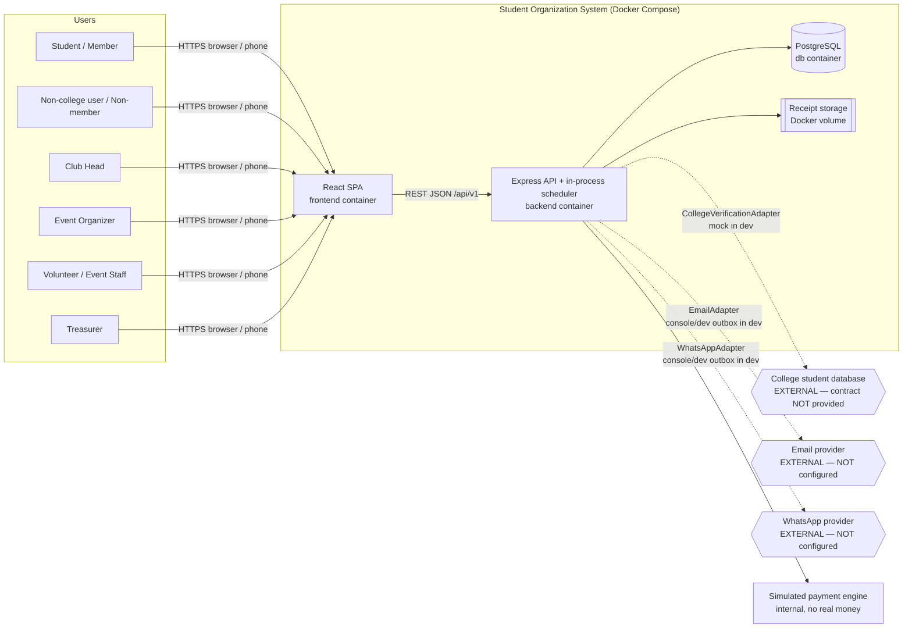
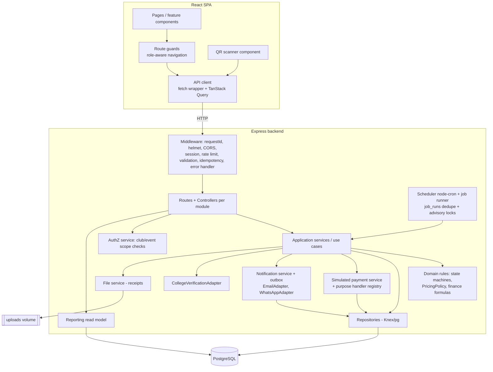
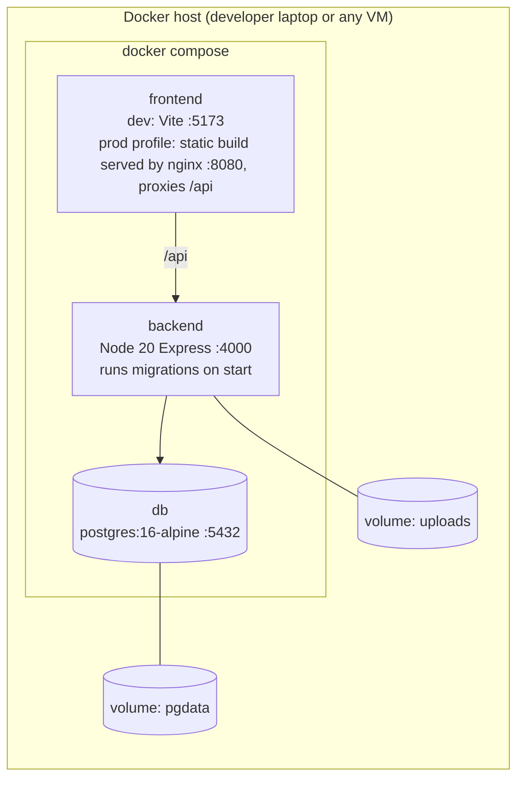

# High-Level Design — Student Organization Management System

| Field | Value |
|---|---|
| Document | `docs/HLD.md` |
| Status | **DRAFT — pending independent OpenAI Codex review. Not approved.** |
| Sources of truth | `Student_Organization_System.pdf` (problem statement, IDs `PDF-xx`) and the team prompt (IDs `PR-xx`) |
| Companion docs | `LLD.md`, `IMPLEMENTATION_PLAN.md`, `REQUIREMENT_TRACEABILITY.md`, `ARCHITECTURE_DECISIONS.md` |
| Fixed stack | React.js (JavaScript), Node.js + Express.js (JavaScript), PostgreSQL, Docker / Docker Compose |

Conventions used in all five documents:

- **[REQ]** confirmed requirement (traceable to PDF or prompt).
- **[DEC]** technical implementation decision taken by the architect (changeable, recorded as an ADR).
- **[ASM-nn]** assumption made where the sources are silent or ambiguous; listed in §2.5 and in `ARCHITECTURE_DECISIONS.md`.
- **[OD-nn]** open decision that needs human (team) approval before or during implementation. A default is proposed so work is not blocked, but it is not to be treated as approved.

---

## 1. Executive Summary

The Skyline Student Association (and the other clubs of the same college) currently runs on a spreadsheet for member sign-ups, cash at the door for tickets, a notebook for the budget, one-by-one WhatsApp messages for announcements and receipt-chasing for reimbursements. Members lose track of events, money goes missing and nobody knows who owes what (PDF §2).

This system is **one web platform** (PDF-01) that gives each club a single place to:

1. **Run memberships** — verify that a person is a college student, sell membership plans with benefits, track dues and expiry, remind members to renew seven days before expiry by email and WhatsApp, support a *simulated* AutoPay renewal, and issue a digital membership ID with a QR code that can be checked at events.
2. **Run events and ticketing** — create events with capacity, member/non-member and early-bird pricing, sell tickets online with a per-ticket QR code, check tickets in at the door in seconds (one-time redemption), and report attendance and revenue.
3. **Communicate** — publish announcements once, keep a record of what was said, by whom and when, and deliver them to the club's mailing list.
4. **Sell merchandise** — club-specific catalogue with size-level inventory, member discounts, time-limited offers, online orders with simulated payment, pickup codes and low-stock alerts.
5. **Coordinate volunteers and fundraisers** — split fundraiser work into tasks with owners and deadlines and see at a glance what remains and whether the fundraiser is on track.
6. **Keep transparent finances** — every rupee in (dues, tickets, merchandise, fundraiser income) and out (approved and paid expenses / reimbursements with receipts) recorded in an auditable ledger, with budgets, balances and summaries anyone on the club team can read.

Primary users: students/members, non-college users (non-members), club heads, event organizers, volunteers/event staff and treasurers.

The system is a **modular monolith** (one Express API, one React SPA, one PostgreSQL database), containerised with Docker Compose for reproducible local runs.

---

## 2. Scope and Requirements

### 2.1 Functional scope (summary — full list in `REQUIREMENT_TRACEABILITY.md`)

| Module | In-scope capabilities | Main sources |
|---|---|---|
| M1 Auth & Profiles | Register, sign in/out, profile maintenance, college-student verification via adapter + mock | PR-AUTH-01/02, PR-MEM-02, PR-ROLE-02 |
| M2 Clubs & Roles | Club discovery, club-scoped role assignment (club head, treasurer, volunteer), event organizer/staff assignment, multi-role users | PR-ROLE-01..07 |
| M3 Membership Plans & Benefits | Multiple plans per club; fee, duration, event discount, merchandise discount, early-bird access | PDF-04, PR-MEM-05 |
| M4 Memberships | Registration, payment, activation, lifecycle, renewal, history, 7-day reminders (email + WhatsApp), simulated AutoPay, digital ID + membership QR verification | PDF-02/03/05/06, PR-MEM-* |
| M5 Events & Ticketing | Event creation by club head, organizer assignment, capacity, pricing (member/non-member/early-bird), bookings, ticket QR, one-time check-in, event reports | PDF-07..12, PR-EVT-* |
| M6 Announcements & Notifications | Publish announcements (meeting, deadline, event, schedule change), record of publication, mailing list, email delivery, WhatsApp renewal reminders, delivery records, dev mode | PDF-13/14, PR-ANN-* |
| M7 Merchandise & Inventory | Catalogue, categories, size variants, stock per size, member discounts, time-limited offers, orders, simulated payment, pickup codes, low-stock alerts, merchandise reports | PDF-15..17, PR-MER-* |
| M8 Volunteers & Fundraisers | Fundraiser projects, tasks, assignment, deadlines, progress, pending/overdue, on-track indicator, related income/expense | PDF-18/19, PR-FUN-* |
| M9 Finance | Simulated payments, ledger of income/expense, expenses, receipt upload, reimbursement approval lifecycle, budgets, balance formulas, transaction history, audit | PDF-20..23, PR-FIN-* |
| M10 Reporting | Event, membership, merchandise, fundraiser and finance reports and charts (read-only aggregation) | PDF-11/12/21, PR-EVT-15, PR-MER-14, PR-FIN-11 |

### 2.2 Non-functional requirements (summary — detail in §12)

Security (authN, club-scoped authZ, OWASP basics), data consistency (no overselling, no double check-in, no duplicate ledger entries), auditability of financial and sensitive actions, reproducible Docker deployment, testability (adapters mockable, clock injectable), mobile-friendly UI (PDF-17: "order from their phones").

### 2.3 User roles and permissions

Roles are of two kinds:

- **Derived statuses** (computed, never manually assigned):
  - `USER` — any registered account (includes non-college users / non-members).
  - `VERIFIED_STUDENT` — user with a current `VERIFIED` college-verification record.
  - `MEMBER(club)` — user with an *effective* `ACTIVE` membership in that club (status ACTIVE **and** `expires_on >= today`, IST).
- **Assigned roles** (stored, club- or event-scoped):
  - `CLUB_HEAD(club)`, `TREASURER(club)`, `VOLUNTEER(club)` — stored in `club_role_assignments`.
  - `EVENT_ORGANIZER(event)` — stored in `event_organizers`, assigned by the club head.
  - `EVENT_STAFF(event)` — a club volunteer authorised for an event's check-in (`event_staff`), assigned by the club head or an organizer of that event.

A user may hold any combination (e.g. member of Club A, volunteer in Club A, treasurer of Club B). Authorization is always evaluated against the **target resource's club / event**, never globally. No additional business role is introduced (see [ASM-01] on club bootstrap).

Permission matrix (✔ = allowed, scope in brackets; full endpoint-level matrix in LLD §4):

| Capability | User / Non-member | Verified student | Member | Volunteer | Event staff | Organizer | Treasurer | Club head |
|---|---|---|---|---|---|---|---|---|
| Browse clubs, published events, public announcements, merchandise | ✔ | ✔ | ✔ | ✔ | ✔ | ✔ | ✔ | ✔ |
| View/buy membership plans | — | ✔ | ✔ (renew) | | | | | |
| Book event as non-member (if event allows) | ✔ | ✔ | n/a | | | | | |
| Member pricing / early access | — | — | ✔ (own club) | | | | | |
| Members-only announcements | — | — | ✔ (own club) | ✔ (club) | | | ✔ | ✔ |
| Buy merchandise | ✔ (if product open to non-members) | ✔ | ✔ | | | | | |
| Own bookings, tickets, orders, payments, memberships | ✔ (own) | ✔ | ✔ | | | | | |
| Scan & check in tickets | | | | | ✔ (event) | ✔ (event) | | ✔ (club) |
| Verify membership QR | | | | ✔ (club) | ✔ | ✔ (event's club) | ✔ (club) | ✔ (club) |
| View event registrations, attendance, event report | | | | | | ✔ (event) | ✔ (club) | ✔ (club) |
| Assign event staff | | | | | | ✔ (event) | | ✔ (club) |
| Create/edit/publish/cancel events; assign organizers | | | | | | edit details only (event) [ASM-07] | | ✔ (club) |
| Manage plans, announcements, merchandise, inventory, orders/pickup | | | | | | | | ✔ (club) |
| Assign club roles (treasurer, volunteer, club head) | | | | | | | | ✔ (club) |
| Fundraisers & tasks: create/assign | | | | | | | | ✔ (club) |
| Update own task status/progress | | | | ✔ (own tasks) | | | | |
| Submit reimbursement request with receipt | | | | ✔ | ✔ | ✔ | ✔ | ✔ |
| Record direct expense, record fundraiser income, mark reimbursement paid | | | | | | | ✔ (club) | |
| Approve/reject reimbursements | | | | | | | ✔ (club; not own) | ✔ only for treasurer's own requests [OD-06] |
| Budgets (create/edit) | | | | | | | ✔ (club) | read |
| Finance summary (aggregates) | | | | read [ASM-12] | | | ✔ | ✔ |
| Transaction details, receipts | | | | own submissions | | | ✔ | ✔ |

### 2.4 Explicit exclusions

Not built, because neither source asks for them: real payment gateways, UPI mandates or bank integration (payments are **simulated**, PR-MEM-11/PR-MER-12); refunds (no refund workflow is specified — see [OD-08]); in-app chat or any messaging channel other than email and the required WhatsApp renewal reminder; in-app notification inbox; AI features, recommendations, chatbots; mobile native apps (responsive web only); club elections workflow (the PDF mentions annual elections only as context); delivery/shipping of merchandise (pickup only); multi-currency (INR only); multi-college tenancy; microservices, Redis, Kafka, Kubernetes, cloud vendor lock-in.

### 2.5 Assumptions (ASM) and open decisions (OD)

Each is repeated with rationale in `ARCHITECTURE_DECISIONS.md` §B.

| ID | Assumption / open decision | Proposed default |
|---|---|---|
| ASM-01 | Neither source says who creates clubs or appoints the first club head. | Clubs and initial club heads are created by a **seed/CLI script** run by the deployer; no platform-admin role. Club heads can thereafter assign roles (including handing over club head). |
| ASM-02 | The college database contract is unknown. | `CollegeVerificationAdapter` interface; `MockCollegeVerificationAdapter` with fixtures; production adapter is a stub returning `UNAVAILABLE` until the contract is supplied. Inputs assumed: student identifier + full name — **to be confirmed** (OD-02). |
| ASM-03 | Membership plans are offered only to verified college students (the prompt calls them "college-student membership plans"). | Non-verified users cannot see or buy any plan. |
| ASM-04 | One ticket per booking, for the booking user, max one active ticket per user per event. | Keeps member pricing tied to the member's identity. Guest tickets are out of scope (OD-07). |
| ASM-05 | An event whose non-member price is empty is members-only ("according to eligibility"). | `non_member_price_paise IS NULL` ⇒ members only. |
| ASM-06 | A ticket bought at member price stays valid even if the membership expires before the event. | Price is locked at purchase; the door validates the ticket, not the membership. |
| ASM-07 | Organizers manage their assigned event (details, staff, monitoring) but cannot publish, cancel, change pricing/capacity or assign organizers. | Club head keeps creation, pricing, capacity, publication, cancellation and organizer assignment. |
| ASM-08 | Membership expiry is stored as an inclusive last-valid **date** in IST (`Asia/Kolkata`). | `expires_on`; valid while `today_IST <= expires_on`. |
| ASM-09 | If the reminder job misses the exact day-7 run (downtime), it sends the single 7-day reminder on the next run while expiry is still in the future. | One reminder per membership term, never more. |
| ASM-10 | Plan duration is expressed in months; PDF's "end of the year" is a 12-month plan. | `duration_months`; fixed academic-year end date is OD-05. |
| ASM-11 | Merchandise size variants share the product price. | Price on product; stock on variant. |
| ASM-12 | PDF: "anyone on the team can understand it at a glance". | All club role holders (club head, treasurer, volunteer, organizers of the club's events) can read the **aggregate** finance summary; line-level transactions and receipts are restricted to treasurer and club head (plus submitters for their own expenses). |
| ASM-13 | Payment reservation holds (seats, stock) last 15 minutes (configurable). | `RESERVATION_HOLD_MINUTES=15`. |
| ASM-14 | "Event-related communications" are satisfied by event-linked announcements (delivered to club members and to ticket holders of that event) plus a booking-confirmation email. | No other channels. |
| OD-01 | Stacking of member benefits with early-bird offers (events and merchandise) is not specified. | Default `BEST_OF` (buyer gets the lowest applicable single price); alternative `STACK`. Config flag; **needs approval**. |
| OD-02 | College verification input fields and re-verification frequency. | Student ID + full name; a `VERIFIED` result stays valid until superseded by a later check (the user may re-check at any time); no forced periodic re-verification. |
| OD-03 | Meaning of plan benefit "early-bird access to eligible events". | Members whose plan has it may book from the event's `early_access_opens_at`, before general registration opens. Early-bird *prices* are separate and time/quantity-limited. |
| OD-04 | When a simulated AutoPay renewal is attempted. | On the membership's `expires_on` date (06:00 IST job). |
| OD-05 | Fixed academic-year expiry vs. rolling duration. | Rolling `duration_months` (ASM-10). |
| OD-06 | Who approves the treasurer's own reimbursement; whether direct expenses need a second approver. | Club head approves the treasurer's own requests; direct expenses recorded by the treasurer require receipt but no second approval. |
| OD-07 | Guest / multiple tickets per user per event. | Not supported (ASM-04). |
| OD-08 | Refunds for cancelled events or orders after payment. | Not supported; cancelling a published event with sold tickets cancels tickets and flags them for manual offline settlement; no ledger reversal is automated. |
| OD-09 | Opening balance carried over from the existing notebook. | Not supported unless approved; if approved, add a treasurer-recorded `OPENING_BALANCE` income entry. |

---

## 3. System Context

External dependencies that are **not yet configured** and are therefore behind adapters with development implementations: college database (ASM-02), email provider, WhatsApp provider. The payment mechanism is intentionally internal and simulated.

---

## 4. Architecture Style

**Decision [DEC] (ADR-001): modular monolith.**

- One deployable Express application with internal modules that own their tables and expose service functions to other modules. One React SPA. One PostgreSQL database.
- Why: a hackathon team needs one codebase, one deploy, one database transaction across modules (e.g. *payment succeeded ⇒ ticket issued ⇒ ledger entry written* must be atomic). Microservices would replace these local transactions with distributed sagas, adding failure modes with no requirement to justify them.
- Module communication: synchronous in-process function calls through a module's public `index.js` (service API). A module **never** queries another module's tables directly for writes. The single documented exception is the Reporting module, which reads across tables through read-only SQL (a read model) — see §6.
- Extension without microservices: adapters (verification, email, WhatsApp, payment) can be swapped by configuration; payment-purpose handlers and notification templates are registered rather than hard-coded; a module can later be extracted because its boundary is already a service API.

---

## 5. Component Architecture

| Component | Responsibility | Depends on |
|---|---|---|
| React presentation layer | Screens, forms, client-side validation for UX only, rendering of QR images and charts. Contains **no** pricing, eligibility or financial logic; displays values returned by the API. | API client |
| API client & route protection | Single `apiClient` (fetch, credentials included, `X-Request-Id`, `Idempotency-Key` for critical POSTs, error normalisation). Route guards read `/auth/me` capabilities to show/hide navigation; the backend re-checks everything. | Backend REST API |
| Routes & controllers | HTTP mapping, schema validation (zod), extracting actor + scope, calling one service method, shaping response. No business rules. | Services, AuthZ, middleware |
| Application services | Use-case orchestration, transaction boundaries (`withTransaction`), calling domain rules and repositories, enqueuing notifications, writing audit logs. | Domain, repositories, adapters |
| Domain rules | Pure functions/objects: lifecycle transition tables, `PricingPolicy`, benefit resolution, progress/on-track formulas, money arithmetic. Fully unit-testable without DB. | Nothing (pure) |
| Repositories | Parameterised SQL via Knex; row-level locking and conditional updates; one repository per aggregate. | PostgreSQL |
| Authentication & authorization | Session-based login (bcrypt hashes, httpOnly cookie, Postgres session store). `authz` helpers: `requireClubRole`, `requireEventRole`, `requireOwnership`, derived-status checks. | Clubs & Roles repository |
| Notification adapters | `EmailAdapter` and `WhatsAppAdapter` interfaces; dev implementations write to the `notification_deliveries` record and the log; production implementations are placeholders until providers are chosen. | Config |
| College-verification adapter | `verify({studentIdentifier, fullName})` → `VERIFIED \| NOT_VERIFIED \| UNAVAILABLE`. Mock reads a fixture file. | Config |
| Simulated payment & renewal processing | Creates payment records, applies simulated outcomes, dispatches to registered purpose handlers inside the same DB transaction; AutoPay job uses it with method `SIMULATED_AUTOPAY`. | Repositories, handler registry |
| Reporting & aggregation | Read-only SQL aggregations with documented formulas (LLD §5.15). | PostgreSQL (read-only) |
| Receipt / file handling | multer upload, type/size validation via magic bytes, random file names on a Docker volume, metadata row in `uploaded_files`, authorised streaming download. | Volume, repositories |
| Background scheduling | In-process `node-cron` triggers: expiry, 7-day reminders, AutoPay, reservation expiry, notification dispatch. Each run is guarded by a Postgres advisory lock and a `job_runs` uniqueness key. | Services |

---

## 6. Module Boundaries

| # | Module (backend folder) | Owns tables | Public service API (examples) | May call |
|---|---|---|---|---|
| M1 | `auth` (auth, profiles, college verification) | `users`, `user_sessions`, `college_verifications` | `getUser`, `isVerifiedStudent`, `verifyCollegeStudent` | — |
| M2 | `clubs` (clubs, club roles) | `clubs`, `club_role_assignments` | `listClubs`, `getRoles(userId)`, `hasClubRole` | M1 |
| M3/M4 | `memberships` (plans, memberships, terms, AutoPay, digital ID) | `membership_plans`, `memberships`, `membership_terms`, `autopay_consents`, `renewal_attempts` | `getEffectiveMembership(userId, clubId)`, `getActiveBenefits`, `listActiveMemberRecipients(clubId)` | M1, M2, Payments, Ledger, Notifications |
| M5 | `events` (events, organizers, staff, bookings, tickets, check-ins) | `events`, `event_organizers`, `event_staff`, `bookings`, `tickets`, `check_ins` | `quotePrice`, `listTicketHolders(eventId)` | M2, M3/M4 (benefits), Payments, Ledger, Notifications |
| M6 | `announcements` + `notifications` | `announcements`, `notification_deliveries` | `enqueue(notification)`, `dispatchPending()` | M2, M3/M4 (recipients), M5 (ticket holders) |
| M7 | `merchandise` | `product_categories`, `products`, `product_variants`, `stock_movements`, `low_stock_alerts`, `orders`, `order_items` | `quoteOrder` | M2, M3/M4, Payments, Ledger, Notifications |
| M8 | `fundraisers` | `fundraisers`, `fundraiser_tasks` | `getFundraiserOverview` | M2 |
| M9 | `finance` (payments, ledger, expenses, budgets, files) | `payments`, `financial_transactions`, `expenses`, `budgets`, `uploaded_files` | `payments.create`, `payments.settle`, `ledger.post`, `expenses.*` | M2, M5/M8 (existence checks via their public API) |
| M10 | `reporting` | none (read model) | `eventReport`, `financeSummary`, ... | read-only SQL over all tables |
| X | `shared` | `audit_logs`, `idempotency_keys`, `job_runs` | `audit.record`, `withTransaction`, `money`, `clock` | — |

**Cycle avoidance.** Payments must trigger domain side effects (activate membership, issue ticket, confirm order) without importing those domains. Each domain registers a `PaymentPurposeHandler` (`MEMBERSHIP_JOIN`, `MEMBERSHIP_RENEWAL`, `EVENT_TICKET`, `MERCH_ORDER`) with the payments module at the composition root (`src/container.js`). Payments depends only on the handler *interface*; domains depend on payments and on `ledger.post`. Finance never imports domain modules for writes. Dependency direction: `shared ← auth ← clubs ← memberships ← events/merchandise/announcements`, with `finance` (payments, ledger) used by memberships/events/merchandise, and `reporting` at the top reading everything.

**No duplicated business rules.** Pricing lives only in `PricingPolicy` (used by events and merchandise); membership effectiveness only in `memberships.getEffectiveMembership`; finance formulas only in `finance/domain/formulas.js` and the reporting SQL that implements the same definitions (tested against each other).

---

## 7. Data Architecture

- **PostgreSQL is the single source of truth** for all state, including session data, notification outbox, job runs and idempotency keys. Uploaded binaries live on a volume; their metadata and ownership live in PostgreSQL.
- **Identifiers**: UUID v4 primary keys (`gen_random_uuid()`); human-facing codes (pickup codes, payment references) are separate unique columns.
- **Money**: integer **paise** in `BIGINT` columns, currency fixed `'INR'` (ADR-008). Percent discounts stored as basis points (`0..10000`); rounding half-up to the paise, once, at quote time.
- **Time**: `timestamptz` for instants; membership validity as `date` in IST (ASM-08). Application clock is injectable for tests and dev job runs.

### 7.1 High-level ER diagram

```mermaid
erDiagram
    USERS ||--o{ COLLEGE_VERIFICATIONS : has
    USERS ||--o{ CLUB_ROLE_ASSIGNMENTS : holds
    CLUBS ||--o{ CLUB_ROLE_ASSIGNMENTS : grants
    CLUBS ||--o{ MEMBERSHIP_PLANS : offers
    USERS ||--o{ MEMBERSHIPS : owns
    CLUBS ||--o{ MEMBERSHIPS : has
    MEMBERSHIPS ||--o{ MEMBERSHIP_TERMS : "paid periods"
    MEMBERSHIP_PLANS ||--o{ MEMBERSHIP_TERMS : "snapshotted from"
    MEMBERSHIPS ||--o{ AUTOPAY_CONSENTS : records
    MEMBERSHIPS ||--o{ RENEWAL_ATTEMPTS : has
    CLUBS ||--o{ EVENTS : hosts
    EVENTS ||--o{ EVENT_ORGANIZERS : "assigned"
    EVENTS ||--o{ EVENT_STAFF : "scanners"
    EVENTS ||--o{ BOOKINGS : receives
    BOOKINGS ||--o| TICKETS : issues
    TICKETS ||--o| CHECK_INS : "redeemed once"
    CLUBS ||--o{ ANNOUNCEMENTS : publishes
    ANNOUNCEMENTS ||--o{ NOTIFICATION_DELIVERIES : "delivered as"
    CLUBS ||--o{ PRODUCTS : sells
    PRODUCTS ||--o{ PRODUCT_VARIANTS : "sizes"
    PRODUCT_VARIANTS ||--o{ STOCK_MOVEMENTS : logs
    PRODUCT_VARIANTS ||--o{ LOW_STOCK_ALERTS : raises
    USERS ||--o{ ORDERS : places
    ORDERS ||--|{ ORDER_ITEMS : contains
    PRODUCT_VARIANTS ||--o{ ORDER_ITEMS : "ordered as"
    CLUBS ||--o{ FUNDRAISERS : runs
    FUNDRAISERS ||--o{ FUNDRAISER_TASKS : "split into"
    USERS ||--o{ FUNDRAISER_TASKS : "assigned"
    PAYMENTS }o--|| USERS : "paid by"
    PAYMENTS }o--o| MEMBERSHIP_TERMS : "for"
    PAYMENTS }o--o| BOOKINGS : "for"
    PAYMENTS }o--o| ORDERS : "for"
    CLUBS ||--o{ FINANCIAL_TRANSACTIONS : ledger
    PAYMENTS ||--o| FINANCIAL_TRANSACTIONS : "posts income"
    EXPENSES ||--o| FINANCIAL_TRANSACTIONS : "posts expense"
    CLUBS ||--o{ EXPENSES : incurs
    EXPENSES }o--o| UPLOADED_FILES : receipt
    CLUBS ||--o{ BUDGETS : plans
```

### 7.2 Transaction boundaries (one DB transaction each)

| Operation | Atomic unit |
|---|---|
| Book ticket | reserve seat (+ early-bird slot) → insert booking (price snapshot) → insert payment `INITIATED` (or, if free, confirm + issue ticket) |
| Settle payment success | conditional update payment → purpose handler (activate/extend membership **or** confirm booking + issue ticket **or** confirm order + decrement stock + pickup code) → insert ledger income row → enqueue notifications → audit |
| Settle payment failure / hold expiry | conditional update payment → release seat / stock reservation → cancel booking/order/term |
| Check-in | conditional update ticket `VALID→USED` → insert `check_ins` row |
| Approve / reject / mark paid reimbursement | conditional status update → (on paid) insert ledger expense row → audit |
| Publish announcement | status `DRAFT→PUBLISHED` → snapshot recipients into `notification_deliveries` |

### 7.3 Integrity guarantees

- **Ticket capacity**: `events.seats_reserved` counter changed only by conditional `UPDATE ... WHERE seats_reserved < capacity`; `CHECK (seats_reserved BETWEEN 0 AND capacity)` as a database backstop.
- **One-time check-in**: conditional update `WHERE status='VALID'` + `UNIQUE(check_ins.ticket_id)`.
- **Inventory**: `product_variants.stock_on_hand`/`stock_reserved` with conditional updates and `CHECK (stock_reserved <= stock_on_hand AND stock_reserved >= 0)`; every change appends a `stock_movements` row.
- **Financial idempotency**: `UNIQUE(financial_transactions.source_type, source_id)`; at most one `SUCCEEDED` payment per booking/order/membership term (partial unique indexes); `Idempotency-Key` on client POSTs.
- **Membership**: `UNIQUE(user_id, club_id)` on memberships (one record cycles through states); plan terms snapshotted into `membership_terms` so later plan edits never change existing memberships (no plan versioning table needed — ADR-009).
- **Historical prices**: each booking and order item stores list price, discount, final price and pricing rule used.
- **Club isolation**: every club-owned table carries `club_id` (denormalised on child rows where authorization needs it), every repository query used for club-scoped endpoints filters by `club_id`, and composite foreign keys ensure e.g. an order item's variant belongs to the same club as the order.
- **Retention & audit**: financial records, payments, check-ins and audit logs are never hard-deleted. Catalogue items, plans and events are archived/cancelled rather than deleted once referenced.

---

## 8. API Architecture

- **Style**: REST over JSON, base path `/api/v1` (URI versioning). Resources nested under `/clubs/:clubId/...` when created within a club; addressed directly (`/events/:eventId`) once they exist, with club scope resolved from the resource.
- **Authentication**: session cookie (`sid`, httpOnly, `SameSite=Lax`, `Secure` in production). State-changing requests also require header `X-Requested-With: soms` (CSRF mitigation together with SameSite) — ADR-004.
- **Authorization**: route-level declaration (`authorize('CLUB_HEAD', { clubFrom: 'params.clubId' })`) plus service-level ownership checks. Default deny.
- **Validation**: zod schemas for params, query and body; unknown fields rejected; amounts must be integers in paise.
- **Errors**: one envelope `{ "error": { "code": "TICKET_ALREADY_USED", "message": "...", "details": {...}, "requestId": "..." } }`. HTTP codes: 400 validation, 401 unauthenticated, 403 forbidden, 404 not found (also used instead of 403 for resources in another club to avoid enumeration), 409 conflict / state violation, 422 business rule violation, 429 rate limit, 503 dependency unavailable, 500 unexpected.
- **Pagination**: list endpoints accept `page` (1-based) and `pageSize` (default 20, max 100); response `{ data: [...], page, pageSize, total }`.
- **Idempotency**: required `Idempotency-Key` header (UUID) on: membership registration, renewal, booking, order creation, payment simulation, check-in, expense submission, reimbursement decisions/payout, income entry. Stored per user + key with request hash and response for 24 h; replay returns the stored response; same key with different body → `409 IDEMPOTENCY_KEY_REUSED`.
- **Protected values**: no endpoint lets a client set prices paid, ticket status, membership status/verification outcome, ledger totals or stock counts directly; they change only via business operations (book, settle, check-in, stock adjustment with reason, etc.).

High-level API module inventory (details in LLD §4):

| Group | Prefix examples |
|---|---|
| Auth & profile | `/auth/*`, `/me`, `/me/college-verification` |
| Clubs & roles | `/clubs`, `/clubs/:clubId/roles` |
| Plans & memberships | `/clubs/:clubId/plans`, `/clubs/:clubId/memberships`, `/me/memberships/*`, `/membership-verifications` |
| Payments (simulated) | `/payments/:paymentId`, `/payments/:paymentId/simulate`, `/me/payments` |
| Events & ticketing | `/events`, `/clubs/:clubId/events`, `/events/:eventId/{price-quote,bookings,organizers,staff,check-ins,report}`, `/me/tickets` |
| Announcements | `/announcements`, `/clubs/:clubId/announcements`, `/announcements/:id/{publish,deliveries}` |
| Merchandise | `/clubs/:clubId/{products,product-categories,inventory,low-stock-alerts,orders}`, `/products/:id`, `/variants/:id/stock-adjustments`, `/clubs/:clubId/pickups`, `/orders/:id/cancel`, `/me/orders` |
| Fundraisers | `/clubs/:clubId/fundraisers`, `/fundraisers/:id/{tasks,overview}`, `/tasks/:id`, `/me/tasks` |
| Finance | `/clubs/:clubId/{budgets,expenses,income-entries,transactions,finance/summary}`, `/expenses/:id/{approve,reject,mark-paid,receipt}`, `/me/expenses` |
| Reports | `/clubs/:clubId/reports/{events,memberships,merchandise,finance}` |
| Ops / dev | `/health`, `/dev/*` (only when `DEV_TOOLS_ENABLED=true` and `NODE_ENV!=production`) |

---

## 9. Security Architecture

| Concern | Design |
|---|---|
| Passwords | bcrypt (cost 12); min length 8; never logged or returned. Login rate-limited (10 / 15 min / IP+email); generic "invalid credentials" message. |
| Sessions | `express-session` + `connect-pg-simple`; session id regenerated on login; 7-day rolling expiry; logout destroys server session. |
| Authorization | Default deny; role + scope checks (club, event, ownership); derived statuses computed server-side per request; cross-club access returns 404. |
| Input validation & output | zod at the edge; React escapes output by default; no `dangerouslySetInnerHTML`; announcement bodies stored and rendered as plain text (line breaks preserved). |
| SQL injection | Only parameterised queries via Knex bindings; no string-concatenated SQL; lint rule forbids `knex.raw` with template interpolation. |
| Uploads | Allowed types JPEG, PNG, PDF verified by magic bytes (`file-type`), max 5 MB, random storage name, stored outside the web root, downloaded only through an authorised endpoint with `Content-Disposition: attachment` and `X-Content-Type-Options: nosniff`. |
| Sensitive data | Student identifiers from verification are not stored beyond a salted hash + outcome; phone numbers/emails visible only to the owner and to club heads for their own members' mailing list; payment records hold no card/bank data (simulated). |
| QR codes | Ticket and membership QR payloads contain only an opaque 128-bit random token (`SOMS1:T:<token>` / `SOMS1:M:<token>`); no name, email or amount. Validation always server-side; scanning requires an authorised role. Membership tokens can be rotated by the owner. |
| Secrets | `.env` (never committed), `.env.example` documented; `SESSION_SECRET` required at boot in production; adapters read credentials from env only. |
| Rate limiting | `express-rate-limit` (in-memory store is acceptable for single instance): auth endpoints, verification (5 / hour / user), check-in (120 / min / staff), global 300 / min / IP. |
| Audit logging | `audit_logs` for: role changes, plan changes, event publish/cancel/price change, check-ins, membership QR verifications, stock adjustments, pickups, expense decisions/payouts, income entries, announcement publication, verification attempts. |
| CORS & headers | Same-origin in production (frontend served by its container and API proxied); in dev `CORS_ORIGIN=http://localhost:5173` with credentials. `helmet` defaults with CSP allowing self + camera use for the scanner page. |
| Error messages | Stable error codes and safe messages; stack traces only in logs; 500 responses include `requestId` only. |
| College DB | The integration contract (transport, auth, fields) is an **outstanding dependency**. Required of the future contract: TLS, service credentials via env, minimal response (eligible yes/no), timeout ≤ 5 s, no bulk export. |

---

## 10. Notifications and Scheduled Work

### 10.1 Notification flow (transactional outbox)

1. A business operation inserts `notification_deliveries` rows (`status=PENDING`, `channel=EMAIL|WHATSAPP`, `template`, `payload`, `dedupe_key UNIQUE`) **in the same transaction** as the change that caused it.
2. The `notification-dispatch` job (every minute) claims pending rows with `FOR UPDATE SKIP LOCKED`, calls the channel adapter, sets `SENT` or schedules a retry (attempt 1→+1 min, 2→+5 min, 3→+30 min), then `FAILED` after 3 failed attempts with `last_error`.
3. Recipient without the needed contact (e.g. no phone for WhatsApp) → `SKIPPED` with reason `NO_CONTACT`.
4. Adapter not configured (production without provider) → `FAILED` with `NOT_CONFIGURED` (no retries), visible in the delivery report.
5. Development: `NOTIFY_MODE=dev` uses `DevEmailAdapter`/`DevWhatsAppAdapter`, which log the rendered message and mark `SENT` with `provider='dev'`; messages are viewable in the dev outbox screen. A dev switch `DEV_NOTIFY_FAIL_CHANNEL` forces failures for testing.

### 10.2 Scheduled jobs (in-process, `node-cron`, timezone `Asia/Kolkata`)

| Job | Schedule | Purpose | Duplicate prevention |
|---|---|---|---|
| `membership-expiry` | 00:05 daily | Persist `ACTIVE → EXPIRED` where `expires_on < today` (reads also compute effective status, so correctness does not depend on this job). | Idempotent update; `job_runs(job,'YYYY-MM-DD')` |
| `renewal-reminders` | 09:00 daily | Enqueue one EMAIL and one WHATSAPP reminder per membership term whose expiry is exactly 7 days away (catch-up per ASM-09). | `dedupe_key = renewal-reminder:{termId}:{channel}` |
| `autopay-renewals` | 06:00 daily | For memberships with AutoPay enabled and `expires_on = today`, create one renewal attempt + simulated payment, settle with the simulated outcome. | `UNIQUE(renewal_attempts.membership_id, for_expires_on)` |
| `reservation-expiry` | every minute | Expire unpaid bookings/orders/terms older than the hold; release seats/stock; expire AutoPay payments pending > 24 h. | Conditional updates on status |
| `notification-dispatch` | every minute | Send outbox rows. | `SKIP LOCKED` claims |

Each run takes `pg_try_advisory_lock(hash(job))`; if not acquired, it exits. Daily jobs also insert `job_runs(job_name, run_key)` unique, so a restart cannot re-run the same day. Dev endpoint `POST /dev/jobs/:name/run { asOf }` executes a job with an overridden clock.

Low-stock alerts are evaluated **synchronously** after each stock change (no job), and their emails flow through the same outbox.

---

## 11. Deployment Architecture

- **Containers**: `frontend`, `backend`, `db`. No other mandatory services.
- **Startup**: `db` healthcheck `pg_isready`; `backend` `depends_on: db: condition: service_healthy`; backend entrypoint runs `knex migrate:latest` then (dev only, `SEED_ON_START=true`) seeds; backend healthcheck `GET /api/v1/health` (checks DB connectivity).
- **Configuration**: `.env` consumed by Compose; full variable list in LLD §1.3.
- **File storage**: `UPLOAD_DIR=/app/uploads` mounted on the `uploads` volume; abstracted behind `FileStorage` (local disk implementation only).
- **Dev vs production-oriented profile**: dev mounts source code with hot reload, enables dev tools, mock college adapter and dev notification adapters, CORS for Vite. The `prod` profile builds images, serves the SPA as static files from the frontend container (nginx stage — an implementation choice, ADR-012), disables `/dev/*`, requires `SESSION_SECRET`, `Secure` cookies, and real adapter configuration (or explicitly records `NOT_CONFIGURED`). No cloud provider is mandated.

---

## 12. Non-Functional Requirements

| ID | Category | Requirement (testable) |
|---|---|---|
| NFR-01 | Security | All non-public endpoints return 401 without a session; club-scoped endpoints return 404/403 for users without the scoped role (verified by an automated authorization test matrix). |
| NFR-02 | Security | No password, session id, student identifier or QR token appears in logs (log redaction test). |
| NFR-03 | Consistency | Under 50 concurrent booking requests for the last N seats, exactly N succeed and `seats_reserved = capacity` (concurrency test). |
| NFR-04 | Consistency | Under 20 concurrent scans of the same ticket, exactly one returns `CHECKED_IN`; the rest `ALREADY_USED`. |
| NFR-05 | Consistency | Under concurrent orders, no variant ever has `available < 0`; total sold ≤ initial stock. |
| NFR-06 | Consistency | Replaying any settlement or idempotent POST never creates a second ledger row (unique-constraint test). |
| NFR-07 | Auditability | Every ledger row has club, category, amount, source reference, recorded-by and (where applicable) approved-by; finance summary equals the sum of ledger rows (reconciliation test). |
| NFR-08 | Reliability | A failed notification never rolls back the business operation; it is retried up to 3 times and its final status is visible. |
| NFR-09 | Reliability | Restarting the backend during a day does not resend reminders or repeat AutoPay attempts. |
| NFR-10 | Performance (**target, needs validation**) | Check-in endpoint p95 < 500 ms on a laptop with 5,000 tickets seeded; list endpoints paginated, p95 < 1 s with seed data. |
| NFR-11 | Usability | All member-facing pages usable at 360 px width; scanner page shows result (valid / already used / invalid / wrong event) in large colour-coded text within the same screen. |
| NFR-12 | Error handling | Every error response follows the envelope and includes `requestId`. |
| NFR-13 | Maintainability | Controllers contain no SQL; services contain no HTTP objects; no module imports another module's repository (lint/dependency-cruiser rule). |
| NFR-14 | Testability | Clock, verification, payment-outcome and notification adapters are injectable; tests run against a disposable PostgreSQL via Compose. |
| NFR-15 | Reproducibility | `cp .env.example .env && docker compose up --build` produces a working system with seed data on a clean machine. |

---

## 13. Architecture Decision Records (summary)

Full records with alternatives and consequences: `ARCHITECTURE_DECISIONS.md`.

| ADR | Decision |
|---|---|
| ADR-001 | Modular monolith, not microservices |
| ADR-002 | JavaScript (ES modules) on both tiers; no TypeScript |
| ADR-003 | Knex for migrations and parameterised queries (no ORM) |
| ADR-004 | Server-side sessions in PostgreSQL + SameSite cookie + custom header CSRF mitigation |
| ADR-005 | Backend is the only source of prices, discounts, eligibility; client sends `expectedTotalPaise` only for change detection |
| ADR-006 | Atomic one-time check-in via conditional update + unique constraint |
| ADR-007 | Capacity and inventory via counters with conditional updates + CHECK constraints + reservation holds |
| ADR-008 | Money as BIGINT paise |
| ADR-009 | Plan terms snapshotted per membership term instead of plan versioning tables |
| ADR-010 | Simulated payment engine with purpose-handler registry and explicit `is_simulated` flag |
| ADR-011 | College verification via adapter + mock; production stub until contract supplied |
| ADR-012 | Frontend production build served by nginx stage in the frontend container |
| ADR-013 | In-process node-cron scheduler with advisory locks and `job_runs` dedupe |
| ADR-014 | Transactional outbox for notifications |
| ADR-015 | Settled-only append-only ledger (`financial_transactions`); pending states live in payments/expenses |
| ADR-016 | Local-volume receipt storage behind `FileStorage` interface |

Design patterns adopted (and rejected) and the SOLID checklist are in `ARCHITECTURE_DECISIONS.md` §D–§E; the cross-document consistency audit is in §F.

---

## 14. HLD Acceptance Checklist

| # | Item | Covered in |
|---|---|---|
| 1 | All six user types and multi-role / club-scoped authorization | §2.3 |
| 2 | Registration for college and non-college users; public discovery not blocked by verification | §2.3, §5, ASM-03 |
| 3 | College verification adapter + mock; undocumented contract flagged | §3, §5, §9, ASM-02, OD-02 |
| 4 | Membership plans, benefits, lifecycle, renewal, history | §2.1, §7 |
| 5 | 7-day renewal reminders via email + WhatsApp | §10 |
| 6 | Simulated AutoPay with consent, dedupe, outcomes | §10, OD-04 |
| 7 | Digital membership ID + non-consumable membership QR | §9 |
| 8 | Event creation by club head, organizer assignment, pricing, early-bird, capacity | §2.1, §7.3 |
| 9 | Ticket QR, one-time atomic check-in | §7.3, ADR-006 |
| 10 | Event reports incl. attendance, revenue, expenses | §8, LLD §5.15 |
| 11 | Announcements with record and mailing list, email delivery, dev mode | §10 |
| 12 | Merchandise catalogue, sizes, inventory, orders, pickup, low-stock alerts, reports | §2.1, §7.3 |
| 13 | Fundraisers, tasks, progress, on-track | §2.1 |
| 14 | Finance: income, expenses, receipts, reimbursements, budgets, balances, audit | §7, ADR-015 |
| 15 | Docker Compose deployment, migrations, health checks, volumes | §11 |
| 16 | Security architecture | §9 |
| 17 | NFRs testable and targets flagged | §12 |
| 18 | Unconfigured dependencies identified (college DB, email, WhatsApp) | §3 |
| 19 | Exclusions and open decisions listed | §2.4, §2.5 |

> This HLD is a draft. It must be independently reviewed by OpenAI Codex (checklist in `ARCHITECTURE_DECISIONS.md` §C) before it is treated as approved.
