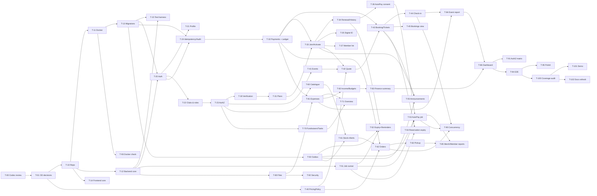

# Implementation Plan — Student Organization Management System

| Field | Value |
|---|---|
| Document | `docs/IMPLEMENTATION_PLAN.md` |
| Status | **DRAFT — pending independent OpenAI Codex review. Not approved.** |
| Inputs | `HLD.md`, `LLD.md`, `REQUIREMENT_TRACEABILITY.md`, `ARCHITECTURE_DECISIONS.md` |

All effort figures are **estimates in focused engineer-hours**, for planning only. Priorities: **P0** = foundational or required problem-statement functionality (must ship); **P1** = required functionality that depends on P0 pieces or required reporting/hardening; **P2** = polish (UX refinements, extra charts, demo convenience). No requirement from the PDF or the prompt is P2 — every required feature is P0 or P1.

---

## 1. Work Breakdown Structure

Legend for columns: **Reqs** = requirement IDs from `REQUIREMENT_TRACEABILITY.md`; **Deps** = tasks that must be done first.

### Phase 0 — Requirements verification and review gate

| ID | Description | Reqs | Deps | Frontend | Backend | Database | Tests | Acceptance criteria | Pri | Est. |
|---|---|---|---|---|---|---|---|---|---|---|
| T-00 | Independent Codex review of all five docs; apply corrections | PR-DOC-02 | — | — | — | — | — | Review findings logged; each finding resolved or recorded as accepted risk | P0 | 4 h |
| T-01 | Team decision on open decisions OD-01…OD-09 | all OD | T-00 | — | — | — | — | Each OD marked Approved / Changed in `ARCHITECTURE_DECISIONS.md` §B; changed defaults propagated to LLD | P0 | 2 h |

### Phase 1 — Repository, Docker, database and skeleton

| ID | Description | Reqs | Deps | Frontend | Backend | Database | Tests | Acceptance criteria | Pri | Est. |
|---|---|---|---|---|---|---|---|---|---|---|
| T-10 | Monorepo layout per LLD §1.1, lint/format, dependency-cruiser rules | PR-TECH-01/03 | T-01 | Vite app scaffold | Express scaffold, ESM | — | lint passes | Folder structure matches LLD; `npm run lint` green in both apps | P0 | 3 h |
| T-11 | Docker Compose (db, backend, frontend), volumes, health checks, `.env.example` | PR-TECH-02 | T-10 | Dockerfile dev/prod | Dockerfile, entrypoint (migrate → seed) | postgres:16 service | smoke: `docker compose up` | Clean clone + `cp .env.example .env && docker compose up --build` serves `/api/v1/health` = ok and SPA | P0 | 4 h |
| T-12 | Backend core: config (zod), pino logger with redaction, requestId, AppError, errorHandler, helmet, CORS, rate-limit wiring, `withTransaction`, clock, money, tokens, qr helpers | PR-TECH-04, NFR-12 | T-10 | — | shared/* | — | unit: money, tokens, error envelope | Every error returns envelope with requestId; redaction unit test passes | P0 | 6 h |
| T-13 | Migration framework + migrations 001 & 004 (shared tables, triggers) | PR-FIN-12 | T-11 | — | knexfile | `audit_logs`, `idempotency_keys`, `job_runs`, trigger functions | migrate up/down | `knex migrate:latest` and rollback succeed in container | P0 | 3 h |
| T-14 | Frontend core: router, Layout, api client (credentials, idempotency keys, error mapping), Money/Date utils, Loading/Empty/Error components | PR-TECH-01 | T-10 | src/api, components | — | — | unit: client error mapping, money formatting | Pages render states; API errors shown with requestId | P0 | 5 h |
| T-15 | Test harness: test DB, factories, testClock, supertest app, Playwright config, CI script | NFR-14 | T-12, T-13 | Playwright | tests/helpers | `soms_test` | sample tests | `npm test` runs unit+integration against Compose DB | P0 | 4 h |

### Phase 2 — Authentication, profiles, roles, club-scoped permissions

| ID | Description | Reqs | Deps | Frontend | Backend | Database | Tests | Acceptance criteria | Pri | Est. |
|---|---|---|---|---|---|---|---|---|---|---|
| T-20 | Register / login / logout / `/auth/me`, sessions | PR-AUTH-01, PR-ROLE-02 | T-12, T-13 | Login, Register pages, AuthProvider | auth module | `users`, `user_sessions` (002) | TC-AUTH-01, login rate limit | Non-college user can register and sign in; passwords bcrypt; generic login errors | P0 | 6 h |
| T-21 | Profile maintenance | PR-AUTH-02 | T-20 | Profile page | `PATCH /me` | — | API validation tests | Name/phone editable; phone E.164 validated | P0 | 2 h |
| T-22 | Clubs, club roles, CLI/seed for clubs and first club head, role assignment API | PR-ROLE-03/07, PDF-01 | T-20 | Clubs list/page, Roles page | clubs module, CLI | `clubs`, `club_role_assignments` (003) | LAST_CLUB_HEAD, duplicate role | Club head assigns/revokes treasurer/volunteer/club head; last head protected; audited | P0 | 6 h |
| T-23 | Authorization layer: `authorize()` middleware, scope resolvers (club from params/resource), capabilities, 404-for-other-club policy | PR-ROLE-07, NFR-01 | T-22 | RequireAuth / RequireCapability, role-aware NavBar | shared/middleware/authorize, clubs.authz | — | authz unit tests, start of TC-AZ-01 matrix | Default deny; multi-role user gets union of scoped rights; cross-club → 404 | P0 | 6 h |
| T-24 | Idempotency middleware + audit helper | PR-FIN-13, NFR-06 | T-13, T-20 | api client key reuse | idempotency, audit | uses 004 tables | TC-PAY-02 (generic) | Replay returns stored response; different body → 409 | P0 | 4 h |

### Phase 3 — College verification, plans, payments core, memberships

Order change versus the suggested phase list: the **simulated payment engine and ledger writer** are built here (not in Phase 8) because membership activation, ticket sales and merchandise orders all settle through them. Expense/budget/reporting parts of finance stay in Phase 8.

| ID | Description | Reqs | Deps | Frontend | Backend | Database | Tests | Acceptance criteria | Pri | Est. |
|---|---|---|---|---|---|---|---|---|---|---|
| T-30 | College verification adapter interface, mock with fixtures, unconfigured stub, verification API | PR-MEM-02/03, PR-ROLE-02 | T-23 | Verification form on Profile | auth/verification | `college_verifications` (002) | TC-VER-01..04 | Verified/unverified/unavailable outcomes testable via fixture; unavailable never blocks registration or browsing | P0 | 5 h |
| T-31 | Membership plans CRUD/archive with benefit fields; plan visibility rule | PR-MEM-05, PDF-04, PR-ROLE-03 | T-30 | Plans management page; plan list for verified students | memberships/plans | `membership_plans` (006) | TC-VER-02, plan validation | Unverified users cannot list/buy plans; archived plans hidden | P0 | 5 h |
| T-32 | Simulated payments: create, settle (conditional), handler registry, simulate endpoint, payment history, ledger `post()` | PR-MEM-10, PR-MER-12, PR-FIN-01/12/13 | T-24 | Checkout page (Simulated banner), My payments | finance/payments, finance/ledger | `payments` (009), `financial_transactions` (011 ledger part) | TC-PAY-01, TC-FIN-04 | Repeated/concurrent settle runs handler once; ledger immutable; `isSimulated` always true | P0 | 8 h |
| T-33 | Membership join → activation (handler), member number, term snapshot, free plan path | PDF-02/03, PR-MEM-01/04/07 | T-31, T-32 | Join flow from club page | memberships service + handler | `memberships`, `membership_terms` (006) | TC-MEM-01/02/04 | Membership becomes ACTIVE only after SUCCEEDED payment; records club, user, plan, fee, payment & membership status | P0 | 8 h |
| T-34 | Membership detail: status, benefits, expiry, terms/payment history, renewal options; manual renewal | PDF-05, PR-MEM-08/14 | T-33 | My memberships, membership detail, renew dialog | renewals | — | TC-MEM-03, failed renewal unchanged | Renewal extends correctly; failed renewal never extends; history visible | P0 | 6 h |
| T-35 | Digital membership ID + QR, rotation, membership QR verification endpoint & scanner tab | PDF-06, PR-MEM-12/13 | T-33, T-23 | Membership card page, "Verify membership" scanner tab | digital-id, membership-verifications | — | TC-MEM-05/06 | Scanning shows current effective status; scanning never mutates; tickets endpoint rejects membership QR | P0 | 5 h |
| T-36 | AutoPay consent enable/disable + consent history | PR-MEM-11 | T-34 | AutoPay toggle with consent text + "simulated" acknowledgement | autopay | `autopay_consents`, memberships autopay columns | consent validation tests | Consent recorded with plan, amount, text version; disable recorded | P0 | 3 h |
| T-37 | Club member list for club head/treasurer incl. verification status | PR-ROLE-03 | T-33 | Members page | `GET /clubs/:id/memberships` | — | authz tests | Club head reviews membership + verification outcomes, own club only | P0 | 3 h |

### Phase 4 — Events, pricing, bookings, QR, check-in

| ID | Description | Reqs | Deps | Frontend | Backend | Database | Tests | Acceptance criteria | Pri | Est. |
|---|---|---|---|---|---|---|---|---|---|---|
| T-40 | PricingPolicy (pure) for tickets and merchandise, both combination modes | PR-EVT-04/05/08, PR-MER-03/04, PR-MEM-06 | T-01 | — | modules/pricing | — | TC-PRC-01..03, TC-MER-05 | 100 % branch coverage of pricing; mode from config | P0 | 5 h |
| T-41 | Event CRUD, lifecycle (publish/cancel/complete), edit rules, organizers & staff assignment | PDF-07/09, PR-EVT-01/02/03, PR-ROLE-03/04/05 | T-23 | Event management pages, organizer/staff pickers | events module | `events`, `event_organizers`, `event_staff` (007) | TC-EVT-04, state tests | Only club head creates/publishes/assigns organizers; organizers limited per ASM-07 | P0 | 8 h |
| T-42 | Public event listing/detail with sales status and per-user price quote | PDF-07/08, PR-EVT-17 | T-40, T-41, T-33 | Home, events list, event detail + quote card | quote endpoint | — | TC-PRC-04/05 | Non-members see non-member price; expired member treated as non-member; early access respected | P0 | 4 h |
| T-43 | Booking with atomic seat/early-bird reservation, PRICE_CHANGED, free events, ticket issuance handler, QR tokens, booking confirmation email enqueue | PDF-07/09, PR-EVT-06/09/10/11, PR-EVT-16 | T-42, T-32 | Book flow → checkout, My tickets, ticket QR page | bookings, ticketPaymentHandler | `bookings`, `tickets` (007) | TC-EVT-01/02/03, TC-PAY-02 | Capacity never exceeded under concurrency; ticket created only after success; QR opaque | P0 | 10 h |
| T-44 | One-time check-in endpoint + scanner page (camera) + check-in list | PDF-10, PR-EVT-12/13/14, PR-ROLE-05 | T-43 | Scan page, result panel, recent check-ins | check-in service | `check_ins` (007) | TC-CHK-01..04 | Exactly one success under 20 parallel scans; "Already used" with time & staff | P0 | 7 h |
| T-45 | Event bookings view for organizer/club head | PR-ROLE-04 | T-43 | Bookings table | `GET /events/:id/bookings` | — | authz | Organizer sees only assigned events | P0 | 2 h |

### Phase 5 — Notifications, jobs and announcements

| ID | Description | Reqs | Deps | Frontend | Backend | Database | Tests | Acceptance criteria | Pri | Est. |
|---|---|---|---|---|---|---|---|---|---|---|
| T-50 | Notification outbox, templates, Dev/Unconfigured Email & WhatsApp adapters, dispatcher with retries, dev outbox viewer | PR-ANN-06/07/08 | T-13 | Dev outbox page | notifications module | `notification_deliveries` (012) | TC-ANN-03, TC-REM-03 | Failures retried 3× then FAILED; NOT_CONFIGURED immediate FAILED; no real credentials needed | P0 | 7 h |
| T-51 | Job runner (advisory lock + job_runs), scheduler, dev job-run endpoint | PR-MEM-09/11 | T-12, T-13 | Dev job runner page | jobs/* | `job_runs` | duplicate-run test | Same job/day cannot run twice; jobs disabled in tests | P0 | 4 h |
| T-52 | Membership expiry job + seven-day reminder job (email + WhatsApp) | PDF-05, PR-MEM-07/09 | T-50, T-51, T-34 | — | definitions | — | TC-REM-01..04 | Exactly one reminder per channel per term, 7 days before expiry | P0 | 5 h |
| T-53 | AutoPay renewal job with guards, outcomes, pending timeout, outcome emails | PR-MEM-11 | T-36, T-51, T-50 | AutoPay attempt history on membership detail | autopayRenewals | `renewal_attempts` | TC-AP-01..05 | No duplicate attempts/payments; extension only on success | P0 | 7 h |
| T-54 | Reservation-expiry job (bookings, orders, terms) | PR-EVT-06, PR-MER-08 | T-43, T-51 | — | reservationExpiry | — | TC-EVT-02 | Held seats/stock released after hold | P0 | 3 h |
| T-55 | Announcements: drafts, publish (immutable record), visibility, mailing-list snapshot incl. event ticket holders, delivery status view | PDF-13/14, PR-ANN-01..05/09, PR-ROLE-01 | T-50, T-33, T-43 | Club announcements feed, home feed, manage + publish, delivery report | announcements module | `announcements` (012) | TC-ANN-01/02/04 | Publish records who/when; deliveries per member; members-only hidden from non-members | P0 | 7 h |

### Phase 6 — Merchandise

| ID | Description | Reqs | Deps | Frontend | Backend | Database | Tests | Acceptance criteria | Pri | Est. |
|---|---|---|---|---|---|---|---|---|---|---|
| T-60 | Catalogue: categories, products, size variants, offers, availability flags, status | PDF-15, PR-MER-01/04/05 | T-23 | Shop page, product management | merchandise catalogue | categories, products, variants (008) | validation tests | Club-specific catalogue; non-member visibility per flag | P0 | 7 h |
| T-61 | Stock adjustments with movements; low-stock alerts (configurable threshold, one per crossing, email to club heads) | PDF-16, PR-MER-02/13 | T-60, T-50 | Inventory page, alerts list, threshold field | stock service, lowStock.evaluate | `stock_movements`, `low_stock_alerts` | TC-MER-01/04 | Stock tracked per club/product/size; alerts not duplicated | P0 | 5 h |
| T-62 | Order placement with reservation, payment handler (decrement on success), cancel, failure release | PDF-15/17, PR-MER-06/07/08/12 | T-61, T-40, T-32 | Cart, checkout, My orders, order detail | orders service, orderPaymentHandler | `orders`, `order_items` | TC-MER-02/03 | No overselling under concurrency; stock decremented only on success | P0 | 9 h |
| T-63 | Pickup code generation and verification; club order-management view | PR-MER-09/10/11 | T-62 | Club orders page, pickup entry | pickups | — | TC-MER-06 | Unique pickup code; picked up once | P0 | 4 h |

### Phase 7 — Fundraisers, volunteers, tasks

| ID | Description | Reqs | Deps | Frontend | Backend | Database | Tests | Acceptance criteria | Pri | Est. |
|---|---|---|---|---|---|---|---|---|---|---|
| T-70 | Fundraisers + tasks CRUD, assignment, assignee-limited updates, My tasks | PDF-18, PR-FUN-01..05/10, PR-ROLE-05 | T-23 | Fundraiser list, task board, My tasks | fundraisers module | `fundraisers`, `fundraiser_tasks` (010) | TC-FUN-02 | Volunteers update only own task status/progress | P0 | 7 h |
| T-71 | Overview: progress, pending/overdue, health (on-track), money figures | PDF-19, PR-FUN-06/07/08/09 | T-70, T-81 | Overview header, health badge, overdue highlights | progress domain | — | TC-FUN-01 | Health matches LLD §2.9 for fixture cases | P0 | 4 h |

### Phase 8 — Finance (expenses, budgets, summary) and reports

| ID | Description | Reqs | Deps | Frontend | Backend | Database | Tests | Acceptance criteria | Pri | Est. |
|---|---|---|---|---|---|---|---|---|---|---|
| T-80 | File storage + receipt upload/download with validation | PDF-22, PR-FIN-03 | T-12 | Upload field component | finance/files | `uploaded_files` (005) | TC-FIN-06 | Only JPEG/PNG/PDF ≤ 5 MB by magic bytes; authorised download only | P0 | 4 h |
| T-81 | Expenses: reimbursement submit, direct expense, approve/reject/mark paid with separation of duties, ledger OUT | PDF-20/22, PR-FIN-02/04/05/06/07, PR-ROLE-06 | T-80, T-32 | My expenses, review queue, decision dialogs | expenses service | `expenses` (011) | TC-FIN-01/02 | Lifecycle per LLD; decision maker & time recorded; ledger only on PAID | P0 | 8 h |
| T-82 | Fundraiser income entries; budgets CRUD with overlap check | PDF-23, PR-FIN-01/08 | T-81 | Income entry form, budgets panel | income, budgets | `budgets` (011) | budget tests | Income linked to fundraiser; budgets non-overlapping | P0 | 4 h |
| T-83 | Finance summary, transaction history, reconciliation | PDF-21, PR-FIN-09/10/11/12 | T-81, T-82 | Finance dashboard (cards, monthly chart, table) | formulas, reporting finance | — | TC-FIN-03/05 | Figures equal LLD formulas; pending not subtracted except in labelled projected balance | P0 | 6 h |
| T-84 | Event report (all metrics + revenue/check-in graphs) | PDF-11/12, PR-EVT-15/16 | T-44, T-81 | Event report page with charts | reporting events | — | TC-RPT-01 | All §5.15 metrics correct on fixtures | P0 | 5 h |
| T-85 | Merchandise and membership reports | PR-MER-14, PR-MEM-14 | T-63, T-53 | Reports pages | reporting | — | TC-RPT-02 | Units sold per size, revenue, members by plan, dues | P1 | 4 h |
| T-86 | Club dashboard tiles (role-based) | PDF-21 | T-83, T-84 | Manage dashboard | — | — | e2e | Each role sees only permitted tiles | P1 | 3 h |

### Phase 9 — Integration, security, Docker validation, E2E

| ID | Description | Reqs | Deps | Frontend | Backend | Database | Tests | Acceptance criteria | Pri | Est. |
|---|---|---|---|---|---|---|---|---|---|---|
| T-90 | Concurrency suite (bookings, check-in, inventory, settlement, AutoPay) | NFR-03..06 | T-44, T-62, T-53 | — | — | — | TC-EVT-01, TC-CHK-03, TC-MER-02, TC-PAY-01, TC-AP-02 + reconciliation | All pass 10 consecutive runs | P0 | 5 h |
| T-91 | Full authorization matrix test | NFR-01, PR-ROLE-07 | all module tasks | — | — | — | TC-AZ-01 | Every manage endpoint tested for each role, same/other club | P0 | 5 h |
| T-92 | Security checks: headers, CORS, rate limits, redaction, upload abuse, SQL-injection probes, `npm audit` | PR-TECH-04, NFR-02 | T-80 | — | — | — | security checklist | No high findings open | P1 | 4 h |
| T-93 | Docker reproducibility check on clean machine; prod profile | NFR-15 | T-11 | prod build | prod config | — | manual + script | README steps work verbatim | P1 | 3 h |
| T-94 | E2E semester path (Playwright) | PDF-01..23 | T-86 | — | — | — | TC-E2E-01 | Green on Compose stack | P1 | 6 h |
| T-95 | UX polish: responsive checks at 360 px, empty/error states, scanner ergonomics | NFR-11, PDF-17 | T-94 | all pages | — | — | manual checklist | No horizontal scroll on member pages | P2 | 4 h |

### Phase 10 — Coverage audit and demo

| ID | Description | Reqs | Deps | Frontend | Backend | Database | Tests | Acceptance criteria | Pri | Est. |
|---|---|---|---|---|---|---|---|---|---|---|
| T-100 | Traceability audit: update status column for every requirement; close gaps | PR-DOC-01 | T-94 | — | — | — | — | No requirement without passing test or explicit waiver | P0 | 3 h |
| T-101 | Demo seed data + scripted walkthrough of the six PDF scenes (incl. dev job runs for reminder/AutoPay) | PDF-01..23 | T-100 | Dev page shortcuts | seeds | seed | dry run | Demo runs end-to-end in ≤ 15 min | P1 | 4 h |
| T-102 | Final docs refresh (README, env, known limitations, ODs as decided) | PR-DOC-01 | T-100 | — | — | — | — | Docs match implemented behaviour | P1 | 2 h |

**Estimated total**: ≈ 300 engineer-hours (estimate; refine after T-01).

---

## 2. Recommended Implementation Order and Rationale

1. **Phase 0** first: the docs must pass Codex review and the open decisions (pricing stacking, early-access meaning, AutoPay timing, approval policy) must be settled — they change schema details and tests.
2. **Phase 1–2**: everything depends on the skeleton, migrations, auth and the authorization layer. Club-scoped authorization is built before any club feature so no module ships without it.
3. **Phase 3** brings the **payment engine and ledger writer** forward (deviation from the suggested order) because memberships, tickets and orders all settle through them; building finance writers late would force rework of three modules.
4. **Phase 4** (events) before **Phase 5** (announcements) because event-linked announcements and booking confirmations need ticket holders; the notification outbox (T-50) only depends on Phase 1 and can start in parallel.
5. **Phase 6–7** are independent of each other and of Phase 5 once Phase 3 exists.
6. **Phase 8** completes finance (expenses, budgets, summaries) and all reports, which aggregate data produced by every earlier module.
7. **Phase 9–10** harden, verify and prepare the demo. All requirement features remain in P0/P1.

---

## 3. Dependency Graph

---

## 4. Parallel Development Plan

Adaptable to 2–5 people; with fewer people, take workstreams in the listed order.

| Workstream | Tasks | Owns (backend module / tables / FE features) |
|---|---|---|
| WS-A Platform | T-10–T-15, T-24, T-51, T-93 | `shared`, `jobs`, migrations 001/004, Docker, CI, `frontend/src/api`, `components` |
| WS-B Identity & Membership | T-20–T-23, T-30–T-37, T-52, T-53 | `auth`, `clubs`, `memberships`; migrations 002/003/006; FE `auth`, `profile`, `clubs`, `memberships`, `admin-roles` |
| WS-C Events & Ticketing | T-40–T-45, T-54, T-84 | `pricing`, `events`; migration 007; FE `events`, `tickets`, `checkin` |
| WS-D Commerce & Comms | T-50, T-55, T-60–T-63, T-85 | `notifications`, `announcements`, `merchandise`; migrations 008/012; FE `announcements`, `merchandise`, `orders`, `dev` |
| WS-E Finance & Fundraisers | T-32, T-70, T-71, T-80–T-83, T-86 | `finance`, `fundraisers`, `reporting`; migrations 005/009/010/011; FE `finance`, `fundraisers`, `reports` |

Shared contracts and rules:

- **API contracts**: LLD §4 is the contract. Any change is a PR to `LLD.md` reviewed by the consuming workstream before code. Frontend `api/endpoints/<module>.js` mirrors it.
- **Cross-module service APIs** (`index.js`): `memberships.getActiveBenefits`, `memberships.listActiveMemberRecipients`, `events.listTicketHolders`, `payments.create/settle`, `ledger.post`, `notifications.enqueue`, `clubs.authz.*` — signatures frozen at checkpoint CP-1; stubs allowed earlier.
- **Database ownership**: each migration file belongs to one workstream; migrations are numbered by the table above and never edited after merge (new migration instead). Cross-module FKs are added in the owning module's migration in the documented order.
- **Git**: trunk-based, short-lived branches `ws-x/T-nn-short-name`; PR requires green CI (lint, dependency rules, tests) and one reviewer from another workstream for any change to `shared/`, `container.js`, migrations or LLD.
- **Checkpoints**: CP-1 after Phase 2 (skeleton, auth, authz, payments interface stubs); CP-2 after T-33/T-43 (money flows end-to-end); CP-3 after Phase 8 (all features); CP-4 after Phase 9 (hardening). Each checkpoint: demo on Compose stack, traceability status update.

---

## 5. Definition of Done

A task/module is done when **all** of the following hold:

1. **Implementation**: behaviour matches LLD (entities, states, endpoints, formulas); no TODOs on the main path.
2. **Authorization**: every endpoint declares role + scope; included in TC-AZ-01 matrix; cross-club access returns 404.
3. **Validation**: zod schemas for params/query/body; backend repeats all client validation; protected fields not writable.
4. **Error handling**: domain errors use documented codes; error envelope with requestId; no stack traces in responses.
5. **Consistency**: transaction boundaries as in LLD §5; concurrency-relevant operations use conditional updates and are covered by a concurrency test.
6. **Audit & logging**: sensitive actions write `audit_logs`; logs redacted.
7. **Tests**: unit tests for domain logic; API tests for each endpoint (happy path + main errors); listed TC-* cases passing in CI.
8. **Frontend**: loading/empty/error/success states; works at 360 px; no business logic in components.
9. **Docs**: LLD updated if behaviour changed; traceability row status updated.
10. **Docker**: works via `docker compose up` from clean state with seed data.

Module-specific additions:

| Module | Extra done criteria |
|---|---|
| Memberships | Activation/extension only after SUCCEEDED payment proven by TC-MEM-01/02, TC-AP-03; reminders deduped (TC-REM-02) |
| Events | TC-EVT-01 and TC-CHK-03 green 10× in a row |
| Merchandise | TC-MER-02 green 10×; low-stock single alert per crossing |
| Finance | Reconciliation endpoint `ok=true` after the full test suite; ledger immutability trigger tested |
| Announcements | Published record immutable; delivery statuses visible |
| Fundraisers | Health values match fixture table |

---

## 6. Risk Register

| ID | Risk | Impact | Likelihood | Mitigation | Fallback |
|---|---|---|---|---|---|
| R-01 | College database contract never provided | Cannot verify real students | High | Adapter + mock + unconfigured stub; contract requirements listed (HLD §9) | Demo with mock; production returns UNAVAILABLE, users stay non-members (registration/browsing unaffected) |
| R-02 | No email / WhatsApp provider configured | Reminders and announcements not actually delivered | High | Dev adapters, delivery records, NOT_CONFIGURED status | Show dev outbox in demo; add provider adapter later behind same interface |
| R-03 | Open decisions not taken (OD-01 stacking, OD-03 early access) | Rework of pricing & tests | Medium | T-01 before coding; config flag for stacking | Ship defaults, clearly labelled as assumptions |
| R-04 | Scheduler misses runs (container down) | Reminders/AutoPay late | Medium | Reminder catch-up rule; idempotent jobs; dev job runner | Manual run via dev endpoint; documented limitation for AutoPay missed days |
| R-05 | Duplicate job execution after restart | Duplicate messages/payments | Low | Advisory lock + `job_runs` + unique attempts + dedupe keys | Reconciliation detects; unique constraints block second ledger row |
| R-06 | QR scanning unreliable on some phones/browsers (camera permission, HTTPS) | Slow door check-in | Medium | `html5-qrcode` with manual ticket-code entry fallback; HTTPS/localhost requirement documented | Staff type ticket code (same atomic endpoint) |
| R-07 | Concurrency bugs in bookings/inventory | Oversold seats/stock | Medium | Conditional updates + CHECK constraints + concurrency suite in CI | DB constraint aborts the transaction instead of overselling |
| R-08 | Financial inconsistency (missed or duplicate ledger rows) | Untrustworthy finance summary | Low–Medium | Single ledger writer, unique source, same-txn posting, reconciliation endpoint/test | Reconciliation report lists mismatches for treasurer |
| R-09 | Scope creep (refunds, guest tickets, chat) | Delays required features | Medium | Exclusions list; ODs; PR reviews against traceability | Defer to post-hackathon backlog |
| R-10 | Time pressure on reports/charts | Missing required reports | Medium | Reports are P0/P1, formulas fixed early, SQL tested | Tables before charts (charts P1 polish) |
| R-11 | Session/CSRF misconfiguration in prod profile | Auth issues | Low | SameSite + custom header; prod config tested in T-93 | Same-origin deployment via nginx proxy |
| R-12 | Uploaded file abuse | Security | Low | Magic-byte check, size limit, attachment download | Disable upload endpoint via config |

---

## 7. Requirement Traceability

The complete matrix (every requirement → HLD, LLD, DB, API, FE, task, test, status) is maintained in `docs/REQUIREMENT_TRACEABILITY.md`. Task IDs used there are the IDs in §1 of this document. Status values: `Designed` (now), `In progress`, `Implemented`, `Verified`.

> This plan is a draft and must be independently reviewed by OpenAI Codex together with the other four documents before implementation starts (task T-00).
