# Low-Level Design — Student Organization Management System

| Field | Value |
|---|---|
| Document | `docs/LLD.md` |
| Status | **DRAFT — pending independent OpenAI Codex review. Not approved.** |
| Depends on | `docs/HLD.md` (module boundaries M1–M10, ASM/OD IDs, ADRs) |

All money values are **integer paise** (`BIGINT`, JSON numbers). All instants are ISO-8601 UTC strings in JSON; membership dates (`expiresOn`, `startsOn`) are `YYYY-MM-DD` in IST. JSON uses camelCase; SQL uses snake_case.

---

## 1. Repository and Folder Structure

### 1.1 Layout

```
soms/                                   # Student Organization Management System
├── docker-compose.yml                  # db, backend, frontend (dev defaults)
├── docker-compose.prod.yml             # override: built images, nginx static frontend, no dev tools
├── .env.example                        # every variable documented (see §1.3)
├── README.md                           # setup + demo script
├── docs/                               # HLD, LLD, IMPLEMENTATION_PLAN, TRACEABILITY, ADRs
├── backend/
│   ├── Dockerfile                      # node:20-alpine, multi-stage (dev / prod)
│   ├── package.json                    # "type": "module"
│   ├── knexfile.js
│   ├── .dependency-cruiser.cjs         # enforces module boundaries (§1.2)
│   ├── src/
│   │   ├── server.js                   # boot: config → db → container → app.listen → scheduler.start
│   │   ├── app.js                      # express app factory (used by tests)
│   │   ├── container.js                # composition root: wires adapters, services, payment handlers
│   │   ├── config/index.js             # env parsing + validation (zod), fails fast
│   │   ├── db/
│   │   │   ├── knex.js
│   │   │   ├── transaction.js          # withTransaction(fn), passes trx to repositories
│   │   │   ├── migrations/             # 001_…sql-in-js, ordered (§3.5)
│   │   │   └── seeds/                  # dev seed: clubs, users per role, plans, events, products
│   │   ├── shared/
│   │   │   ├── errors.js               # AppError(code, httpStatus, message, details)
│   │   │   ├── money.js                # applyBps, sum, format (pure)
│   │   │   ├── clock.js                # now(), todayIST(); overridable in tests/dev jobs
│   │   │   ├── tokens.js               # randomToken(), pickup/ticket codes
│   │   │   ├── qr.js                   # payload build/parse, SVG render (qrcode lib)
│   │   │   ├── logger.js               # pino with redaction
│   │   │   ├── audit.js                # audit.record(trx, {...})
│   │   │   ├── pagination.js
│   │   │   └── middleware/
│   │   │       ├── requestId.js  session.js  requireAuth.js  authorize.js
│   │   │       ├── validate.js   idempotency.js  rateLimits.js  csrfHeader.js
│   │   │       └── errorHandler.js
│   │   ├── modules/
│   │   │   ├── auth/            # users, sessions, profile, college verification
│   │   │   │   ├── index.js routes.js controller.js service.js repository.js schemas.js
│   │   │   │   └── verification/ CollegeVerificationAdapter.js MockCollegeVerificationAdapter.js
│   │   │   │                     UnconfiguredCollegeVerificationAdapter.js fixtures/students.mock.json
│   │   │   ├── clubs/           # clubs, club roles, authz queries
│   │   │   ├── memberships/     # plans, memberships, terms, autopay, digital id
│   │   │   │   ├── domain/membershipStateMachine.js termDates.js
│   │   │   │   └── handlers/membershipPaymentHandler.js
│   │   │   ├── events/          # events, organizers, staff, bookings, tickets, check-ins
│   │   │   │   ├── domain/eventStateMachine.js salesWindow.js
│   │   │   │   └── handlers/ticketPaymentHandler.js
│   │   │   ├── pricing/         # PricingPolicy (pure) used by events + merchandise
│   │   │   ├── merchandise/     # catalogue, variants, stock, alerts, orders, pickup
│   │   │   │   └── handlers/orderPaymentHandler.js
│   │   │   ├── announcements/
│   │   │   ├── notifications/   # outbox service, templates, adapters (Email/WhatsApp: Dev, Unconfigured)
│   │   │   ├── fundraisers/     # fundraisers, tasks, progress domain
│   │   │   ├── finance/         # payments (simulated), ledger, expenses, budgets, income entries, files
│   │   │   │   ├── payments/ service.js repository.js simulator.js handlerRegistry.js
│   │   │   │   ├── ledger/ service.js repository.js
│   │   │   │   ├── domain/formulas.js expenseStateMachine.js
│   │   │   │   └── files/ FileStorage.js LocalFileStorage.js
│   │   │   ├── reporting/       # read-only SQL queries
│   │   │   └── dev/             # dev-only routes (job runner, outbox viewer, payment override)
│   │   └── jobs/
│   │       ├── scheduler.js     # node-cron registrations
│   │       ├── runJob.js        # advisory lock + job_runs bookkeeping
│   │       └── definitions/ membershipExpiry.js renewalReminders.js autopayRenewals.js
│   │                         reservationExpiry.js notificationDispatch.js
│   └── tests/
│       ├── unit/  integration/  api/  concurrency/
│       ├── fixtures/ factories.js users.js clubs.js
│       └── helpers/ testDb.js testClock.js testApp.js
└── frontend/
    ├── Dockerfile                      # dev: vite; prod: build → nginx stage
    ├── nginx.conf                      # prod: static + proxy /api → backend:4000
    ├── package.json  vite.config.js
    ├── src/
    │   ├── main.jsx  App.jsx  routes.jsx
    │   ├── api/ client.js  endpoints/*.js     # one file per backend module
    │   ├── auth/ AuthProvider.jsx  RequireAuth.jsx  RequireCapability.jsx
    │   ├── components/ (layout, forms, Money.jsx, StatusBadge.jsx, QrImage.jsx,
    │   │                 QrScanner.jsx, DataTable.jsx, EmptyState.jsx, ErrorState.jsx, charts/)
    │   ├── features/ auth/ profile/ clubs/ memberships/ events/ tickets/ checkin/
    │   │             announcements/ merchandise/ orders/ fundraisers/ finance/ reports/ admin-roles/ dev/
    │   └── utils/ formatMoney.js formatDate.js errorMessages.js
    └── tests/ unit/  e2e/ (Playwright)
```

### 1.2 Dependency rules (enforced by dependency-cruiser in CI)

- `controller` → `service` (same module) only; `service` → own `repository`, own `domain`, `shared`, and **other modules' `index.js`** only.
- No import of another module's `repository.js` or `domain/`.
- `finance/payments` must not import `memberships`, `events`, `merchandise` (handlers are registered in `container.js`).
- `reporting` may read any table but exposes no write functions.
- Frontend: `features/*` → `api/endpoints/*` and `components/*`; no feature imports another feature's internals.

### 1.3 Environment variables

| Variable | Example | Notes |
|---|---|---|
| `NODE_ENV` | `development` | `production` disables dev tools |
| `PORT` | `4000` | |
| `DATABASE_URL` | `postgres://soms:soms@db:5432/soms` | |
| `SESSION_SECRET` | random 64 chars | required in production |
| `CORS_ORIGIN` | `http://localhost:5173` | dev only |
| `APP_TIMEZONE` | `Asia/Kolkata` | business dates |
| `UPLOAD_DIR` | `/app/uploads` | volume mount |
| `MAX_UPLOAD_BYTES` | `5242880` | |
| `RESERVATION_HOLD_MINUTES` | `15` | ASM-13 |
| `AUTOPAY_PENDING_TIMEOUT_HOURS` | `24` | |
| `PRICING_COMBINATION_MODE` | `BEST_OF` | `BEST_OF` \| `STACK` — OD-01 |
| `DEFAULT_LOW_STOCK_THRESHOLD` | `5` | per-variant override |
| `FUNDRAISER_AT_RISK_TOLERANCE_PCT` | `20` | §2.8 |
| `COLLEGE_VERIFICATION_MODE` | `mock` | `mock` \| `unconfigured` (real adapter added when contract known) |
| `VERIFICATION_HASH_KEY` | random | HMAC key for student identifier hashing |
| `NOTIFY_MODE` | `dev` | `dev` \| `unconfigured` (+ provider adapters later) |
| `DEV_NOTIFY_FAIL_CHANNEL` | `` | `EMAIL`/`WHATSAPP` to force failures in dev |
| `SIM_AUTOPAY_OUTCOME` | `SUCCEEDED` | `SUCCEEDED`\|`FAILED`\|`PENDING` |
| `DEV_TOOLS_ENABLED` | `true` | ignored when production |
| `SEED_ON_START` | `true` | dev only |
| `JOBS_ENABLED` | `true` | tests set `false` and invoke jobs directly |

---

## 2. Domain Model

Status names below are the exact values stored in the database (`CHECK` constraints) and returned by the API.

### 2.1 Auth & Profiles (M1)

**User** — `id`, `email` (unique, lower-cased), `fullName` (2–100), `phoneE164` (optional, `^\+[1-9]\d{7,14}$`, needed for WhatsApp), `passwordHash`, `isActive`.
Invariants: email unique; inactive users cannot sign in.
Operations: `register`, `login`, `logout`, `updateProfile` (name, phone; email change is out of scope).

**CollegeVerification** — `id`, `userId`, `outcome` ∈ {`VERIFIED`, `NOT_VERIFIED`, `UNAVAILABLE`}, `studentIdentifierHash` (HMAC-SHA256), `adapter`, `externalReference?`, `checkedAt`, `supersededAt?`.
Rules:
- *Current verification* of a user = latest row with `outcome ≠ UNAVAILABLE` and `supersededAt IS NULL`. User is `VERIFIED_STUDENT` iff it is `VERIFIED`.
- `UNAVAILABLE` (adapter timeout/error/not configured) never changes the current verification.
- A new `VERIFIED`/`NOT_VERIFIED` row supersedes the previous current row.
- One student identifier can be `VERIFIED` for at most one user (partial unique index) → `STUDENT_ID_ALREADY_LINKED`.
- Rate limit 5 attempts/hour/user.
Errors: `VERIFICATION_UNAVAILABLE` (503), `STUDENT_ID_ALREADY_LINKED` (409), `VERIFICATION_RATE_LIMITED` (429).

`CollegeVerificationAdapter` interface:
```js
// verify({ studentIdentifier, fullName }) -> Promise<{ outcome: 'VERIFIED'|'NOT_VERIFIED'|'UNAVAILABLE', externalReference?: string }>
```
`MockCollegeVerificationAdapter` reads `fixtures/students.mock.json` (`[{ "studentIdentifier": "SRKR2023CS001", "fullName": "Asha Rao" }]`); match is case-insensitive on name, exact on identifier. Magic identifier `MOCK-UNAVAILABLE` returns `UNAVAILABLE`. `UnconfiguredCollegeVerificationAdapter` always returns `UNAVAILABLE`. The field set is ASM-02/OD-02 and must be confirmed with the college.

### 2.2 Clubs & Roles (M2)

**Club** — `id`, `slug`, `name`, `description`, `contactEmail?`, `isActive`, `nextMemberSeq`.
**ClubRoleAssignment** — `id`, `clubId`, `userId`, `role` ∈ {`CLUB_HEAD`, `TREASURER`, `VOLUNTEER`}, `assignedBy`, `assignedAt`, `revokedAt?`, `revokedBy?`.
Invariants: at most one active assignment per (club, user, role); a club always has ≥ 1 active `CLUB_HEAD` (revoking the last one → `LAST_CLUB_HEAD`); only club heads assign/revoke; clubs and first club heads are created by seed/CLI (`npm run cli -- create-club …`, `assign-club-head …`) — ASM-01.

**Capabilities resolution** (`clubs.getCapabilities(userId)`): returns `{ verifiedStudent, memberships:[{clubId, effectiveStatus}], clubRoles:[{clubId, role}], organizerOf:[eventId], staffOf:[eventId] }`. Returned by `/auth/me` for UI navigation; recomputed server-side on every authorization check (no role claims trusted from the client).

### 2.3 Membership Plans (M3)

**MembershipPlan** — `id`, `clubId`, `name`, `description`, `benefitsText`, `feePaise ≥ 0`, `durationMonths` 1–24, `eventDiscountBps` 0–10000, `merchDiscountBps` 0–10000, `earlyBirdAccess` bool, `status` ∈ {`ACTIVE`, `ARCHIVED`}.
Rules: edits affect only future purchases (terms snapshot the plan, §2.4). Archived plans are not offered and cannot be renewed into; existing memberships keep their snapshot. Plans are never deleted once referenced.

Benefit resolution (`memberships.getActiveBenefits(userId, clubId, date)`): returns the snapshot of the **PAID term covering `date`** of an effective ACTIVE membership, else `null`:
```js
{ membershipId, termId, planName, eventDiscountBps, merchDiscountBps, earlyBirdAccess }
```

### 2.4 Memberships (M4)

**Membership** — `id`, `userId`, `clubId`, `status`, `memberNumber?` (assigned on first activation, e.g. `SKY-000042`), `currentPlanId?`, `startedOn?`, `expiresOn?`, `qrToken` (unique), `autopayEnabled`, `autopayPlanId?`, `autopayAmountPaise?`.
One record per (user, club), reused across lapses and renewals.

**MembershipTerm** — one paid (or attempted) period: `id`, `membershipId`, `kind` ∈ {`JOIN`, `RENEWAL`}, `source` ∈ {`MANUAL`, `AUTOPAY`}, plan snapshot (`planId`, `planName`, `feePaise`, `durationMonths`, `eventDiscountBps`, `merchDiscountBps`, `earlyBirdAccess`, `benefitsText`), `status`, `startsOn?`, `endsOn?`, `paidAt?`.

**Effective status** (computed on every read): `ACTIVE` with `expiresOn < todayIST` ⇒ `EXPIRED`. The expiry job persists it.

**Term dates**: on payment success, `startsOn = (membership effectively ACTIVE) ? expiresOn + 1 day : todayIST`; `endsOn = addMonths(startsOn, durationMonths) − 1 day`; membership `expiresOn = endsOn`.

Membership state transitions:

| From | Event | To | Guard / side effects |
|---|---|---|---|
| — | `register(plan)` | `PENDING_PAYMENT` | verified student, plan ACTIVE; creates JOIN term + payment (fee 0 → straight to ACTIVE, no payment, no ledger row) |
| `CANCELLED` | `register(plan)` | `PENDING_PAYMENT` | same; reuses record |
| `PENDING_PAYMENT` | JOIN payment `SUCCEEDED` | `ACTIVE` | term → PAID; assign memberNumber; set dates; ledger `MEMBERSHIP_DUES` |
| `PENDING_PAYMENT` | JOIN payment `FAILED`/`EXPIRED` | `CANCELLED` | term → FAILED |
| `ACTIVE` | RENEWAL payment `SUCCEEDED` | `ACTIVE` | new term PAID; `expiresOn` extended; ledger `MEMBERSHIP_RENEWAL` |
| `ACTIVE` | `expiresOn < today` | `EXPIRED` | expiry job (or read-time) ; AutoPay settings retained but inactive |
| `EXPIRED` | RENEWAL payment `SUCCEEDED` | `ACTIVE` | term starts today |
| `ACTIVE`/`EXPIRED` | RENEWAL payment `FAILED`/`EXPIRED` | unchanged | term → FAILED |

Invariants: `ACTIVE ⇒ expiresOn IS NOT NULL`; at most one `PENDING_PAYMENT` term per membership (`PAYMENT_ALREADY_PENDING`); a membership is **never** extended unless a term reaches `PAID` via a `SUCCEEDED` payment (or a free plan).

Term state transitions: `PENDING_PAYMENT → PAID | FAILED`; terminal otherwise.

**AutoPay** — `AutopayConsent` rows (`ENABLED`/`DISABLED`, `planId`, `consentedAmountPaise`, `consentTextVersion`, `createdAt`) form the consent history; `memberships.autopay*` columns cache the current setting.
Enable guard: membership effectively ACTIVE, user verified, plan ACTIVE, request includes `acknowledgeSimulated: true` and `consentTextVersion`.
**RenewalAttempt** — `id`, `membershipId`, `forExpiresOn`, `termId?`, `paymentId?`, `status` ∈ {`PROCESSING`, `SUCCEEDED`, `FAILED`, `PENDING`, `SKIPPED`}, `skipReason?` ∈ {`PLAN_ARCHIVED`, `PRICE_CHANGED`, `NOT_VERIFIED`, `PAYMENT_ALREADY_PENDING`}. Unique (`membershipId`, `forExpiresOn`).

| From | Event | To |
|---|---|---|
| — | job selects membership | `PROCESSING` (or `SKIPPED` if guard fails) |
| `PROCESSING` | simulated outcome SUCCEEDED | `SUCCEEDED` |
| `PROCESSING` | outcome FAILED | `FAILED` |
| `PROCESSING` | outcome PENDING | `PENDING` |
| `PENDING` | payment later SUCCEEDED (dev simulate) | `SUCCEEDED` |
| `PENDING` | payment EXPIRED after timeout | `FAILED` |

**Digital membership ID**: available when the membership has ever been activated (status ACTIVE or EXPIRED); shows name, club, member number, plan name, effective status, expiry, QR (`SOMS1:M:<qrToken>`). Scanning never mutates state. Owner can rotate the token (`POST /me/memberships/:id/digital-id/rotate`), invalidating screenshots shared with others.

### 2.5 Events & Ticketing (M5)

**Event** — fields in §3. Status ∈ {`DRAFT`, `PUBLISHED`, `CANCELLED`, `COMPLETED`}.

| From | Event | To | Who / guard |
|---|---|---|---|
| — | create | `DRAFT` | club head |
| `DRAFT` | publish | `PUBLISHED` | club head; ≥1 organizer assigned; dates valid |
| `DRAFT` | cancel | `CANCELLED` | club head |
| `PUBLISHED` | cancel | `CANCELLED` | club head; VALID tickets → CANCELLED; pending bookings → CANCELLED, payments → FAILED(`EVENT_CANCELLED`); no automatic refund (OD-08) |
| `PUBLISHED` | complete | `COMPLETED` | club head or organizer; `now ≥ endsAt` |

Edit rules: club head may edit any field in DRAFT; in PUBLISHED may edit description/venue/times (keeping order invariants), prices (affect future bookings only) and capacity (`capacity ≥ seatsReserved`). Organizers may edit description and venue only (ASM-07). CANCELLED/COMPLETED are read-only.

Date invariants: `earlyAccessOpensAt < registrationOpensAt < registrationClosesAt ≤ startsAt < endsAt`; `earlyBirdEndsAt` within `[registrationOpensAt, registrationClosesAt]` if set; early-bird price fields require `earlyBirdEndsAt`.

**Sales window** (derived, returned as `salesStatus`): `NOT_OPEN`, `EARLY_ACCESS` (member early-access only), `OPEN`, `SOLD_OUT` (`seatsReserved = capacity`), `CLOSED` (after close/start or not PUBLISHED).

**Booking** — status ∈ {`PENDING_PAYMENT`, `CONFIRMED`, `CANCELLED`, `EXPIRED`}; snapshot: `buyerType` ∈ {`MEMBER`, `NON_MEMBER`}, `priceTier` ∈ {`MEMBER_REGULAR`, `NON_MEMBER_REGULAR`, `MEMBER_EARLY_BIRD`, `NON_MEMBER_EARLY_BIRD`, `FREE`}, `listPricePaise`, `discountPaise`, `finalPricePaise`, `pricingMode`, `membershipTermId?`, `usesEarlyBird`, `holdExpiresAt`.

| From | Event | To | Side effects |
|---|---|---|---|
| — | book (price > 0) | `PENDING_PAYMENT` | seat (+EB slot) reserved; payment INITIATED |
| — | book (price = 0) | `CONFIRMED` | seat reserved; ticket issued |
| `PENDING_PAYMENT` | payment SUCCEEDED | `CONFIRMED` | ticket issued; ledger `TICKET_SALE`; email `BOOKING_CONFIRMED` |
| `PENDING_PAYMENT` | payment FAILED | `CANCELLED` | seat (+EB) released |
| `PENDING_PAYMENT` | hold expired | `EXPIRED` | seat released; payment → EXPIRED |
| `PENDING_PAYMENT`/`CONFIRMED` | event cancelled | `CANCELLED` | ticket → CANCELLED |

**Ticket** — `status` ∈ {`VALID`, `USED`, `CANCELLED`}; `ticketCode` (10 chars Crockford base32, display), `qrToken` (128-bit base64url). Created only when its booking is CONFIRMED.

| From | Event | To |
|---|---|---|
| — | booking confirmed | `VALID` |
| `VALID` | successful check-in | `USED` (`usedAt`, `usedBy`, check_ins row) |
| `VALID` | event cancelled | `CANCELLED` |
| `USED`/`CANCELLED` | any | terminal |

Check-in rejections: `TICKET_NOT_FOUND`, `TICKET_WRONG_EVENT`, `TICKET_ALREADY_USED` (details: `usedAt`, `checkedInByName`), `TICKET_CANCELLED`, `EVENT_NOT_ACTIVE` (event not PUBLISHED), `INVALID_QR_FORMAT`, `NOT_EVENT_STAFF`.

Expired membership (ASM-06, PR-EVT-07): at booking time an expired member is a non-member (non-member price, cannot book members-only events, no early access). At the door the ticket is validated, not the membership.

**EventOrganizer** (event, user) — assigned by club head; user must be a registered user. **EventStaff** (event, user) — must hold `VOLUNTEER` in the event's club; assigned by club head or organizer; grants scan rights for that event only.

### 2.6 Pricing Policy (shared, `modules/pricing`)

Strategy Pattern: `PricingPolicy` with `combinationMode` (`BEST_OF` default, `STACK`) injected from config (OD-01). Pure functions; no DB access.

```
discount(p, bps) = floor((p * bps + 5000) / 10000)        // half-up to the paise

quoteTicket(event, benefits | null, now, earlyBirdRemaining):
  isMember = benefits != null
  window   = salesWindow(event, isMember && benefits.earlyBirdAccess, now)   // throws REGISTRATION_NOT_OPEN / REGISTRATION_CLOSED / SOLD_OUT
  if !isMember && event.nonMemberPricePaise == null -> throw MEMBERS_ONLY_EVENT
  base      = isMember ? event.memberPricePaise : event.nonMemberPricePaise
  memDisc   = isMember && event.memberDiscountEligible ? discount(base, benefits.eventDiscountBps) : 0
  regular   = { tier: isMember ? MEMBER_REGULAR : NON_MEMBER_REGULAR, list: base, disc: memDisc, final: base - memDisc }
  ebPrice   = isMember ? event.earlyBirdMemberPricePaise : event.earlyBirdNonMemberPricePaise
  ebOk      = ebPrice != null && now <= event.earlyBirdEndsAt && earlyBirdRemaining > 0
  if ebOk:
     ebDisc = (mode == STACK && isMember && event.memberDiscountEligible) ? discount(ebPrice, benefits.eventDiscountBps) : 0
     eb     = { tier: isMember ? MEMBER_EARLY_BIRD : NON_MEMBER_EARLY_BIRD, list: ebPrice, disc: ebDisc, final: ebPrice - ebDisc }
     return eb.final <= regular.final ? eb : regular        // never charge more because of an "offer"
  return regular
  // final == 0 -> tier FREE in the stored snapshot (tier of origin kept in pricingMode detail)

quoteMerchItem(product, benefits | null, now):
  if !benefits && !product.availableToNonMembers -> throw MEMBERS_ONLY_PRODUCT
  list    = product.pricePaise
  memDisc = benefits && product.memberDiscountEligible ? discount(list, benefits.merchDiscountBps) : 0
  regular = list - memDisc
  offerOk = product.offerPricePaise != null && offerStartsAt <= now <= offerEndsAt
  if offerOk:
     offerDisc = (mode == STACK && benefits && product.memberDiscountEligible) ? discount(offer, bps) : 0
     offerFinal = offer - offerDisc
     if offerFinal <= regular -> rule OFFER(+MEMBER if stacked)
  else rule MEMBER_DISCOUNT or LIST
```

The member discount on events is defined to apply on top of the event's member price (club head sets the member price; plan discount is the plan-specific extra). This is part of OD-01 and must be confirmed.

Client flow: `GET /events/:id/price-quote` → display → `POST bookings` with `expectedFinalPricePaise`. If the server's fresh quote differs → `409 PRICE_CHANGED` with the new quote; the client must ask the user to confirm. The client value is **never** used as the charged amount.

### 2.7 Announcements & Notifications (M6)

**Announcement** — `clubId`, `eventId?`, `title` (≤150), `body` (≤5000, plain text), `category` ∈ {`MEETING`, `DEADLINE`, `EVENT`, `SCHEDULE_CHANGE`, `GENERAL`}, `audience` ∈ {`PUBLIC`, `MEMBERS`}, `sendEmail` bool, `status` ∈ {`DRAFT`, `PUBLISHED`}, `createdBy`, `publishedBy?`, `publishedAt?`.
Transitions: `DRAFT → PUBLISHED` (club head). Published announcements are immutable (the record of "what was said and when"); corrections are new announcements (category `SCHEDULE_CHANGE`). Drafts may be edited/deleted.
Visibility: `PUBLIC` → everyone incl. signed-out visitors; `MEMBERS` → effective members of the club and club role holders.
**Mailing list** (resolved at publish, snapshotted as delivery rows): effective ACTIVE members of the club; if `eventId` is set, plus users holding VALID/USED tickets for that event (ASM-14); de-duplicated by user. Email only for announcements.

**NotificationDelivery** — `channel` ∈ {`EMAIL`, `WHATSAPP`}, `template` ∈ {`ANNOUNCEMENT`, `RENEWAL_REMINDER_7D`, `AUTOPAY_RESULT`, `BOOKING_CONFIRMED`, `LOW_STOCK_ALERT`}, `status` ∈ {`PENDING`, `SENDING`, `SENT`, `FAILED`, `SKIPPED`}, `attempts`, `nextAttemptAt`, `lastError`, `dedupeKey` (unique).

| From | Event | To |
|---|---|---|
| — | enqueue (contact present) | `PENDING` |
| — | enqueue (no email/phone) | `SKIPPED` (`NO_CONTACT`) |
| `PENDING` | dispatcher claims | `SENDING` |
| `SENDING` | adapter ok | `SENT` |
| `SENDING` | adapter error, attempts < 3 | `PENDING` (`nextAttemptAt` = now + 1/5/30 min) |
| `SENDING` | adapter error, attempts = 3, or `NOT_CONFIGURED` | `FAILED` |
| `SENDING` stuck > 10 min (crash) | dispatcher recovery | `PENDING` |

Adapters (`notifications/adapters`): `EmailAdapter.send({to, subject, text})`, `WhatsAppAdapter.send({toE164, text})` → `{ providerMessageId }` or throws `NotificationError{retryable}`. Implementations: `DevEmailAdapter`, `DevWhatsAppAdapter` (log + mark SENT, provider `dev`), `UnconfiguredEmailAdapter`, `UnconfiguredWhatsAppAdapter` (throw non-retryable `NOT_CONFIGURED`). No real provider is assumed.

### 2.8 Merchandise (M7)

**ProductCategory** (`clubId`, `name` unique per club). **Product** — `clubId`, `categoryId`, `name`, `description`, `pricePaise > 0`, `memberDiscountEligible`, `availableToNonMembers`, `offerPricePaise?`, `offerStartsAt?`, `offerEndsAt?`, `status` ∈ {`DRAFT`, `ACTIVE`, `INACTIVE`, `ARCHIVED`}. Orderable iff ACTIVE.
**ProductVariant** — `productId`, `clubId`, `sizeLabel` (e.g. `S`, `M`, `L`, `XL`, `ONE_SIZE`; unique per product), `stockOnHand ≥ 0`, `stockReserved ≥ 0`, `lowStockThreshold ≥ 0`, `isActive`. `available = stockOnHand − stockReserved`.
**StockMovement** — `type` ∈ {`RESTOCK`, `ADJUSTMENT`, `RESERVE`, `RELEASE`, `SALE`}, signed `quantity`, `reason`, `orderId?`, `actorUserId?` — append-only.
**LowStockAlert** — `status` ∈ {`OPEN`, `RESOLVED`}; at most one OPEN per variant.
**Order** — status ∈ {`PENDING_PAYMENT`, `CONFIRMED`, `PICKED_UP`, `CANCELLED`, `EXPIRED`}; one club per order; `pickupCode` (8 chars Crockford base32) generated on confirmation; snapshot totals.
**OrderItem** — `variantId`, `quantity` 1–10, unit list/discount/final price, `lineTotalPaise`, `priceRule` ∈ {`LIST`, `MEMBER_DISCOUNT`, `OFFER`, `OFFER_PLUS_MEMBER`}.

| Order from | Event | To | Stock effect |
|---|---|---|---|
| — | place | `PENDING_PAYMENT` | reserve: `stockReserved += q` |
| `PENDING_PAYMENT` | payment SUCCEEDED | `CONFIRMED` | sale: `stockOnHand −= q`, `stockReserved −= q`; ledger `MERCH_SALE`; pickup code |
| `PENDING_PAYMENT` | payment FAILED / user cancels | `CANCELLED` | release: `stockReserved −= q` |
| `PENDING_PAYMENT` | hold expired | `EXPIRED` | release |
| `CONFIRMED` | club head verifies pickup code | `PICKED_UP` | none |

Stock is *reserved* at order placement and *decremented* at payment success (PR-MER-07). Cancellation after CONFIRMED is not supported (no refunds, OD-08).

Low-stock rule: after any change to a variant, if `available ≤ lowStockThreshold` and no OPEN alert → create OPEN alert and email club heads (dedupe `low-stock:{alertId}:{userId}`); if `available > threshold` → resolve OPEN alert. Hence one alert per crossing, never repeated while it stays low.

### 2.9 Fundraisers & Tasks (M8)

**Fundraiser** — `clubId`, `name`, `description`, `startsOn`, `targetDate`, `goalAmountPaise?`, `status` ∈ {`PLANNING`, `ACTIVE`, `COMPLETED`, `CANCELLED`}. Transitions: `PLANNING → ACTIVE → COMPLETED`; `PLANNING|ACTIVE → CANCELLED` (club head).
**FundraiserTask** — `fundraiserId`, `clubId`, `title`, `description`, `assigneeUserId?` (must hold a club role — volunteer, treasurer or club head), `deadline` (timestamptz), `status` ∈ {`TODO`, `IN_PROGRESS`, `DONE`, `CANCELLED`}, `progressPercent` 0–100.

| From | Event | To | Who |
|---|---|---|---|
| — | create | `TODO` | club head |
| `TODO` | start / progress > 0 | `IN_PROGRESS` | assignee or club head |
| `TODO`/`IN_PROGRESS` | complete | `DONE` (`progressPercent=100`, `completedAt`) | assignee or club head |
| `DONE` | reopen | `IN_PROGRESS` | club head |
| any non-DONE | cancel | `CANCELLED` | club head |

Assignees may change only `status` and `progressPercent` of their own tasks; title/description/deadline/assignee are club-head-only.

Formulas (`fundraisers/domain/progress.js`):
- `activeTasks` = tasks with status ≠ CANCELLED.
- `progressPct` = `activeTasks.length ? round(Σ progressPercent / activeTasks.length) : 0`.
- `overdue(task)` = status ∈ {TODO, IN_PROGRESS} ∧ `deadline < now`.
- `pending` = status ∈ {TODO, IN_PROGRESS}.
- `timeElapsedPct` = clamp(0,100, (now − startsOn) / (targetDate − startsOn) × 100).
- `health`: COMPLETED/CANCELLED → same; no active tasks → `NO_TASKS`; any overdue task, or `today > targetDate ∧ progressPct < 100` → `OFF_TRACK`; `progressPct < timeElapsedPct − tolerance` → `AT_RISK`; else `ON_TRACK`. Tolerance `FUNDRAISER_AT_RISK_TOLERANCE_PCT` (default 20; **value needs team validation**).
- Money: `income = Σ ledger IN FUNDRAISER_INCOME (fundraiserId)`, `expensesPaid = Σ ledger OUT (fundraiserId)`, `net = income − expensesPaid`, `goalPct = goal ? income/goal×100 : null`.

### 2.10 Finance (M9)

**Payment (simulated)** — `purpose` ∈ {`MEMBERSHIP_JOIN`, `MEMBERSHIP_RENEWAL`, `EVENT_TICKET`, `MERCH_ORDER`}; exactly one of `membershipTermId`/`bookingId`/`orderId`; `amountPaise > 0`; `method` ∈ {`SIMULATED`, `SIMULATED_AUTOPAY`}; `isSimulated = true` (CHECK); `reference` `SIM-<12 chars>`; `status` ∈ {`INITIATED`, `PENDING`, `SUCCEEDED`, `FAILED`, `EXPIRED`}.

| From | Event | To |
|---|---|---|
| — | create | `INITIATED` |
| `INITIATED` | simulate PENDING | `PENDING` |
| `INITIATED`/`PENDING` | simulate SUCCEEDED | `SUCCEEDED` (handler.onSucceeded) |
| `INITIATED`/`PENDING` | simulate FAILED | `FAILED` (handler.onFailed) |
| `INITIATED`/`PENDING` | hold / AutoPay timeout | `EXPIRED` (handler.onFailed) |
| terminal | simulate again | no change; returns current state (idempotent) |

`payments.settle(paymentId, outcome, trx)`: `UPDATE payments SET status=$outcome, settled_at=now() WHERE id=$1 AND status IN ('INITIATED','PENDING') RETURNING *`. Only if a row is returned are handler side effects executed — so concurrent or repeated settlement cannot double-apply.

`PaymentPurposeHandler` interface: `{ purpose, onSucceeded(payment, trx), onFailed(payment, reason, trx) }`, registered in `container.js`.

**FinancialTransaction (ledger)** — append-only, settled amounts only (ADR-015): `direction` ∈ {`IN`, `OUT`}, `category` ∈ IN:{`MEMBERSHIP_DUES`, `MEMBERSHIP_RENEWAL`, `TICKET_SALE`, `MERCH_SALE`, `FUNDRAISER_INCOME`} / OUT:{`REIMBURSEMENT_PAYOUT`, `DIRECT_EXPENSE`}, `status = POSTED`, `sourceType` ∈ {`PAYMENT`, `EXPENSE`, `INCOME_ENTRY`}, `sourceId`, related ids, `recordedBy?` (null = system on behalf of payer; `payerUserId` stored), `approvedBy?`, `reference`, `evidenceFileId?`, `occurredAt`. UNIQUE (`sourceType`, `sourceId`). A DB trigger rejects UPDATE/DELETE.

**Expense** — `kind` ∈ {`REIMBURSEMENT`, `DIRECT`}, `title`, `description`, `amountPaise > 0` (manually entered), `incurredOn`, `eventId?` xor `fundraiserId?`, `receiptFileId` (required), `submittedBy`, `payeeUserId` (= submitter for reimbursements), `status` ∈ {`SUBMITTED`, `APPROVED`, `REJECTED`, `PAID`}, decision fields, payout fields.

| From | Event | To | Who / guard | Ledger |
|---|---|---|---|---|
| — | submit reimbursement | `SUBMITTED` | any club role holder or organizer of a club event | — |
| — | record direct expense | `PAID` | treasurer (OD-06) | OUT `DIRECT_EXPENSE` |
| `SUBMITTED` | approve | `APPROVED` | treasurer ≠ submitter; club head if submitter is the treasurer | — |
| `SUBMITTED` | reject (note required) | `REJECTED` | same as approve | — |
| `APPROVED` | mark paid (payoutReference) | `PAID` | treasurer ≠ payee; club head if payee is the treasurer | OUT `REIMBURSEMENT_PAYOUT` |

Distinction (PR-FIN-07): *submitted* = claim awaiting review (no financial effect); *approved* = committed liability (affects projected balance only); *paid* = cash out (ledger row, affects available balance).

**Budget** — `clubId`, `name`, `periodStart`, `periodEnd`, `amountPaise > 0`, `notes?`; budgets of one club must not overlap (service check `BUDGET_PERIOD_OVERLAP`).

**Finance formulas** (`finance/domain/formulas.js`; reporting SQL in §5.15 implements the same):

| Metric | Definition |
|---|---|
| `totalIncome` | Σ ledger `IN` for club (optionally in period by `occurredAt`) |
| `incomeByCategory` | Σ ledger `IN` grouped by category |
| `totalPaidExpenses` | Σ ledger `OUT` |
| `availableBalance` | all-time `totalIncome − totalPaidExpenses` (no period filter) |
| `approvedUnpaidTotal` | Σ `expenses.amount` with status `APPROVED` |
| `pendingReviewTotal` | Σ `expenses.amount` with status `SUBMITTED` |
| `projectedBalance` | `availableBalance − approvedUnpaidTotal` — labelled "Projected after approved payouts"; pending-review claims are **not** subtracted |
| `budgetSpent` | Σ ledger `OUT` with `occurredAt` in budget period |
| `budgetCommitted` | Σ `APPROVED` expenses with `incurredOn` in period |
| `budgetRemaining` | `amount − budgetSpent`; `budgetRemainingAfterCommitted = budgetRemaining − budgetCommitted` |
| Refunds | not supported (OD-08) ⇒ gross recorded revenue = net recorded revenue |

Reconciliation (`GET /clubs/:clubId/finance/reconciliation`): (a) Σ SUCCEEDED payments by purpose = Σ ledger IN by matching category (sourceType PAYMENT); (b) count SUCCEEDED payments without ledger row = 0; (c) Σ PAID expenses = Σ ledger OUT; (d) ledger rows whose source is not SUCCEEDED/PAID = 0. Any mismatch is listed.

**UploadedFile** — `clubId`, `uploadedBy`, `purpose = RECEIPT`, `originalName`, `storageKey`, `mimeType`, `sizeBytes`, `sha256`.

---

## 3. PostgreSQL Database Design

Conventions: `id uuid PRIMARY KEY DEFAULT gen_random_uuid()`; `created_at timestamptz NOT NULL DEFAULT now()`; `updated_at` maintained by trigger `set_updated_at()`; status columns are `text` with `CHECK (... IN (...))`; FKs `ON DELETE RESTRICT` unless stated. Extensions: `pgcrypto`.

### 3.1 Tables

**Shared**

`audit_logs` — id; `actor_user_id uuid NULL → users`; `club_id uuid NULL → clubs`; `action text NOT NULL` (e.g. `TICKET_CHECKED_IN`); `entity_type text NOT NULL`; `entity_id uuid NULL`; `metadata jsonb NOT NULL DEFAULT '{}'`; `request_id text NULL`; created_at. Index (`club_id`, `created_at DESC`), (`entity_type`, `entity_id`). Append-only (trigger).

`idempotency_keys` — PK (`user_id uuid → users`, `key uuid`); `method text`, `path text`, `request_hash text NOT NULL`, `status_code int NULL`, `response_body jsonb NULL`, `locked_at timestamptz`, created_at, `expires_at timestamptz NOT NULL`. Index (`expires_at`). Rows with `status_code IS NULL` = in progress → concurrent duplicate gets `409 REQUEST_IN_PROGRESS`.

`job_runs` — id; `job_name text NOT NULL`; `run_key text NOT NULL`; `status text CHECK IN ('RUNNING','SUCCEEDED','FAILED')`; `started_at`, `finished_at`, `summary jsonb`, `error text`. UNIQUE (`job_name`, `run_key`).

**M1**

`users` — id; `email text NOT NULL`; `full_name text NOT NULL CHECK (length BETWEEN 2 AND 100)`; `phone_e164 text NULL CHECK (phone_e164 ~ '^\+[1-9][0-9]{7,14}$')`; `password_hash text NOT NULL`; `is_active boolean NOT NULL DEFAULT true`; created_at, updated_at. UNIQUE INDEX on `lower(email)`.

`user_sessions` — connect-pg-simple schema: `sid varchar PRIMARY KEY`, `sess json NOT NULL`, `expire timestamp(6) NOT NULL`; index `expire`.

`college_verifications` — id; `user_id uuid NOT NULL → users`; `outcome text CHECK IN ('VERIFIED','NOT_VERIFIED','UNAVAILABLE')`; `student_identifier_hash text NOT NULL`; `adapter text NOT NULL`; `external_reference text NULL`; `checked_at timestamptz NOT NULL`; `superseded_at timestamptz NULL`; created_at. Index (`user_id`, `checked_at DESC`). Partial UNIQUE (`student_identifier_hash`) WHERE `outcome='VERIFIED' AND superseded_at IS NULL`.

**M2**

`clubs` — id; `slug text UNIQUE NOT NULL`; `name text NOT NULL`; `description text NOT NULL DEFAULT ''`; `contact_email text NULL`; `is_active boolean DEFAULT true`; `member_number_prefix text NOT NULL` (e.g. `SKY`); `next_member_seq int NOT NULL DEFAULT 1`; created_at, updated_at.

`club_role_assignments` — id; `club_id → clubs`; `user_id → users`; `role text CHECK IN ('CLUB_HEAD','TREASURER','VOLUNTEER')`; `assigned_by uuid NULL → users` (NULL = seed/CLI); `assigned_at`; `revoked_at NULL`; `revoked_by NULL → users`. Partial UNIQUE (`club_id`,`user_id`,`role`) WHERE `revoked_at IS NULL`. Index (`user_id`) WHERE `revoked_at IS NULL`.

**Files**

`uploaded_files` — id; `club_id → clubs`; `uploaded_by → users`; `purpose text CHECK IN ('RECEIPT')`; `original_name text NOT NULL`; `storage_key text UNIQUE NOT NULL`; `mime_type text CHECK IN ('image/jpeg','image/png','application/pdf')`; `size_bytes int CHECK (size_bytes > 0 AND size_bytes <= 5242880)`; `sha256 char(64) NOT NULL`; created_at.

**M3/M4**

`membership_plans` — id; `club_id → clubs`; `name text NOT NULL`; `description text DEFAULT ''`; `benefits_text text DEFAULT ''`; `fee_paise bigint NOT NULL CHECK (fee_paise >= 0)`; `duration_months int CHECK (BETWEEN 1 AND 24)`; `event_discount_bps int DEFAULT 0 CHECK (BETWEEN 0 AND 10000)`; `merch_discount_bps int DEFAULT 0 CHECK (BETWEEN 0 AND 10000)`; `early_bird_access boolean DEFAULT false`; `status text DEFAULT 'ACTIVE' CHECK IN ('ACTIVE','ARCHIVED')`; `created_by → users`; created_at, updated_at. Partial UNIQUE (`club_id`, `lower(name)`) WHERE `status='ACTIVE'`. Index (`club_id`, `status`).

`memberships` — id; `user_id → users`; `club_id → clubs`; `status text CHECK IN ('PENDING_PAYMENT','ACTIVE','EXPIRED','CANCELLED')`; `member_number text NULL`; `current_plan_id NULL → membership_plans`; `started_on date NULL`; `expires_on date NULL`; `qr_token text UNIQUE NOT NULL`; `autopay_enabled boolean DEFAULT false`; `autopay_plan_id NULL → membership_plans`; `autopay_amount_paise bigint NULL`; created_at, updated_at. UNIQUE (`user_id`,`club_id`); UNIQUE (`club_id`,`member_number`); CHECK (`status <> 'ACTIVE' OR expires_on IS NOT NULL`); CHECK (`NOT autopay_enabled OR (autopay_plan_id IS NOT NULL AND autopay_amount_paise IS NOT NULL)`). Indexes (`club_id`,`status`), (`expires_on`) WHERE `status='ACTIVE'`, (`expires_on`) WHERE `autopay_enabled`.

`membership_terms` — id; `membership_id → memberships`; `club_id`, `user_id` (denormalised, FK); `kind text CHECK IN ('JOIN','RENEWAL')`; `source text CHECK IN ('MANUAL','AUTOPAY')`; `plan_id → membership_plans`; snapshot columns `plan_name text`, `fee_paise bigint`, `duration_months int`, `event_discount_bps int`, `merch_discount_bps int`, `early_bird_access boolean`, `benefits_text text`; `status text CHECK IN ('PENDING_PAYMENT','PAID','FAILED')`; `starts_on date NULL`; `ends_on date NULL`; `paid_at timestamptz NULL`; created_at. CHECK (`(status='PAID') = (starts_on IS NOT NULL AND ends_on IS NOT NULL AND paid_at IS NOT NULL)`); CHECK (`ends_on IS NULL OR ends_on >= starts_on`). Partial UNIQUE (`membership_id`) WHERE `status='PENDING_PAYMENT'`. Index (`membership_id`, `ends_on DESC`).

`autopay_consents` — id; `membership_id → memberships`; `user_id → users`; `action text CHECK IN ('ENABLED','DISABLED')`; `plan_id NULL → membership_plans`; `consented_amount_paise bigint NULL`; `consent_text_version text NULL`; created_at. CHECK (`action='DISABLED' OR (plan_id IS NOT NULL AND consented_amount_paise IS NOT NULL AND consent_text_version IS NOT NULL)`).

`renewal_attempts` — id; `membership_id → memberships`; `for_expires_on date NOT NULL`; `term_id NULL → membership_terms`; `payment_id NULL → payments` (FK added in migration 008); `status text CHECK IN ('PROCESSING','SUCCEEDED','FAILED','PENDING','SKIPPED')`; `skip_reason text NULL`; created_at, `completed_at NULL`. UNIQUE (`membership_id`,`for_expires_on`).

**M5**

`events` — id; `club_id → clubs`; `title text NOT NULL (≤150)`; `description text DEFAULT ''`; `venue text NOT NULL`; `starts_at`, `ends_at timestamptz NOT NULL`; `registration_opens_at`, `registration_closes_at timestamptz NOT NULL`; `early_access_opens_at timestamptz NULL`; `capacity int NOT NULL CHECK (capacity > 0)`; `seats_reserved int NOT NULL DEFAULT 0`; `member_price_paise bigint NOT NULL CHECK (>= 0)`; `non_member_price_paise bigint NULL CHECK (>= 0)`; `member_discount_eligible boolean DEFAULT true`; `early_bird_member_price_paise bigint NULL`; `early_bird_non_member_price_paise bigint NULL`; `early_bird_ends_at timestamptz NULL`; `early_bird_quantity int NULL CHECK (> 0)`; `early_bird_reserved int NOT NULL DEFAULT 0`; `status text CHECK IN ('DRAFT','PUBLISHED','CANCELLED','COMPLETED')`; `cancel_reason text NULL`; `created_by → users`; `published_at`, `cancelled_at`, `completed_at NULL`; created_at, updated_at.
CHECKs: `seats_reserved BETWEEN 0 AND capacity`; `early_bird_reserved >= 0 AND (early_bird_quantity IS NULL OR early_bird_reserved <= early_bird_quantity)`; `registration_opens_at < registration_closes_at AND registration_closes_at <= starts_at AND starts_at < ends_at`; `early_access_opens_at IS NULL OR early_access_opens_at < registration_opens_at`; `(early_bird_member_price_paise IS NULL AND early_bird_non_member_price_paise IS NULL) OR early_bird_ends_at IS NOT NULL`; `early_bird_non_member_price_paise IS NULL OR non_member_price_paise IS NOT NULL`. Indexes (`club_id`,`starts_at`), (`status`,`starts_at`).

`event_organizers` — PK (`event_id → events`, `user_id → users`); `assigned_by → users`; `assigned_at`. Index (`user_id`).

`event_staff` — PK (`event_id`,`user_id`); `club_id → clubs`; `assigned_by → users`; `assigned_at`. Index (`user_id`).

`bookings` — id; `event_id → events`; `club_id → clubs`; `user_id → users`; `status text CHECK IN ('PENDING_PAYMENT','CONFIRMED','CANCELLED','EXPIRED')`; `buyer_type text CHECK IN ('MEMBER','NON_MEMBER')`; `price_tier text CHECK IN ('MEMBER_REGULAR','NON_MEMBER_REGULAR','MEMBER_EARLY_BIRD','NON_MEMBER_EARLY_BIRD','FREE')`; `list_price_paise`, `discount_paise`, `final_price_paise bigint NOT NULL CHECK (>= 0)`; CHECK (`final_price_paise = list_price_paise - discount_paise`); `pricing_mode text CHECK IN ('BEST_OF','STACK')`; `membership_term_id NULL → membership_terms`; `uses_early_bird boolean NOT NULL`; `hold_expires_at timestamptz NULL`; `confirmed_at`, `cancelled_at NULL`; `cancel_reason text NULL`; created_at. Partial UNIQUE (`event_id`,`user_id`) WHERE `status IN ('PENDING_PAYMENT','CONFIRMED')`. Index (`event_id`,`status`), (`status`,`hold_expires_at`) WHERE `status='PENDING_PAYMENT'`.

`tickets` — id; `booking_id uuid UNIQUE NOT NULL → bookings`; `event_id`, `club_id`, `user_id` (FK); `ticket_code text UNIQUE NOT NULL`; `qr_token text UNIQUE NOT NULL`; `status text CHECK IN ('VALID','USED','CANCELLED')`; `issued_at`; `used_at NULL`; `used_by NULL → users`; `cancelled_at NULL`. CHECK (`(status='USED') = (used_at IS NOT NULL AND used_by IS NOT NULL)`). Index (`event_id`,`status`), (`user_id`).

`check_ins` — id; `ticket_id uuid UNIQUE NOT NULL → tickets`; `event_id → events`; `checked_in_by → users`; `checked_in_at timestamptz NOT NULL DEFAULT now()`. Index (`event_id`,`checked_in_at`).

**M7**

`product_categories` — id; `club_id`; `name`; UNIQUE (`club_id`, `lower(name)`).

`products` — id; `club_id → clubs`; `category_id → product_categories`; `name text NOT NULL`; `description text DEFAULT ''`; `price_paise bigint CHECK (> 0)`; `member_discount_eligible boolean DEFAULT true`; `available_to_non_members boolean DEFAULT false`; `offer_price_paise bigint NULL CHECK (> 0)`; `offer_starts_at`, `offer_ends_at timestamptz NULL`; `status text CHECK IN ('DRAFT','ACTIVE','INACTIVE','ARCHIVED')`; `created_by`; created_at, updated_at. CHECK (`offer_price_paise IS NULL OR (offer_starts_at IS NOT NULL AND offer_ends_at > offer_starts_at AND offer_price_paise < price_paise)`). Composite FK (`category_id`,`club_id`) → product_categories(`id`,`club_id`) (UNIQUE (`id`,`club_id`) on categories). Index (`club_id`,`status`).

`product_variants` — id; `product_id → products`; `club_id`; `size_label text NOT NULL (≤20)`; `stock_on_hand int NOT NULL DEFAULT 0`; `stock_reserved int NOT NULL DEFAULT 0`; `low_stock_threshold int NOT NULL CHECK (>= 0)`; `is_active boolean DEFAULT true`; created_at, updated_at. CHECK (`stock_on_hand >= 0 AND stock_reserved >= 0 AND stock_reserved <= stock_on_hand`). UNIQUE (`product_id`,`size_label`); UNIQUE (`id`,`club_id`). Composite FK (`product_id`,`club_id`) → products(`id`,`club_id`).

`stock_movements` — id; `variant_id`, `club_id`; `type text CHECK IN ('RESTOCK','ADJUSTMENT','RESERVE','RELEASE','SALE')`; `quantity int CHECK (quantity <> 0)`; `reason text NULL`; `order_id NULL → orders`; `actor_user_id NULL → users`; created_at. Append-only. Index (`variant_id`,`created_at`).

`low_stock_alerts` — id; `variant_id`, `club_id`; `status text CHECK IN ('OPEN','RESOLVED')`; `available_at_trigger int`; `threshold_at_trigger int`; `triggered_at`; `resolved_at NULL`. Partial UNIQUE (`variant_id`) WHERE `status='OPEN'`.

`orders` — id; `club_id`; `user_id`; `status text CHECK IN ('PENDING_PAYMENT','CONFIRMED','PICKED_UP','CANCELLED','EXPIRED')`; `buyer_type`; `subtotal_paise`, `discount_paise`, `total_paise bigint CHECK (total_paise > 0 AND total_paise = subtotal_paise - discount_paise)`; `pricing_mode`; `membership_term_id NULL`; `pickup_code text UNIQUE NULL`; `hold_expires_at NULL`; `confirmed_at`, `picked_up_at NULL`; `picked_up_by NULL → users`; `cancelled_at NULL`; `cancel_reason NULL`; created_at. CHECK (`status NOT IN ('CONFIRMED','PICKED_UP') OR pickup_code IS NOT NULL`). Index (`club_id`,`status`,`created_at DESC`), (`user_id`,`created_at DESC`).

`order_items` — id; `order_id → orders ON DELETE RESTRICT`; `club_id`; `product_id`; `variant_id`; `quantity int CHECK (BETWEEN 1 AND 10)`; `unit_list_price_paise`, `unit_discount_paise`, `unit_final_price_paise`, `line_total_paise bigint`; CHECK (`line_total_paise = unit_final_price_paise * quantity`); `price_rule text CHECK IN ('LIST','MEMBER_DISCOUNT','OFFER','OFFER_PLUS_MEMBER')`. UNIQUE (`order_id`,`variant_id`). Composite FK (`variant_id`,`club_id`) → product_variants(`id`,`club_id`) — guarantees the item belongs to the order's club.

**Finance**

`payments` — id; `club_id`; `user_id`; `purpose text CHECK IN ('MEMBERSHIP_JOIN','MEMBERSHIP_RENEWAL','EVENT_TICKET','MERCH_ORDER')`; `membership_term_id NULL`, `booking_id NULL`, `order_id NULL` (FKs); CHECK (`num_nonnulls(membership_term_id, booking_id, order_id) = 1`); `amount_paise bigint CHECK (> 0)`; `currency char(3) DEFAULT 'INR' CHECK (currency='INR')`; `method text CHECK IN ('SIMULATED','SIMULATED_AUTOPAY')`; `is_simulated boolean NOT NULL DEFAULT true CHECK (is_simulated)`; `status text CHECK IN ('INITIATED','PENDING','SUCCEEDED','FAILED','EXPIRED')`; `reference text UNIQUE NOT NULL`; `failure_reason text NULL`; created_at, updated_at, `settled_at NULL`. Partial UNIQUEs: (`booking_id`) / (`order_id`) / (`membership_term_id`) WHERE `status IN ('INITIATED','PENDING','SUCCEEDED')`. Index (`club_id`,`created_at DESC`), (`user_id`,`created_at DESC`), (`status`,`created_at`) WHERE `status IN ('INITIATED','PENDING')`.

`fundraisers` — id; `club_id`; `name`; `description`; `starts_on date`, `target_date date CHECK (target_date >= starts_on)`; `goal_amount_paise bigint NULL CHECK (> 0)`; `status text CHECK IN ('PLANNING','ACTIVE','COMPLETED','CANCELLED')`; `created_by`; created_at, updated_at, `completed_at NULL`. UNIQUE (`id`,`club_id`).

`fundraiser_tasks` — id; `fundraiser_id`, `club_id` (composite FK → fundraisers(`id`,`club_id`)); `title (≤150)`; `description DEFAULT ''`; `assignee_user_id NULL → users`; `deadline timestamptz NOT NULL`; `status text CHECK IN ('TODO','IN_PROGRESS','DONE','CANCELLED')`; `progress_percent int DEFAULT 0 CHECK (BETWEEN 0 AND 100)`; CHECK (`status <> 'DONE' OR progress_percent = 100`); `created_by`; created_at, updated_at, `completed_at NULL`. Index (`fundraiser_id`,`status`), (`assignee_user_id`,`status`).

`budgets` — id; `club_id`; `name`; `period_start date`, `period_end date CHECK (period_end >= period_start)`; `amount_paise bigint CHECK (> 0)`; `notes text NULL`; `created_by`; created_at, updated_at.

`expenses` — id; `club_id`; `kind text CHECK IN ('REIMBURSEMENT','DIRECT')`; `title (≤150)`; `description DEFAULT ''`; `amount_paise bigint CHECK (> 0)`; `incurred_on date NOT NULL`; `event_id NULL → events`; `fundraiser_id NULL → fundraisers`; CHECK (`num_nonnulls(event_id, fundraiser_id) <= 1`); `receipt_file_id uuid NOT NULL → uploaded_files`; `submitted_by → users`; `payee_user_id NULL → users`; `status text CHECK IN ('SUBMITTED','APPROVED','REJECTED','PAID')`; `decided_by NULL`, `decided_at NULL`, `decision_note NULL`; `paid_by NULL`, `paid_at NULL`, `payout_reference NULL`; created_at, updated_at.
CHECKs: `kind <> 'REIMBURSEMENT' OR payee_user_id = submitted_by`; `status NOT IN ('APPROVED','REJECTED') OR (decided_by IS NOT NULL AND decided_at IS NOT NULL)`; `decided_by IS NULL OR kind='DIRECT' OR decided_by <> submitted_by`; `status <> 'REJECTED' OR decision_note IS NOT NULL`; `status <> 'PAID' OR (paid_by IS NOT NULL AND paid_at IS NOT NULL)`. Index (`club_id`,`status`), (`submitted_by`). Event/fundraiser club match enforced in service (event.club_id = expense.club_id).

`financial_transactions` — id; `club_id`; `direction text CHECK IN ('IN','OUT')`; `category text` CHECK (`(direction='IN' AND category IN ('MEMBERSHIP_DUES','MEMBERSHIP_RENEWAL','TICKET_SALE','MERCH_SALE','FUNDRAISER_INCOME')) OR (direction='OUT' AND category IN ('REIMBURSEMENT_PAYOUT','DIRECT_EXPENSE'))`); `amount_paise bigint CHECK (> 0)`; `currency char(3) DEFAULT 'INR'`; `status text DEFAULT 'POSTED' CHECK (status='POSTED')`; `source_type text CHECK IN ('PAYMENT','EXPENSE','INCOME_ENTRY')`; `source_id uuid NOT NULL`; `payment_id NULL → payments`; `expense_id NULL → expenses`; `event_id NULL`, `fundraiser_id NULL`, `membership_id NULL`, `order_id NULL`; `payer_user_id NULL → users`; `recorded_by NULL → users`; `approved_by NULL → users`; `description text NOT NULL`; `reference text NULL`; `evidence_file_id NULL → uploaded_files`; `occurred_at timestamptz NOT NULL`; created_at. UNIQUE (`source_type`,`source_id`). CHECK (`source_type <> 'PAYMENT' OR (payment_id = source_id)`); CHECK (`source_type <> 'EXPENSE' OR (expense_id = source_id)`). Indexes (`club_id`,`occurred_at DESC`), (`club_id`,`category`), (`event_id`), (`fundraiser_id`). Trigger `forbid_update_delete`.

**M6**

`announcements` — id; `club_id`; `event_id NULL → events`; `title`; `body CHECK (length(body) <= 5000)`; `category text CHECK IN ('MEETING','DEADLINE','EVENT','SCHEDULE_CHANGE','GENERAL')`; `audience text CHECK IN ('PUBLIC','MEMBERS')`; `send_email boolean DEFAULT true`; `status text CHECK IN ('DRAFT','PUBLISHED')`; `created_by`; `published_by NULL`; `published_at NULL`; created_at, updated_at. CHECK (`(status='PUBLISHED') = (published_at IS NOT NULL AND published_by IS NOT NULL)`). Trigger prevents UPDATE of a PUBLISHED row. Index (`club_id`,`published_at DESC`) WHERE `status='PUBLISHED'`, (`audience`,`published_at DESC`).

`notification_deliveries` — id; `club_id NULL`; `recipient_user_id → users`; `channel text CHECK IN ('EMAIL','WHATSAPP')`; `template text CHECK IN (...§2.7)`; `announcement_id NULL → announcements`; `destination text NULL` (email/phone snapshot); `payload jsonb NOT NULL`; `status text CHECK IN ('PENDING','SENDING','SENT','FAILED','SKIPPED')`; `attempts int DEFAULT 0`; `next_attempt_at timestamptz DEFAULT now()`; `last_error text NULL`; `provider text NULL`; `provider_message_id text NULL`; `dedupe_key text UNIQUE NOT NULL`; created_at, `sent_at NULL`, `claimed_at NULL`. Index (`status`,`next_attempt_at`) WHERE `status='PENDING'`; (`announcement_id`,`status`).

### 3.2 Key design explanations

| Question | Answer |
|---|---|
| Plan versioning? | No version table. Each `membership_terms` row snapshots fee, duration and benefits at purchase; benefits applied to bookings/orders come from the covering term. Plans can be edited or archived freely (ADR-009). |
| Historical event prices? | `bookings` stores tier, list, discount, final price, mode and the membership term used. |
| Double redemption? | `UPDATE tickets ... WHERE status='VALID'` (row-level atomic) + `UNIQUE(check_ins.ticket_id)` + CHECK on used fields. |
| Capacity under concurrency? | Conditional `UPDATE events SET seats_reserved = seats_reserved + 1 WHERE id=$1 AND status='PUBLISHED' AND seats_reserved < capacity` (Postgres serialises updates of the row); `CHECK (seats_reserved <= capacity)` backstop. Same for early-bird slots. |
| Inventory under concurrency? | Conditional `UPDATE product_variants SET stock_reserved = stock_reserved + $q WHERE id=$1 AND is_active AND stock_on_hand - stock_reserved >= $q`; variants locked in ascending `id` order within an order to avoid deadlocks; CHECK backstop. |
| Payment retries / duplicate financial entries? | `settle` conditional update on non-terminal status; partial unique "one live payment per target"; `UNIQUE(source_type, source_id)` on ledger; Idempotency-Key on client calls. |
| Club ownership? | `club_id` on every club-owned row; composite FKs (`variant_id, club_id`), (`fundraiser_id, club_id`), (`category_id, club_id`); repositories for club endpoints always filter `club_id`; service-level checks for cross-entity references (event ↔ expense). |
| Reconciliation? | §2.10 reconciliation endpoint and test; ledger immutable. |
| Money? | `BIGINT` paise, `char(3)` currency fixed INR; integer arithmetic only; bps for percentages (ADR-008). |
| Deletion / archival | Hard delete allowed only for: DRAFT events (no bookings), DRAFT announcements, DRAFT products with no orders, event organizer/staff links, categories without products. Everything else archived/cancelled. Users are deactivated, never deleted (financial history). |

### 3.3 Mermaid ER diagram (complete)

```mermaid
erDiagram
    users ||--o{ college_verifications : ""
    users ||--o{ club_role_assignments : ""
    clubs ||--o{ club_role_assignments : ""
    clubs ||--o{ membership_plans : ""
    users ||--o{ memberships : ""
    clubs ||--o{ memberships : ""
    memberships ||--o{ membership_terms : ""
    membership_plans ||--o{ membership_terms : ""
    memberships ||--o{ autopay_consents : ""
    memberships ||--o{ renewal_attempts : ""
    renewal_attempts }o--o| payments : ""
    clubs ||--o{ events : ""
    events ||--o{ event_organizers : ""
    events ||--o{ event_staff : ""
    users ||--o{ event_organizers : ""
    users ||--o{ event_staff : ""
    events ||--o{ bookings : ""
    users ||--o{ bookings : ""
    bookings ||--o| tickets : ""
    tickets ||--o| check_ins : ""
    clubs ||--o{ product_categories : ""
    product_categories ||--o{ products : ""
    products ||--o{ product_variants : ""
    product_variants ||--o{ stock_movements : ""
    product_variants ||--o{ low_stock_alerts : ""
    users ||--o{ orders : ""
    orders ||--|{ order_items : ""
    product_variants ||--o{ order_items : ""
    membership_terms ||--o{ payments : ""
    bookings ||--o{ payments : ""
    orders ||--o{ payments : ""
    payments ||--o| financial_transactions : ""
    expenses ||--o| financial_transactions : ""
    clubs ||--o{ financial_transactions : ""
    clubs ||--o{ expenses : ""
    uploaded_files ||--o{ expenses : ""
    events ||--o{ expenses : ""
    fundraisers ||--o{ expenses : ""
    clubs ||--o{ fundraisers : ""
    fundraisers ||--o{ fundraiser_tasks : ""
    users ||--o{ fundraiser_tasks : ""
    clubs ||--o{ budgets : ""
    clubs ||--o{ announcements : ""
    events ||--o{ announcements : ""
    announcements ||--o{ notification_deliveries : ""
    users ||--o{ notification_deliveries : ""
    users ||--o{ audit_logs : ""
```



### 3.4 Data dictionary (condensed)

| Table | Purpose | Owner module | Cardinality notes |
|---|---|---|---|
| users | Accounts for every person | M1 | 1 user : N memberships, bookings, orders |
| user_sessions | Server-side sessions | M1 | |
| college_verifications | Verification attempts/outcomes | M1 | N per user; ≤1 current |
| clubs | Clubs of the college | M2 | |
| club_role_assignments | CLUB_HEAD/TREASURER/VOLUNTEER per club | M2 | user ↔ club N:M |
| membership_plans | Plans offered by a club | M3 | club 1:N |
| memberships | User's membership in a club | M4 | unique per (user, club) |
| membership_terms | Paid / attempted periods with plan snapshot | M4 | membership 1:N |
| autopay_consents | AutoPay consent history | M4 | membership 1:N |
| renewal_attempts | AutoPay attempts per expiry date | M4 | ≤1 per (membership, expiry) |
| events | Club events with pricing/capacity | M5 | club 1:N |
| event_organizers / event_staff | Event-scoped roles | M5 | event ↔ user N:M |
| bookings | Purchase intents with price snapshot | M5 | ≤1 live per (event, user) |
| tickets | Issued individual tickets | M5 | booking 1:0..1 |
| check_ins | Redemption records | M5 | ticket 1:0..1 |
| product_categories / products / product_variants | Catalogue and size-level stock | M7 | product 1:N variants |
| stock_movements | Inventory audit trail | M7 | |
| low_stock_alerts | Threshold alerts | M7 | ≤1 OPEN per variant |
| orders / order_items | Merchandise orders | M7 | order 1:N items, single club |
| payments | Simulated payment attempts | M9 | ≤1 live per target |
| financial_transactions | Immutable ledger of settled money | M9 | ≤1 per source |
| expenses | Reimbursement claims and direct expenses | M9 | |
| budgets | Club budgets per period | M9 | non-overlapping per club |
| uploaded_files | Receipt metadata | M9 | |
| fundraisers / fundraiser_tasks | Fundraiser projects and tasks | M8 | fundraiser 1:N tasks |
| announcements | Published communications record | M6 | |
| notification_deliveries | Outbox + delivery status | M6 | |
| audit_logs | Sensitive action audit | shared | |
| idempotency_keys | Replay protection | shared | |
| job_runs | Scheduled-job dedupe | shared | |

### 3.5 Migration order

1. `001_extensions_shared` — pgcrypto, `set_updated_at`, `forbid_update_delete` functions.
2. `002_users_sessions_verifications`
3. `003_clubs_roles`
4. `004_audit_idempotency_jobs` (after users/clubs for FKs)
5. `005_uploaded_files`
6. `006_membership_plans_memberships_terms_autopay` (renewal_attempts without payment FK)
7. `007_events_organizers_staff_bookings_tickets_checkins`
8. `008_merch_catalogue_variants_stock_alerts_orders_items`
9. `009_payments` (+ FK `renewal_attempts.payment_id`)
10. `010_fundraisers_tasks`
11. `011_budgets_expenses_ledger` (+ ledger immutability trigger)
12. `012_announcements_notifications` (+ published-immutability trigger)
Each migration has a `down`; seeds run after migrations in dev only.

---

## 4. API Specification

Base `/api/v1`. Common headers: `Cookie: sid=…`; `X-Requested-With: soms` on non-GET; `Idempotency-Key: <uuid>` where marked **[IDEM]**; response header `X-Request-Id`.

### 4.0 Common error codes

| HTTP | Code | Meaning |
|---|---|---|
| 400 | `VALIDATION_FAILED` | schema errors in `details.fields` |
| 400 | `IDEMPOTENCY_KEY_REQUIRED` | missing header on [IDEM] route |
| 401 | `UNAUTHENTICATED` | no/expired session |
| 403 | `FORBIDDEN` | authenticated but lacks role in the resource's scope (same club) |
| 404 | `NOT_FOUND` | missing, or in another club / not owned |
| 409 | `CONFLICT_STATE` | transition not allowed from current status (`details.currentStatus`) |
| 409 | `IDEMPOTENCY_KEY_REUSED` / `REQUEST_IN_PROGRESS` | |
| 422 | domain codes | listed per endpoint |
| 429 | `RATE_LIMITED` | |
| 503 | `VERIFICATION_UNAVAILABLE` | dependency down |
| 500 | `INTERNAL_ERROR` | safe message + requestId |

Example error:
```json
{ "error": { "code": "TICKET_ALREADY_USED", "message": "This ticket has already been used.",
  "details": { "usedAt": "2026-11-20T14:02:11Z", "checkedInByName": "Ravi K" }, "requestId": "req_7f2c" } }
```

Role notation: `PUBLIC` (no auth), `AUTH` (any user), `OWNER` (resource owner), `CH(club)`, `TR(club)`, `VOL(club)`, `ORG(event)`, `STAFF(event)`, `TEAM(club)` = CH ∪ TR ∪ VOL ∪ ORG of any event of the club.

### 4.1 Authentication & profiles

| Method & path | Role | Body / params | Success | Errors | DB / txn |
|---|---|---|---|---|---|
| `POST /auth/register` | PUBLIC | `{email, password, fullName, phoneE164?}` | 201 user | `EMAIL_TAKEN` 409, `WEAK_PASSWORD` 400 | insert users; session created |
| `POST /auth/login` | PUBLIC (rate-limited) | `{email, password}` | 200 `/auth/me` payload | `INVALID_CREDENTIALS` 401, `ACCOUNT_INACTIVE` 403 | session regenerate |
| `POST /auth/logout` | AUTH | — | 204 | — | destroy session |
| `GET /auth/me` | AUTH | — | 200 user + capabilities | — | reads roles, memberships, verification |
| `PATCH /me` | AUTH | `{fullName?, phoneE164?}` | 200 user | `VALIDATION_FAILED` | update users |
| `POST /me/college-verification` | AUTH (5/h) | `{studentIdentifier, fullName}` | 200 `{outcome, checkedAt}` | `VERIFICATION_UNAVAILABLE` 503, `STUDENT_ID_ALREADY_LINKED` 409 | adapter call **outside** txn, then txn: supersede + insert; audit |
| `GET /me/college-verification` | AUTH | — | 200 `{status:'VERIFIED'\|'NOT_VERIFIED'\|'NONE', checkedAt}` | — | read |

Register request/response:
```json
POST /api/v1/auth/register
{ "email": "asha@srkrec.ac.in", "password": "S3cure!pass", "fullName": "Asha Rao", "phoneE164": "+919876543210" }
201
{ "data": { "id": "6f1e…", "email": "asha@srkrec.ac.in", "fullName": "Asha Rao", "phoneE164": "+919876543210" } }
```
`GET /auth/me` response:
```json
{ "data": { "user": { "id": "6f1e…", "fullName": "Asha Rao", "email": "asha@srkrec.ac.in" },
  "capabilities": { "verifiedStudent": true,
    "memberships": [{ "clubId": "c1…", "membershipId": "m1…", "effectiveStatus": "ACTIVE", "expiresOn": "2027-06-30" }],
    "clubRoles": [{ "clubId": "c1…", "role": "VOLUNTEER" }],
    "organizerOf": [], "staffOf": ["e9…"] } } }
```
Password rule: ≥ 8 chars, not equal to email. Responses never include `passwordHash`.

### 4.2 Clubs & roles

| Method & path | Role | Body / params | Success | Errors |
|---|---|---|---|---|
| `GET /clubs` | PUBLIC | `?page&pageSize&q` | 200 list `{id, slug, name, description}` | — |
| `GET /clubs/:clubId` | PUBLIC | — | 200 club + counts of upcoming published events | `NOT_FOUND` |
| `GET /clubs/:clubId/roles` | CH | — | 200 active assignments with user name/email | |
| `POST /clubs/:clubId/roles` | CH | `{userEmail, role}` | 201 assignment | `USER_NOT_FOUND` 422, `ROLE_ALREADY_ASSIGNED` 409 |
| `DELETE /clubs/:clubId/roles/:assignmentId` | CH | — | 204 (sets revoked_at) | `LAST_CLUB_HEAD` 422 |

Role changes write `audit_logs` (`CLUB_ROLE_ASSIGNED/REVOKED`).

### 4.3 Membership plans, memberships, renewals, AutoPay, digital ID

| Method & path | Role | Body / params | Success | Errors | Txn / IDEM |
|---|---|---|---|---|---|
| `GET /clubs/:clubId/plans` | AUTH; VERIFIED_STUDENT sees ACTIVE plans; CH sees all (`?includeArchived=true`) | — | 200 plans | `NOT_VERIFIED` 403 (non-CH unverified) | read |
| `POST /clubs/:clubId/plans` | CH | `{name, description, benefitsText, feePaise, durationMonths, eventDiscountBps, merchDiscountBps, earlyBirdAccess}` | 201 | `PLAN_NAME_TAKEN` 409 | insert; audit |
| `PATCH /plans/:planId` | CH(plan.club) | same fields, partial | 200 | `CONFLICT_STATE` if ARCHIVED | update; audit |
| `POST /plans/:planId/archive` | CH | — | 200 | | update; audit |
| `POST /clubs/:clubId/memberships` | VERIFIED_STUDENT | `{planId, expectedFeePaise}` | 201 `{membership, term, payment\|null}` | `NOT_VERIFIED` 403, `PLAN_NOT_AVAILABLE` 422, `ALREADY_MEMBER` 409, `PAYMENT_ALREADY_PENDING` 409, `PRICE_CHANGED` 409 | txn; **[IDEM]** |
| `GET /me/memberships` | AUTH | — | 200 list with effective status, plan, expiresOn, autopay | | |
| `GET /me/memberships/:membershipId` | OWNER | — | 200 detail: benefits (current term), terms history, payments history, renewal options (ACTIVE plans with fee), autopay setting + consent history | `NOT_FOUND` | |
| `POST /me/memberships/:membershipId/renewals` | OWNER, VERIFIED_STUDENT | `{planId, expectedFeePaise}` | 201 `{term, payment\|null}` | `NOT_VERIFIED`, `PLAN_NOT_AVAILABLE`, `PAYMENT_ALREADY_PENDING`, `CONFLICT_STATE` (PENDING_PAYMENT/CANCELLED), `PRICE_CHANGED` | txn; **[IDEM]** |
| `PUT /me/memberships/:membershipId/autopay` | OWNER | `{enabled:true, planId, consentTextVersion, acknowledgeSimulated:true}` or `{enabled:false}` | 200 setting | `MEMBERSHIP_NOT_ACTIVE` 422, `PLAN_NOT_AVAILABLE`, `ACK_REQUIRED` 400 | txn: consent row + cache columns; audit |
| `GET /me/memberships/:membershipId/digital-id` | OWNER | — | 200 `{memberName, clubName, memberNumber, planName, effectiveStatus, expiresOn, qrPayload, qrSvg}` | `MEMBERSHIP_NEVER_ACTIVATED` 422 | |
| `POST /me/memberships/:membershipId/digital-id/rotate` | OWNER | — | 200 new digital ID | | update qr_token; audit |
| `POST /membership-verifications` | TEAM(club of membership) or STAFF of club event | `{qrPayload}` | 200 `{memberName, clubName, memberNumber, planName, effectiveStatus, expiresOn}` | `INVALID_QR_FORMAT` 400, `NOT_FOUND` 404 (unknown or other club) | read; audit `MEMBERSHIP_VERIFIED`; no state change |
| `GET /clubs/:clubId/memberships` | CH, TR | `?status&planId&q&page` | 200 list: member, plan, status, expiresOn, verification status, autopay flag | | |

Membership registration example:
```json
POST /api/v1/clubs/c1…/memberships   Idempotency-Key: 3b6f…
{ "planId": "p-annual", "expectedFeePaise": 50000 }
201
{ "data": {
  "membership": { "id": "m1…", "status": "PENDING_PAYMENT" },
  "term": { "id": "t1…", "kind": "JOIN", "planName": "Annual", "feePaise": 50000, "status": "PENDING_PAYMENT" },
  "payment": { "id": "pay1…", "amountPaise": 50000, "status": "INITIATED", "reference": "SIM-8K2Q…", "isSimulated": true } } }
```

### 4.4 Payments (simulated)

| Method & path | Role | Body | Success | Errors | Txn / IDEM |
|---|---|---|---|---|---|
| `GET /payments/:paymentId` | OWNER | — | 200 payment + target summary | | |
| `POST /payments/:paymentId/simulate` | OWNER (method `SIMULATED` only) | `{outcome: 'SUCCEEDED'\|'FAILED'\|'PENDING'}` | 200 payment (terminal states returned unchanged) | `CONFLICT_STATE` (e.g. PENDING→PENDING ok, AUTOPAY payment → 403) | txn: settle + handler + ledger + outbox; **[IDEM]** |
| `GET /me/payments` | AUTH | `?purpose&status&page` | 200 list | | |
| `GET /clubs/:clubId/payments` | TR, CH | `?purpose&status&from&to&page` | 200 list (all statuses) | | |

```json
POST /api/v1/payments/pay1…/simulate   Idempotency-Key: 9a…
{ "outcome": "SUCCEEDED" }
200
{ "data": { "id": "pay1…", "status": "SUCCEEDED", "purpose": "MEMBERSHIP_JOIN", "settledAt": "2026-10-12T05:31:00Z",
  "result": { "membershipStatus": "ACTIVE", "expiresOn": "2027-10-11", "memberNumber": "SKY-000042" } } }
```
The checkout UI labels every payment "Simulated payment — no real money is charged".

### 4.5 Events, pricing, bookings, tickets, check-in

| Method & path | Role | Body / params | Success | Errors | Txn / IDEM |
|---|---|---|---|---|---|
| `GET /events` | PUBLIC | `?clubId&from&to&page` | 200 PUBLISHED (and COMPLETED with `?includePast`) events with `salesStatus`, prices, remaining seats | | |
| `GET /clubs/:clubId/events` | PUBLIC; CH/ORG also see DRAFT/CANCELLED with `?all=true` | | 200 | | |
| `GET /events/:eventId` | PUBLIC (PUBLISHED/COMPLETED); CH/ORG any | | 200 event detail | `NOT_FOUND` | |
| `GET /events/:eventId/price-quote` | AUTH | — | 200 `{eligible, reason?, buyerType, priceTier, listPricePaise, discountPaise, finalPricePaise, salesStatus, pricingMode}` | | read |
| `POST /clubs/:clubId/events` | CH | event fields (§3 names camelCase) | 201 DRAFT event | `VALIDATION_FAILED` (date order, price rules) | insert; audit |
| `PATCH /events/:eventId` | CH (rules §2.5); ORG (description, venue) | partial | 200 | `CAPACITY_BELOW_RESERVED` 422, `FIELD_NOT_EDITABLE` 403, `CONFLICT_STATE` | update; audit price/capacity change |
| `POST /events/:eventId/publish` | CH | — | 200 | `ORGANIZER_REQUIRED` 422 | |
| `POST /events/:eventId/cancel` | CH | `{reason}` | 200 `{cancelledTickets, cancelledBookings}` | | txn; audit |
| `POST /events/:eventId/complete` | CH, ORG | — | 200 | `EVENT_NOT_ENDED` 422 | |
| `GET /events/:eventId/organizers` | CH, ORG | | 200 | | |
| `PUT /events/:eventId/organizers` | CH | `{userIds:[…]}` (≥1 when PUBLISHED) | 200 | `USER_NOT_FOUND` 422 | replace set in txn; audit |
| `GET /events/:eventId/staff` | CH, ORG | | 200 | | |
| `POST /events/:eventId/staff` | CH, ORG | `{userId}` | 201 | `NOT_CLUB_VOLUNTEER` 422 | audit |
| `DELETE /events/:eventId/staff/:userId` | CH, ORG | | 204 | | audit |
| `POST /events/:eventId/bookings` | AUTH | `{expectedFinalPricePaise}` | 201 `{booking, payment\|null, ticket\|null}` | `MEMBERS_ONLY_EVENT` 422, `REGISTRATION_NOT_OPEN` 422, `REGISTRATION_CLOSED` 422, `SOLD_OUT` 409, `ALREADY_BOOKED` 409, `PRICE_CHANGED` 409 (with `details.quote`) | txn §5.7; **[IDEM]** |
| `POST /bookings/:bookingId/cancel` | OWNER (PENDING_PAYMENT only) | — | 200 | `CONFLICT_STATE` | txn: payment FAILED(`USER_CANCELLED`) via settle → release |
| `GET /events/:eventId/bookings` | CH, ORG, TR | `?status&buyerType&q&page` | 200 bookings with holder name, tier, price, ticket status | | |
| `GET /me/tickets` | AUTH | `?upcoming` | 200 tickets with event summary + status | | |
| `GET /me/tickets/:ticketId` | OWNER | | 200 `{ticketCode, status, event, qrPayload, qrSvg}` (qr only when VALID) | | |
| `POST /events/:eventId/check-ins` | STAFF, ORG, CH | `{qrPayload}` | 201 `{result:'CHECKED_IN', ticketCode, holderName, buyerType, checkedInAt}` | `INVALID_QR_FORMAT` 400, `TICKET_NOT_FOUND` 404, `TICKET_WRONG_EVENT` 409, `TICKET_ALREADY_USED` 409, `TICKET_CANCELLED` 409, `EVENT_NOT_ACTIVE` 422 | txn §5.8; **[IDEM]**; audit |
| `GET /events/:eventId/check-ins` | STAFF, ORG, CH | `?page` | 200 recent check-ins + counts | | |
| `GET /events/:eventId/report` | ORG, CH, TR | | 200 §5.15 event report | | read |

Booking example:
```json
POST /api/v1/events/e9…/bookings   Idempotency-Key: 51…
{ "expectedFinalPricePaise": 18000 }
201
{ "data": {
  "booking": { "id": "b1…", "status": "PENDING_PAYMENT", "buyerType": "MEMBER", "priceTier": "MEMBER_EARLY_BIRD",
               "listPricePaise": 18000, "discountPaise": 0, "finalPricePaise": 18000, "holdExpiresAt": "2026-11-01T10:15:00Z" },
  "payment": { "id": "pay7…", "status": "INITIATED", "amountPaise": 18000, "isSimulated": true },
  "ticket": null } }
```
Check-in example: `POST /events/e9…/check-ins {"qrPayload":"SOMS1:T:Qm9f…"}` → `201 {"data":{"result":"CHECKED_IN","ticketCode":"7KQ2M9XH4D","holderName":"Asha Rao","buyerType":"MEMBER","checkedInAt":"2026-11-20T14:02:11Z"}}`. Holder name is shown so staff can confirm identity verbally; no email/phone/amount is returned.

### 4.6 Announcements & notifications

| Method & path | Role | Body / params | Success | Errors |
|---|---|---|---|---|
| `GET /announcements` | PUBLIC (PUBLIC audience) / AUTH (+ MEMBERS of own clubs) | `?clubId&category&page` | 200 published list | |
| `GET /clubs/:clubId/announcements` | as above; CH sees drafts with `?status=DRAFT` | | 200 | |
| `GET /announcements/:id` | visibility rules | | 200 | `NOT_FOUND` |
| `POST /clubs/:clubId/announcements` | CH | `{title, body, category, audience, sendEmail, eventId?}` | 201 DRAFT | `EVENT_NOT_IN_CLUB` 422 |
| `PATCH /announcements/:id` | CH (DRAFT only) | partial | 200 | `ANNOUNCEMENT_IMMUTABLE` 409 |
| `DELETE /announcements/:id` | CH (DRAFT only) | | 204 | `ANNOUNCEMENT_IMMUTABLE` |
| `POST /announcements/:id/publish` | CH | — | 200 `{publishedAt, recipientsQueued}` | `CONFLICT_STATE` | txn: publish + snapshot deliveries; audit; **[IDEM]** |
| `GET /announcements/:id/deliveries` | CH | `?status&page` | 200 counts by status + rows (recipient name, channel, status, lastError) | |
| `GET /dev/outbox` | dev tools only, AUTH | `?channel&page` | 200 rendered messages | 404 when disabled |

### 4.7 Merchandise

| Method & path | Role | Body / params | Success | Errors | Txn / IDEM |
|---|---|---|---|---|---|
| `GET /clubs/:clubId/product-categories` | PUBLIC | | 200 | | |
| `POST /clubs/:clubId/product-categories` | CH | `{name}` | 201 | `CATEGORY_NAME_TAKEN` 409 | |
| `GET /clubs/:clubId/products` | PUBLIC (ACTIVE); CH all with `?all=true` | `?categoryId` | 200 products with variants `{sizeLabel, available, orderable}` and caller-specific display price (if signed in) | | |
| `GET /products/:productId` | PUBLIC / CH | | 200 | | |
| `POST /clubs/:clubId/products` | CH | `{categoryId, name, description, pricePaise, memberDiscountEligible, availableToNonMembers, offerPricePaise?, offerStartsAt?, offerEndsAt?, variants:[{sizeLabel, initialStock, lowStockThreshold?}]}` | 201 DRAFT product | `VALIDATION_FAILED` | txn: product + variants + RESTOCK movements; audit |
| `PATCH /products/:productId` | CH | partial (no stock fields) | 200 | | audit price changes |
| `POST /products/:productId/status` | CH | `{status:'ACTIVE'\|'INACTIVE'\|'ARCHIVED'}` | 200 | `CONFLICT_STATE` | |
| `POST /products/:productId/variants` | CH | `{sizeLabel, initialStock, lowStockThreshold?}` | 201 | `SIZE_EXISTS` 409 | |
| `PATCH /variants/:variantId` | CH | `{lowStockThreshold?, isActive?}` | 200 | | re-evaluate low stock |
| `POST /variants/:variantId/stock-adjustments` | CH | `{type:'RESTOCK'\|'ADJUSTMENT', quantity (≠0, RESTOCK >0), reason}` | 200 variant | `STOCK_BELOW_RESERVED` 422 | txn: conditional update + movement + low-stock eval; audit; **[IDEM]** |
| `GET /clubs/:clubId/inventory` | CH, TR | | 200 per product/variant: onHand, reserved, available, threshold, alert | | |
| `GET /clubs/:clubId/low-stock-alerts` | CH | `?status=OPEN` | 200 | | |
| `GET /clubs/:clubId/orders/quote` | AUTH | `?items=variantId:qty,…` | 200 quote lines + total | `MEMBERS_ONLY_PRODUCT`, `OUT_OF_STOCK` | read |
| `POST /clubs/:clubId/orders` | AUTH | `{items:[{variantId, quantity}], expectedTotalPaise}` | 201 `{order, payment}` | `PRODUCT_NOT_ORDERABLE` 422, `MEMBERS_ONLY_PRODUCT` 422, `OUT_OF_STOCK` 409 (`details.variantId, available`), `PRICE_CHANGED` 409, `TOO_MANY_ITEMS` 400 (>10 lines) | txn §5.9; **[IDEM]** |
| `POST /orders/:orderId/cancel` | OWNER (PENDING_PAYMENT) | | 200 | `CONFLICT_STATE` | settle FAILED → release |
| `GET /me/orders` | AUTH | `?page` | 200 orders with status, payment status, pickupCode (if CONFIRMED) | | |
| `GET /me/orders/:orderId` | OWNER | | 200 detail + items + payment history | | |
| `GET /clubs/:clubId/orders` | CH, TR | `?status&q&page` | 200 order management list | | |
| `POST /clubs/:clubId/pickups` | CH | `{pickupCode}` | 200 order → PICKED_UP | `PICKUP_CODE_NOT_FOUND` 404, `ORDER_NOT_READY` 409, `ALREADY_PICKED_UP` 409 | conditional update; audit; **[IDEM]** |

Pickup is verified by the club head entering/scanning the pickup code at the club's pickup desk (location/time communicated via announcements — no pickup scheduling feature).

### 4.8 Fundraisers & tasks

| Method & path | Role | Body / params | Success | Errors |
|---|---|---|---|---|
| `GET /clubs/:clubId/fundraisers` | TEAM | `?status` | 200 list with health + progress | |
| `POST /clubs/:clubId/fundraisers` | CH | `{name, description, startsOn, targetDate, goalAmountPaise?}` | 201 PLANNING | |
| `PATCH /fundraisers/:id` | CH | partial + `status` transitions | 200 | `CONFLICT_STATE` |
| `GET /fundraisers/:id/overview` | TEAM | | 200 `{fundraiser, progressPct, health, timeElapsedPct, counts:{todo,inProgress,done,cancelled,overdue}, tasks:[…assignee, deadline, overdue], money:{income, expensesPaid, net, goalPct}}` | |
| `POST /fundraisers/:id/tasks` | CH | `{title, description, assigneeUserId?, deadline}` | 201 | `ASSIGNEE_NOT_IN_CLUB` 422, `FUNDRAISER_CLOSED` 409 |
| `PATCH /tasks/:taskId` | CH (all fields); assignee (`status`, `progressPercent`) | partial | 200 | `FIELD_NOT_EDITABLE` 403, `CONFLICT_STATE` |
| `GET /me/tasks` | AUTH | `?status` | 200 own tasks across clubs with fundraiser name, deadline, overdue flag | |

### 4.9 Budgets, expenses, reimbursements, income, transactions

| Method & path | Role | Body / params | Success | Errors | Txn / IDEM |
|---|---|---|---|---|---|
| `GET /clubs/:clubId/budgets` | CH, TR | | 200 budgets + spent/committed/remaining | | |
| `POST /clubs/:clubId/budgets` | TR | `{name, periodStart, periodEnd, amountPaise, notes?}` | 201 | `BUDGET_PERIOD_OVERLAP` 409 | audit |
| `PATCH /budgets/:budgetId` | TR | partial | 200 | | audit |
| `POST /clubs/:clubId/expenses` | multipart; `kind=REIMBURSEMENT`: TEAM; `kind=DIRECT`: TR | fields `{kind, title, description, amountPaise, incurredOn, eventId?, fundraiserId?}` + file `receipt` | 201 expense | `RECEIPT_REQUIRED` 400, `UNSUPPORTED_FILE_TYPE` 415, `FILE_TOO_LARGE` 413, `EVENT_NOT_IN_CLUB` 422 | file stored first, then txn: uploaded_files + expense (+ ledger for DIRECT); on txn failure file deleted; **[IDEM]** |
| `GET /clubs/:clubId/expenses` | CH, TR | `?status&kind&eventId&fundraiserId&page` | 200 | | |
| `GET /me/expenses` | AUTH | | 200 own submissions with status | | |
| `GET /expenses/:id` | CH, TR, submitter | | 200 | | |
| `GET /expenses/:id/receipt` | CH, TR, submitter | | 200 file stream | | |
| `POST /expenses/:id/approve` | TR (≠ submitter) / CH if submitter is TR | `{note?}` | 200 | `SELF_APPROVAL_FORBIDDEN` 403, `CONFLICT_STATE` | conditional update `WHERE status='SUBMITTED'`; audit; **[IDEM]** |
| `POST /expenses/:id/reject` | same | `{note}` required | 200 | same | same |
| `POST /expenses/:id/mark-paid` | TR (≠ payee) / CH if payee is TR | `{payoutReference, paidOn}` | 200 | `SELF_PAYOUT_FORBIDDEN` 403, `CONFLICT_STATE` | txn: `WHERE status='APPROVED'` + ledger OUT; audit; **[IDEM]** |
| `POST /clubs/:clubId/income-entries` | TR | `{fundraiserId, amountPaise, receivedOn, description, reference?}` (optional multipart evidence) | 201 ledger row | `FUNDRAISER_NOT_IN_CLUB` 422 | txn ledger IN `FUNDRAISER_INCOME`; audit; **[IDEM]** |
| `GET /clubs/:clubId/transactions` | CH, TR | `?direction&category&from&to&eventId&fundraiserId&page` | 200 ledger rows with recordedBy/approvedBy names and source links | | |
| `GET /clubs/:clubId/finance/summary` | TEAM (aggregates only) | `?from&to` | 200 §2.10 metrics | | read |
| `GET /clubs/:clubId/finance/reconciliation` | CH, TR | | 200 `{ok, checks:[…], mismatches:[…]}` | | read |

Finance summary response:
```json
{ "data": { "currency": "INR", "period": { "from": "2026-07-01", "to": "2026-12-31" },
  "totalIncomePaise": 845000, "incomeByCategory": { "MEMBERSHIP_DUES": 300000, "MEMBERSHIP_RENEWAL": 50000,
    "TICKET_SALE": 320000, "MERCH_SALE": 150000, "FUNDRAISER_INCOME": 25000 },
  "totalPaidExpensesPaise": 210000, "availableBalancePaise": 635000,
  "approvedUnpaidTotalPaise": 15000, "pendingReviewTotalPaise": 8000, "projectedBalancePaise": 620000,
  "activeBudget": { "name": "Odd semester 2026", "amountPaise": 400000, "spentPaise": 210000, "committedPaise": 15000, "remainingPaise": 190000 },
  "monthly": [{ "month": "2026-10", "inPaise": 420000, "outPaise": 90000 }] } }
```

### 4.10 Reports

| Method & path | Role | Content |
|---|---|---|
| `GET /events/:eventId/report` | ORG, CH, TR | §5.15 event metrics + daily revenue series |
| `GET /clubs/:clubId/reports/events` | CH, TR | per-event rows of the same metrics |
| `GET /clubs/:clubId/reports/memberships` | CH, TR | active members by plan, joins/renewals per month, dues collected, expiring in next 7 days, AutoPay-enabled count, renewal attempt outcomes |
| `GET /clubs/:clubId/reports/merchandise` | CH, TR | units sold per product/size, revenue, orders by status, inventory, open alerts |
| `GET /clubs/:clubId/reports/finance` | CH, TR | summary + monthly series + category breakdown |

### 4.11 Ops & dev

`GET /health` (PUBLIC) → `{status:'ok', db:'ok'}` / 503. Dev-only (404 unless enabled): `POST /dev/jobs/:jobName/run {asOf?, autopayOutcome?}`, `GET /dev/outbox`, `POST /dev/payments/:paymentId/simulate {outcome}` (to resolve AutoPay PENDING payments), `GET /dev/college-mock` (fixture identifiers for demo).

---

## 5. Service and Controller Design

Pattern for every use case: **controller** validates (zod) → builds `actor` from session → calls one **service** method → maps result to JSON. **Service** performs authorization of scope (via `clubs.authz`), loads aggregates through repositories, runs domain rules, writes in `withTransaction`, records audit, enqueues notifications in the same transaction. Errors are `AppError`s mapped by `errorHandler`.

### 5.1 College verification & membership registration

1. `POST /me/college-verification`: rate limit → adapter `verify()` with 5 s timeout (outside DB txn) → if `UNAVAILABLE`: insert attempt row, return 503 → else txn: hash identifier (HMAC), supersede current row, insert new row (unique-violation on hash → `STUDENT_ID_ALREADY_LINKED`), audit.
2. `POST /clubs/:clubId/memberships`: idempotency middleware → `membershipService.register(actor, clubId, planId, expectedFeePaise)`:
   - `auth.isVerifiedStudent(userId)` else `NOT_VERIFIED`.
   - plan ACTIVE in club else `PLAN_NOT_AVAILABLE`; `plan.feePaise === expectedFeePaise` else `PRICE_CHANGED`.
   - txn: `SELECT … FROM memberships WHERE user_id, club_id FOR UPDATE`; if ACTIVE/EXPIRED → `ALREADY_MEMBER` (use renewal); if PENDING_PAYMENT → `PAYMENT_ALREADY_PENDING` (response includes existing paymentId); else insert/update to PENDING_PAYMENT; insert JOIN term (snapshot); fee 0 → call `activateTerm` directly; else `payments.create({purpose: MEMBERSHIP_JOIN, termId, amount})`.

```mermaid
sequenceDiagram
    actor U as Student
    participant FE as React
    participant API as MembershipController
    participant MS as MembershipService
    participant CV as CollegeVerificationAdapter
    participant PS as PaymentService
    participant DB as PostgreSQL
    U->>FE: Verify student (ID, name)
    FE->>API: POST /me/college-verification
    API->>CV: verify()
    CV-->>API: VERIFIED
    API->>DB: insert college_verifications
    U->>FE: Choose plan
    FE->>API: POST /clubs/:id/memberships {planId, expectedFeePaise}
    API->>MS: register()
    MS->>DB: BEGIN; lock membership row; insert term(snapshot)
    MS->>PS: create(MEMBERSHIP_JOIN)
    PS->>DB: insert payment INITIATED; COMMIT
    FE->>API: POST /payments/:id/simulate {SUCCEEDED}
    API->>PS: settle()
    PS->>DB: BEGIN; UPDATE payment WHERE status IN (INITIATED,PENDING)
    PS->>MS: handler.onSucceeded (term PAID, membership ACTIVE, member number)
    MS->>DB: ledger IN MEMBERSHIP_DUES; COMMIT
    API-->>FE: ACTIVE, expiresOn
```

### 5.2 Plan selection & activation — `membershipPaymentHandler`

`onSucceeded(payment)`: lock membership + term; term must be PENDING_PAYMENT; compute dates (§2.4); term → PAID; membership → ACTIVE, `expiresOn`, `currentPlanId`, `startedOn ??= today`; on first activation `memberNumber = prefix + lpad(UPDATE clubs SET next_member_seq = next_member_seq + 1 RETURNING next_member_seq - 1)`; `ledger.post({category: kind==JOIN?MEMBERSHIP_DUES:MEMBERSHIP_RENEWAL, sourceType: PAYMENT, sourceId: payment.id, membershipId, amount})`; if source AUTOPAY → renewal attempt SUCCEEDED + enqueue `AUTOPAY_RESULT` email. `onFailed`: term → FAILED; JOIN ⇒ membership → CANCELLED; AUTOPAY ⇒ attempt FAILED + `AUTOPAY_RESULT` email (failure, with link to renew manually).

### 5.3 Seven-day renewal reminders (`renewalReminders` job)

```sql
SELECT m.id AS membership_id, t.id AS term_id, m.user_id, m.expires_on, u.email, u.phone_e164
FROM memberships m
JOIN membership_terms t ON t.membership_id = m.id AND t.status='PAID' AND t.ends_on = m.expires_on
JOIN users u ON u.id = m.user_id
WHERE m.status = 'ACTIVE'
  AND m.expires_on BETWEEN :today + 1 AND :today + 7          -- exact day 7 normally; catch-up per ASM-09
  AND NOT EXISTS (SELECT 1 FROM membership_terms p WHERE p.membership_id = m.id AND p.status='PAID' AND p.starts_on > m.expires_on)
  AND NOT EXISTS (SELECT 1 FROM notification_deliveries d WHERE d.dedupe_key = 'renewal-reminder:' || t.id || ':EMAIL');
```
For each row: in one txn insert EMAIL and WHATSAPP deliveries (`ON CONFLICT (dedupe_key) DO NOTHING`); WHATSAPP with no phone → SKIPPED/`NO_CONTACT`. Payload: club name, plan, `expiresOn`, renewal link, AutoPay status ("AutoPay (simulated) will attempt renewal on {expiresOn}" when enabled). Normal behaviour: a membership expiring on D is reminded on D−7; the catch-up range only matters if the job did not run on D−7.

```mermaid
sequenceDiagram
    participant CRON as node-cron 09:00 IST
    participant JR as runJob
    participant RR as renewalReminders
    participant DB as PostgreSQL
    participant ND as notificationDispatch
    participant EA as EmailAdapter
    participant WA as WhatsAppAdapter
    CRON->>JR: run('renewal-reminders', today)
    JR->>DB: pg_try_advisory_lock; INSERT job_runs(job, date)
    JR->>RR: execute(today)
    RR->>DB: select due terms; insert deliveries ON CONFLICT DO NOTHING
    JR->>DB: job_runs SUCCEEDED; unlock
    ND->>DB: claim PENDING (SKIP LOCKED)
    ND->>EA: send(email)
    ND->>WA: send(whatsapp)
    ND->>DB: SENT / retry / FAILED
```

### 5.4 Simulated AutoPay (`autopayRenewals` job, 06:00 IST)

For each `memberships` row with `autopay_enabled AND status='ACTIVE' AND expires_on = :today` (separate txn per membership):
1. `INSERT INTO renewal_attempts (membership_id, for_expires_on, status) VALUES (…, 'PROCESSING') ON CONFLICT DO NOTHING RETURNING id` — no row ⇒ already processed, skip.
2. Guards: user verified; `autopay_plan_id` plan ACTIVE; `plan.fee_paise = autopay_amount_paise`; no PENDING_PAYMENT term. Failure ⇒ attempt `SKIPPED(reason)`, enqueue `AUTOPAY_RESULT` email asking for manual renewal/re-consent. Commit.
3. Insert RENEWAL term (source AUTOPAY, snapshot) + payment (`SIMULATED_AUTOPAY`); link to attempt.
4. `outcome = simulator.decide()` (`SIM_AUTOPAY_OUTCOME` or dev override `autopayOutcome`); `SUCCEEDED/FAILED` ⇒ `payments.settle` in the same txn (handler §5.2 updates attempt); `PENDING` ⇒ payment PENDING, attempt PENDING.
5. Pending resolution: `POST /dev/payments/:id/simulate` or `reservationExpiry` marks it EXPIRED after `AUTOPAY_PENDING_TIMEOUT_HOURS` ⇒ handler.onFailed.
Guarantees: unique attempt per expiry date; settlement conditional; membership extended only in `onSucceeded`; if a pending AutoPay later succeeds after expiry, the new term starts on the success date (§2.4 date rule). Transactions recorded in `payments` with `method=SIMULATED_AUTOPAY` and `isSimulated=true`, plus a ledger row on success.

```mermaid
sequenceDiagram
    participant J as autopayRenewals
    participant DB as PostgreSQL
    participant SIM as PaymentSimulator
    participant PS as PaymentService
    participant H as MembershipPaymentHandler
    J->>DB: due memberships (autopay, expires_on=today)
    loop each membership (own txn)
        J->>DB: INSERT renewal_attempts ON CONFLICT DO NOTHING
        alt already exists
            J-->>J: skip
        else new attempt
            J->>DB: guards (verified, plan active, amount unchanged)
            J->>DB: insert term(AUTOPAY) + payment(SIMULATED_AUTOPAY)
            J->>SIM: decide()
            alt SUCCEEDED / FAILED
                J->>PS: settle(outcome)
                PS->>H: onSucceeded / onFailed
                H->>DB: term PAID + expiry extended + ledger | term FAILED
            else PENDING
                J->>DB: attempt PENDING
            end
            J->>DB: enqueue AUTOPAY_RESULT email; COMMIT
        end
    end
```

### 5.5 Event creation & organizer assignment

`eventService.create(actor, clubId, dto)`: `requireClubRole(CLUB_HEAD)`; validate date order and price-field coherence (zod refinements + domain `validateEvent`); insert DRAFT; audit. `setOrganizers(eventId, userIds)`: CH of event's club; users exist & active; txn delete-missing + insert-new; audit. `publish`: DRAFT, ≥1 organizer, `registrationClosesAt > now` → PUBLISHED.

### 5.6 Ticket pricing

`eventService.quote(actor, eventId)`: load event; `benefits = memberships.getActiveBenefits(userId, event.clubId, todayIST)`; `ebRemaining = quantity == null ? ∞ : quantity − earlyBirdReserved`; `PricingPolicy.quoteTicket(...)`; return eligibility errors as `{eligible:false, reason}` (quote endpoint) or throw (booking).

### 5.7 Ticket purchase & QR generation

```mermaid
sequenceDiagram
    actor U as User
    participant C as BookingController
    participant S as BookingService
    participant P as PricingPolicy
    participant DB as PostgreSQL
    participant PS as PaymentService
    U->>C: POST /events/:id/bookings {expectedFinalPricePaise} + Idempotency-Key
    C->>S: book(actor, eventId, expected)
    S->>DB: BEGIN
    S->>DB: existing live booking for (event,user)? -> ALREADY_BOOKED
    S->>P: quoteTicket(event, benefits, now, ebRemaining)
    S->>DB: UPDATE events SET seats_reserved+1 (+early_bird_reserved+1) WHERE seats_reserved < capacity AND (eb condition) RETURNING
    alt 0 rows
        S->>DB: re-read; if EB exhausted re-quote at regular price
        S-->>C: SOLD_OUT or PRICE_CHANGED (ROLLBACK)
    end
    S->>S: quote.final == expected ? else PRICE_CHANGED (ROLLBACK)
    S->>DB: INSERT booking (snapshot)
    alt final == 0
        S->>DB: booking CONFIRMED; INSERT ticket(qr_token, ticket_code)
    else
        S->>PS: create(EVENT_TICKET, bookingId)
    end
    S->>DB: COMMIT
    C-->>U: 201 booking (+payment)
```

`ticketPaymentHandler.onSucceeded`: `UPDATE bookings SET status='CONFIRMED' WHERE id AND status='PENDING_PAYMENT'`; insert ticket (`qrToken = randomBytes(16).base64url`, `ticketCode` 10-char base32, retry on unique collision ≤3); ledger IN `TICKET_SALE` with `eventId`; enqueue `BOOKING_CONFIRMED` email (event, ticket code, link — not the QR token). `onFailed(reason)`: booking → CANCELLED (FAILED/USER_CANCELLED) or EXPIRED (hold); `UPDATE events SET seats_reserved = seats_reserved − 1, early_bird_reserved = early_bird_reserved − (uses_early_bird?1:0)`.
QR rendering: `GET /me/tickets/:id` returns `qrPayload` and server-rendered SVG (`qrcode` library); the payload is opaque.

### 5.8 Atomic one-time check-in

```mermaid
sequenceDiagram
    actor V as Volunteer
    participant FE as Scanner page
    participant C as CheckInController
    participant S as CheckInService
    participant DB as PostgreSQL
    V->>FE: scan QR
    FE->>C: POST /events/:eid/check-ins {qrPayload}
    C->>S: checkIn(actor, eid, payload)
    S->>S: parse SOMS1:T:token else INVALID_QR_FORMAT
    S->>DB: authorize STAFF/ORG/CH for event; event PUBLISHED?
    S->>DB: BEGIN; UPDATE tickets SET status='USED', used_at=now(), used_by=:actor WHERE qr_token=:t AND event_id=:eid AND status='VALID' AND EXISTS(booking CONFIRMED) RETURNING id
    alt 1 row
        S->>DB: INSERT check_ins(ticket_id unique); audit; COMMIT
        C-->>FE: 201 CHECKED_IN
    else 0 rows
        S->>DB: ROLLBACK; SELECT ticket by token
        S-->>FE: TICKET_NOT_FOUND / TICKET_WRONG_EVENT / TICKET_ALREADY_USED(usedAt, by) / TICKET_CANCELLED
    end
```
Two simultaneous scans: Postgres row lock on the UPDATE makes the second UPDATE re-evaluate `status='VALID'` after the first commits ⇒ 0 rows ⇒ `TICKET_ALREADY_USED`. The `UNIQUE(check_ins.ticket_id)` is the backstop. Membership QR (`SOMS1:M:`) submitted to this endpoint returns `INVALID_QR_FORMAT` with hint "membership card, not a ticket" — the workflows are separate.

### 5.9 Merchandise purchase & stock decrement

`orderService.place(actor, clubId, items, expectedTotal)`: validate ≤10 lines, distinct variants; load variants+products of the club (else 404); `benefits = getActiveBenefits(...)`; quote each line (`PricingPolicy.quoteMerchItem`); compare total ⇒ `PRICE_CHANGED`. Txn: for variants sorted by id: conditional reserve UPDATE (0 rows ⇒ `OUT_OF_STOCK`, rollback); insert `RESERVE` movements; `lowStock.evaluate(variant)`; insert order + items; `payments.create(MERCH_ORDER)`; commit.
`orderPaymentHandler.onSucceeded`: `UPDATE orders SET status='CONFIRMED', pickup_code=:code WHERE id AND status='PENDING_PAYMENT'`; per item (sorted) `UPDATE product_variants SET stock_on_hand = stock_on_hand − q, stock_reserved = stock_reserved − q`; `SALE` movements; ledger IN `MERCH_SALE` with `orderId`. `onFailed`: order CANCELLED/EXPIRED; release reserved; `RELEASE` movements; `lowStock.evaluate`.

### 5.10 Low-stock alert generation

`lowStock.evaluate(trx, variantId)`: read `available`, `threshold`; if `available ≤ threshold`: `INSERT INTO low_stock_alerts (...) VALUES (...,'OPEN') ON CONFLICT (variant_id) WHERE status='OPEN' DO NOTHING RETURNING id`; if a row was inserted, enqueue `LOW_STOCK_ALERT` email to each active club head (dedupe `low-stock:{alertId}:{userId}`). Else `UPDATE low_stock_alerts SET status='RESOLVED', resolved_at=now() WHERE variant_id AND status='OPEN'`. Called after reserve, release, sale, restock, adjustment and threshold change.

### 5.11 Expense submission & reimbursement approval

```mermaid
sequenceDiagram
    actor V as Volunteer
    actor T as Treasurer
    participant API as ExpenseController
    participant FS as FileStorage
    participant ES as ExpenseService
    participant L as LedgerService
    participant DB as PostgreSQL
    V->>API: POST /clubs/:id/expenses (multipart receipt)
    API->>FS: validate magic bytes, size; save as random key
    API->>ES: submit()
    ES->>DB: BEGIN; insert uploaded_files, expense SUBMITTED; audit; COMMIT
    T->>API: POST /expenses/:id/approve
    API->>ES: approve(actor)
    ES->>ES: actor is TR of club and != submitter (or CH when submitter is TR)
    ES->>DB: UPDATE expenses SET APPROVED, decided_by, decided_at WHERE status='SUBMITTED'
    T->>API: POST /expenses/:id/mark-paid {payoutReference}
    API->>ES: markPaid()
    ES->>DB: BEGIN; UPDATE ... SET PAID WHERE status='APPROVED'
    ES->>L: post(OUT, REIMBURSEMENT_PAYOUT, source=EXPENSE, approvedBy=decided_by, recordedBy=actor)
    L->>DB: insert ledger (unique source); COMMIT
```
If the DB transaction fails after file save, the service deletes the stored file (compensating action); an orphan-file sweep is not needed for the hackathon but `uploaded_files` without expense are detectable by query.

### 5.12 Financial transaction recording & reconciliation

`ledger.post(trx, entry)` is the only writer of `financial_transactions`; validates direction/category, `amount > 0`, club, source; `INSERT … ON CONFLICT (source_type, source_id) DO NOTHING RETURNING id` — a conflict means the source was already posted; the caller treats it as success only if the existing row's amount and category match, else raises `LEDGER_CONFLICT` (500 + alert log). Callers: payment handlers (IN), `expenses.markPaid` / `recordDirect` (OUT), `incomeEntries.record` (IN). Reconciliation queries in §2.10 run on demand and in an integration test after every concurrency test.

### 5.13 Fundraiser task assignment & progress

`taskService.create`: CH; fundraiser in club and not COMPLETED/CANCELLED; assignee holds an active club role. `taskService.update(actor, taskId, patch)`: if actor is CH → any allowed field; else actor must be assignee and patch ⊆ {status, progressPercent}; apply transition table; `DONE` forces 100 and `completedAt`; `progressPercent > 0` on TODO moves to IN_PROGRESS. Overview computed by `progress.js` from tasks + ledger sums (§2.9).

### 5.14 Announcement publication & delivery

`publish(actor, id)`: CH; txn `UPDATE announcements SET status='PUBLISHED', published_by, published_at WHERE id AND status='DRAFT' RETURNING`; if `sendEmail`: recipients = `memberships.listActiveMemberRecipients(clubId, today)` ∪ (`eventId` ? `events.listTicketHolders(eventId)` : ∅), distinct users; insert EMAIL deliveries (`dedupe_key = announcement:{id}:{userId}:EMAIL`) in batches of 500; audit; commit. Dispatcher sends later. `PUBLIC` vs `MEMBERS` audience controls web visibility; email always goes to the mailing list (members [+ ticket holders]).

### 5.15 Report aggregation (formulas and SQL)

Event report (`:e` = event id):

| Metric | Formula / SQL |
|---|---|
| capacity | `events.capacity` |
| ticketsSold | `SELECT count(*) FROM tickets WHERE event_id=:e AND status IN ('VALID','USED')` |
| pendingBookings (held seats) | `count(*) FROM bookings WHERE event_id=:e AND status='PENDING_PAYMENT'` |
| remainingCapacity | `capacity − seats_reserved` (seats not sold and not held) |
| memberVsNonMember | `SELECT b.buyer_type, count(*) FROM bookings b JOIN tickets t ON t.booking_id=b.id WHERE b.event_id=:e AND t.status IN ('VALID','USED') GROUP BY 1` |
| earlyBirdSold | same join, `WHERE b.uses_early_bird` |
| grossRecordedRevenue | `SELECT coalesce(sum(amount_paise),0) FROM financial_transactions WHERE event_id=:e AND category='TICKET_SALE'` |
| refunds | 0 (not supported, OD-08); netRecordedRevenue = gross |
| paymentStatusBreakdown | `SELECT p.status, count(*), sum(p.amount_paise) FROM payments p JOIN bookings b ON b.id=p.booking_id WHERE b.event_id=:e GROUP BY 1` (informational; only SUCCEEDED counts as revenue) |
| checkedIn | `count(*) FROM check_ins WHERE event_id=:e` |
| attendanceRate | `checkedIn / ticketsSold` (null when ticketsSold = 0); cancelled tickets excluded |
| expensesPaid | `sum(amount_paise) FROM financial_transactions WHERE event_id=:e AND direction='OUT'` |
| expensesApprovedUnpaid | `sum(amount_paise) FROM expenses WHERE event_id=:e AND status='APPROVED'` |
| eventNet | `grossRecordedRevenue − expensesPaid` |
| revenueSeries | `SELECT date_trunc('day', occurred_at AT TIME ZONE 'Asia/Kolkata') d, sum(amount_paise) FROM financial_transactions WHERE event_id=:e AND direction='IN' GROUP BY d ORDER BY d` |
| checkInSeries | per 15-min bucket of `check_ins.checked_in_at` |

Merchandise: unitsSold = `Σ order_items.quantity` for orders `CONFIRMED|PICKED_UP` grouped by product, size; revenue = Σ ledger `MERCH_SALE`; ordersByStatus; inventory from variants. Membership: activeMembers = count with effective ACTIVE grouped by `current_plan_id`; duesCollected = Σ ledger `MEMBERSHIP_DUES`+`MEMBERSHIP_RENEWAL`; expiringIn7Days; autopayEnabled; renewal attempts by status. Finance: §2.10. Each report has an integration test that recomputes the figure from fixture rows independently.

---

## 6. Frontend Design

Stack: React 18 + Vite (JavaScript), React Router v6, TanStack Query (server state), react-hook-form + zod (forms), Recharts (charts), `html5-qrcode` (camera scanning), no global business state store.

### 6.1 Routes

| Path | Page | Access (UI guard; backend re-checks) |
|---|---|---|
| `/` | Home: upcoming events, public announcements, clubs | public |
| `/login`, `/register` | Auth forms | public |
| `/clubs`, `/clubs/:slug` | Club list / club page (events, announcements, merchandise, join CTA) | public |
| `/events/:eventId` | Event detail + price quote + Book | public (booking requires login) |
| `/checkout/:paymentId` | Simulated payment screen (Succeed / Fail / Pending buttons, "Simulated" banner) | owner |
| `/me/profile` | Profile + college verification | auth |
| `/me/memberships`, `/me/memberships/:id` | Status, benefits, expiry, history, renew, AutoPay toggle | auth |
| `/me/memberships/:id/card` | Digital membership ID with QR (full-screen, high contrast) | owner |
| `/me/tickets`, `/me/tickets/:id` | Ticket list / ticket QR | auth |
| `/me/orders`, `/me/orders/:id` | Order history, status, payment status, pickup code | auth |
| `/me/tasks` | My fundraiser tasks | volunteer |
| `/me/expenses` | My reimbursement requests + new request | team |
| `/shop/:clubSlug` | Merchandise catalogue, size picker, cart (per club) | public |
| `/manage/:clubId` | Club dashboard (role-based tiles) | team |
| `/manage/:clubId/roles` | Role assignment | CH |
| `/manage/:clubId/plans` | Plans CRUD/archive | CH |
| `/manage/:clubId/members` | Member list | CH, TR |
| `/manage/:clubId/events`, `/manage/events/:eventId` | Event create/edit/publish/cancel, organizers, staff, bookings, report | CH / ORG |
| `/scan/:eventId` | Ticket scanner + result panel; tab "Verify membership card" | STAFF/ORG/CH |
| `/manage/:clubId/announcements` | Draft, publish, delivery status | CH |
| `/manage/:clubId/merchandise` | Products, variants, stock adjustments, low-stock alerts | CH |
| `/manage/:clubId/orders` | Orders + pickup code entry | CH (TR read) |
| `/manage/:clubId/fundraisers`, `/manage/fundraisers/:id` | Fundraiser list, overview board, tasks | CH; TEAM read |
| `/manage/:clubId/finance` | Summary, transactions, budgets, expenses review, income entry, reconciliation | TR, CH (TEAM sees summary) |
| `/manage/:clubId/reports` | Event, membership, merchandise, finance charts | CH, TR |
| `/dev` | Outbox viewer, job runner, mock identifiers | dev tools only |

### 6.2 Component hierarchy (excerpt)

`App → AuthProvider → Layout(NavBar[role-aware], Outlet)`; `NavBar` builds menu from `capabilities`. `EventDetailPage → EventHeader, PriceQuoteCard(useQuery quote), BookButton(useMutation, idempotency key per click-session) → navigate(/checkout/:paymentId)`. `ScanPage → QrScanner(onDecode) → useCheckIn mutation → ScanResultPanel(result|errorCode)`, debounced so the same payload within 3 s is not resubmitted. `FinancePage → SummaryCards, MonthlyChart, TransactionsTable, BudgetPanel, ExpenseReviewQueue`.

### 6.3 Conventions

- `api/client.js`: `request(method, path, {body, idempotent})` adds `X-Requested-With`, `credentials:'include'`, generates `Idempotency-Key` (crypto.randomUUID) once per user action and reuses it on retry; maps error envelope to `ApiError{code, message, details}`; 401 → clear auth and redirect to `/login?next=`.
- `utils/errorMessages.js`: code → user-friendly text (e.g. `TICKET_ALREADY_USED` → "Already used at 14:02 by Ravi").
- States: every data view renders `Loading` skeleton, `EmptyState`, `ErrorState` (with retry and requestId), success toasts for mutations.
- Money displayed via `<Money paise={…}/>` (`₹1,234.50`); forms take rupees and convert to paise with integer math (`Math.round(parseFloat(x)*100)` after strict `^\d+(\.\d{1,2})?$` validation).
- Business logic is **never** in components: prices, eligibility, health, balances come from the API.
- Responsive layout down to 360 px; scanner page uses the rear camera and large result banners (green CHECKED IN, amber ALREADY USED, red INVALID/WRONG EVENT/CANCELLED).

### 6.4 Client validation vs backend

Client validates required fields, formats (email, phone, dates order, integer paise, file type/size) for UX only. **The backend repeats all of them** and additionally enforces everything the client cannot know: verification status, membership effectiveness, prices/discounts, sales windows, capacity, stock, role scope, state transitions, self-approval rules.

---

## 7. Background Jobs

| Job | Cron (IST) | Run key | Behaviour | Failure handling |
|---|---|---|---|---|
| `membership-expiry` | `5 0 * * *` | `YYYY-MM-DD` | `UPDATE memberships SET status='EXPIRED' WHERE status='ACTIVE' AND expires_on < :today`; audit summary | Logs + `job_runs FAILED`; next day re-run catches up (idempotent) |
| `autopay-renewals` | `0 6 * * *` | `YYYY-MM-DD` | §5.4 | Per-membership txn: one failure does not abort others; error captured in attempt (`FAILED`, reason `PROCESSING_ERROR`) |
| `renewal-reminders` | `0 9 * * *` | `YYYY-MM-DD` | §5.3 | Dedupe keys make re-runs safe |
| `reservation-expiry` | `* * * * *` | none (lock only) | Expire `INITIATED/PENDING` payments with `purpose IN (EVENT_TICKET, MERCH_ORDER, MEMBERSHIP_JOIN, MEMBERSHIP_RENEWAL[manual])` older than hold → `settle(EXPIRED)`; AutoPay payments PENDING > 24 h → EXPIRED | Each payment settled in own txn |
| `notification-dispatch` | `* * * * *` | none | Claim ≤50 PENDING rows due (`FOR UPDATE SKIP LOCKED`, set SENDING), send, update; recover SENDING > 10 min | Retry schedule §2.7 |

`runJob(name, runKey, fn)`: acquire `pg_try_advisory_lock(hashtext(name))` → if daily, `INSERT job_runs … ON CONFLICT DO NOTHING RETURNING` (no row ⇒ already ran ⇒ exit) → execute → update status/summary → release. Startup does not back-fill skipped days except via the natural catch-up rules (expiry, reminders); AutoPay for a missed day is **not** retried automatically (documented risk R-05; dev endpoint can run with `asOf`).
Testing: `JOBS_ENABLED=false` in tests; tests call job functions with a `testClock` (`asOf`); dev endpoint `POST /dev/jobs/:name/run {asOf, autopayOutcome}` for demos.

---

## 8. File and Receipt Handling

- Upload: `multer` memory storage limited to `MAX_UPLOAD_BYTES`, single field `receipt`; detect type with `file-type` from bytes (ignore client mime/extension); allow `image/jpeg`, `image/png`, `application/pdf`; compute SHA-256.
- Store: `LocalFileStorage.save(buffer)` writes to `${UPLOAD_DIR}/receipts/yyyy/mm/<uuid>.<ext>` with mode 0640; `storage_key` is the relative path; original name kept only as metadata (sanitised, ≤200 chars).
- Reference: `uploaded_files` row in the same transaction as the expense/income entry; `expenses.receipt_file_id` FK.
- Retrieve: `GET /expenses/:id/receipt` authorises (CH, TR of club, or submitter), streams with `Content-Type` from DB, `Content-Disposition: attachment; filename="receipt-<expenseId>.<ext>"`, `Cache-Control: private, no-store`.
- No binaries in PostgreSQL (keeps backups small; ADR-016). Volume `uploads` persists across container restarts; backup = copy the volume together with a `pg_dump`.

---

## 9. Error Handling and Observability

- `AppError(code, status, message, details)`; zod errors → `VALIDATION_FAILED` with `details.fields[{path, message}]`; unique-violation mapping table (constraint name → domain code) in `errorHandler`; unknown errors → 500 `INTERNAL_ERROR`, full stack logged.
- `requestId` middleware: accept `X-Request-Id` if UUID-like else generate; attached to logs, audit rows and error responses.
- Logging: pino JSON; fields `time, level, requestId, userId, method, path, status, durationMs`; redact `password`, `passwordHash`, `cookie`, `authorization`, `studentIdentifier`, `qrPayload`, `qrToken`, `phoneE164`, `destination`. Job logs include `job`, `runKey`, counts.
- Audit events (`audit_logs.action`): `CLUB_ROLE_ASSIGNED/REVOKED`, `PLAN_CREATED/UPDATED/ARCHIVED`, `COLLEGE_VERIFICATION_RECORDED`, `AUTOPAY_ENABLED/DISABLED`, `MEMBERSHIP_QR_ROTATED`, `MEMBERSHIP_VERIFIED`, `EVENT_CREATED/UPDATED/PUBLISHED/CANCELLED/COMPLETED`, `EVENT_ORGANIZERS_SET`, `EVENT_STAFF_ADDED/REMOVED`, `TICKET_CHECKED_IN`, `TICKET_SCAN_REJECTED`, `ANNOUNCEMENT_PUBLISHED`, `PRODUCT_*`, `STOCK_ADJUSTED`, `ORDER_PICKED_UP`, `EXPENSE_SUBMITTED/APPROVED/REJECTED/PAID`, `DIRECT_EXPENSE_RECORDED`, `INCOME_RECORDED`, `BUDGET_CREATED/UPDATED`.
- Unexpected failures in handlers abort the whole transaction (no partial side effects); notification sends happen outside business transactions.

---

## 10. Testing Design

Tooling: Vitest (unit, backend & frontend), Supertest (API), real PostgreSQL in Compose (`soms_test` DB, migrated fresh per run, truncated per test file), Playwright (E2E against Compose stack). Factories in `tests/fixtures/factories.js` (`makeUser`, `makeVerifiedStudent`, `makeClub({head, treasurer, volunteers})`, `makePlan`, `makeActiveMember`, `makeEvent`, `makeProduct`), `testClock.set('2026-11-01T10:00:00+05:30')`.

| Test ID | Name | Level | Fixture | Expected | Invariant |
|---|---|---|---|---|---|
| TC-AUTH-01 | register/login/logout round-trip | API | none | 201/200/204; `/auth/me` 401 after logout | session security |
| TC-VER-01 | verified student via mock | API | mock fixture id | outcome VERIFIED; plans visible | PR-MEM-02 |
| TC-VER-02 | unverified user cannot see/buy plans | API | non-fixture id | NOT_VERIFIED; GET plans 403; POST memberships 403 | PR-MEM-03 |
| TC-VER-03 | adapter unavailable keeps previous status | API | `MOCK-UNAVAILABLE` | 503, prior VERIFIED retained | ASM-02 |
| TC-VER-04 | same student id on two accounts | API | two users | second 409 STUDENT_ID_ALREADY_LINKED | identity integrity |
| TC-VER-05 | non-college user can register, browse, book as non-member | E2E | open event | booking at non-member price | PR-ROLE-02 |
| TC-MEM-01 | join → payment success activates | integration | plan 12 months | ACTIVE, expiresOn = start+12m−1d, ledger MEMBERSHIP_DUES once | activation only on success |
| TC-MEM-02 | join payment failed | integration | | membership CANCELLED, no ledger | PR-MEM-10 |
| TC-MEM-03 | renewal while active extends from expiry+1 | unit+integration | active member | new expiresOn correct | term dates |
| TC-MEM-04 | plan edit doesn't alter existing member benefits | integration | edit discount | booking uses old snapshot | ADR-009 |
| TC-MEM-05 | membership QR verify is repeatable, non-consuming | API | | 3 verifies → same result, no status change | PR-MEM-13 |
| TC-MEM-06 | membership QR rejected by ticket check-in | API | | INVALID_QR_FORMAT | separate workflows |
| TC-PRC-01 | member discount applied to member price | unit | bps 1000, price 20000 | final 18000 | pricing |
| TC-PRC-02 | early-bird window and quantity | unit | EB ends T, qty 1 | before T & remaining → EB; after T → regular; qty exhausted → regular | PR-EVT-05 |
| TC-PRC-03 | BEST_OF vs STACK overlap | unit | both modes | matches table in §2.6 | OD-01 |
| TC-PRC-04 | expired member pays non-member price | integration | expiresOn = yesterday | NON_MEMBER_REGULAR | PR-EVT-07 |
| TC-PRC-05 | early access only with plan benefit | integration | before registrationOpensAt | with benefit: allowed; without: REGISTRATION_NOT_OPEN | OD-03 |
| TC-PRC-06 | client price ignored | API | expected wrong | 409 PRICE_CHANGED; charged amount always server quote | ADR-005 |
| TC-REM-01 | reminder exactly 7 days before | integration | expiresOn = today+7 | 1 EMAIL + 1 WHATSAPP pending | PR-MEM-09 |
| TC-REM-02 | job re-run same day / next day no duplicate | integration | run twice; run day+1 | still 1 per channel | dedupe |
| TC-REM-03 | no phone → WhatsApp SKIPPED | integration | | SKIPPED NO_CONTACT | delivery status |
| TC-REM-04 | renewed member not reminded | integration | future PAID term | 0 deliveries | correctness |
| TC-AP-01 | AutoPay success extends once | integration | autopay on, expires today | 1 attempt, 1 payment SUCCEEDED, 1 ledger, expiry extended | PR-MEM-11 |
| TC-AP-02 | duplicate AutoPay job run | concurrency | run job twice concurrently | 1 attempt, 1 payment | no duplicates |
| TC-AP-03 | AutoPay failure doesn't extend | integration | outcome FAILED | term FAILED, expiresOn unchanged, email queued | no extension on failure |
| TC-AP-04 | AutoPay pending then timeout | integration | PENDING, clock +25h | payment EXPIRED, attempt FAILED, membership expires | pending handling |
| TC-AP-05 | price changed since consent → SKIPPED | integration | edit fee | SKIPPED PRICE_CHANGED, no payment | consent integrity |
| TC-PAY-01 | settle twice / concurrently | concurrency | 10 parallel simulate SUCCEEDED | 1 handler execution, 1 ledger row | idempotent settlement |
| TC-PAY-02 | Idempotency-Key replay | API | same key twice | identical response, 1 booking | idempotency |
| TC-EVT-01 | capacity under concurrent bookings | concurrency | capacity 10, 50 users parallel | exactly 10 bookings, seats_reserved=10, 40 SOLD_OUT | PR-EVT-06 |
| TC-EVT-02 | failed/expired payment releases seat | integration | | seats_reserved decremented | capacity accuracy |
| TC-EVT-03 | members-only event blocks non-member | API | null non-member price | MEMBERS_ONLY_EVENT | ASM-05 |
| TC-EVT-04 | only club head creates events / assigns organizers | API | organizer, volunteer, other-club head | 403/404 | PR-ROLE-03 |
| TC-CHK-01 | valid ticket check-in | API | | 201, ticket USED, check_ins row with staff + timestamp | PR-EVT-12/13 |
| TC-CHK-02 | duplicate scan | API | scan twice | second 409 TICKET_ALREADY_USED with usedAt | one-time |
| TC-CHK-03 | 20 simultaneous scans | concurrency | | exactly 1 success | NFR-04 |
| TC-CHK-04 | wrong event / cancelled / unknown token / non-staff | API | | TICKET_WRONG_EVENT / TICKET_CANCELLED / TICKET_NOT_FOUND / 403 | validation |
| TC-MER-01 | size-specific inventory | integration | M:5, L:0 | L order OUT_OF_STOCK, M ok; other sizes unaffected | PR-MER-02 |
| TC-MER-02 | overselling under concurrency | concurrency | stock 5, 30 parallel orders qty 1 | 5 reserved; available never < 0 | PR-MER-08 |
| TC-MER-03 | stock decremented only on payment success | integration | | onHand unchanged at placement, reduced after SUCCEEDED; restored reservation on FAILED | PR-MER-07 |
| TC-MER-04 | low-stock alert once per crossing | integration | threshold 3, sell to 2, to 1, restock 10, sell to 3 | 2 alerts total, 2 emails per head | PR-MER-13 |
| TC-MER-05 | member merch discount + offer | unit | | per §2.6 | pricing |
| TC-MER-06 | pickup code flow | API | | PICKED_UP once; reuse → ALREADY_PICKED_UP | pickup |
| TC-ANN-01 | publish snapshots mailing list | integration | 3 members + 1 ticket holder | 4 deliveries | PR-ANN-05 |
| TC-ANN-02 | published announcement immutable | API | | PATCH → ANNOUNCEMENT_IMMUTABLE | record of what was said |
| TC-ANN-03 | delivery failure retries then FAILED | integration | `DEV_NOTIFY_FAIL_CHANNEL=EMAIL` | attempts 3, FAILED, publish not rolled back | NFR-08 |
| TC-ANN-04 | MEMBERS audience hidden from non-members | API | | not in list; 404 detail | visibility |
| TC-FUN-01 | task progress & health | unit | fixtures per state | ON_TRACK / AT_RISK / OFF_TRACK / NO_TASKS as defined | PR-FUN-08 |
| TC-FUN-02 | volunteer edits only own task status/progress | API | | other fields 403; other's task 404 | least privilege |
| TC-FIN-01 | unauthorized reimbursement approval | API | volunteer, submitter-treasurer self, other-club treasurer | 403 / SELF_APPROVAL_FORBIDDEN / 404 | PR-FIN-05 |
| TC-FIN-02 | lifecycle and ledger effect | integration | submit→approve→pay | ledger OUT only after PAID; projected balance reflects APPROVED | PR-FIN-07/10 |
| TC-FIN-03 | finance formulas | integration | seeded mix incl. pending/failed payments | totals equal hand-computed values; pending/failed excluded | PR-EVT-16 |
| TC-FIN-04 | ledger immutability | DB | UPDATE/DELETE | exception | auditability |
| TC-FIN-05 | reconciliation after concurrency suite | integration | | ok=true | consistency |
| TC-FIN-06 | receipt upload validation | API | .exe renamed .pdf, 6 MB | 415 / 413 | secure upload |
| TC-AZ-01 | club-scoped authorization matrix | API (table-driven) | every manage endpoint × roles × same/other club | expected 2xx/403/404 per matrix | NFR-01 |
| TC-RPT-01 | event report correctness | integration | known bookings/check-ins/expenses | all metrics match §5.15 | report correctness |
| TC-RPT-02 | merchandise & membership reports | integration | | match fixtures | |
| TC-E2E-01 | full semester demo path | E2E | seed | join→book→scan→announce→order→pickup→reimburse→summary | PDF scenes |
